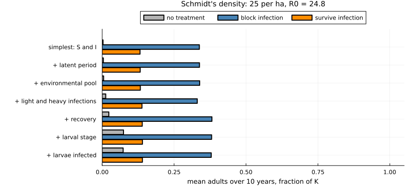
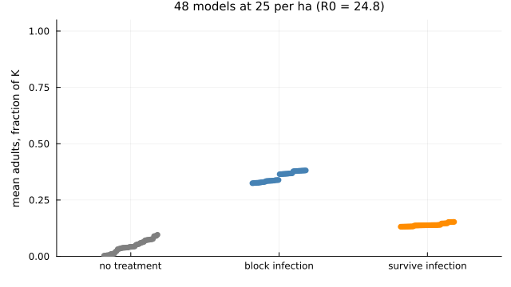
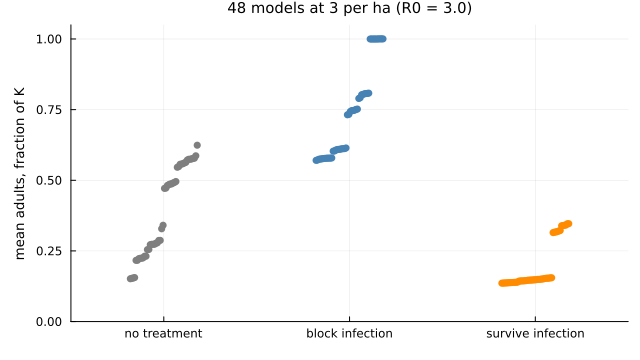
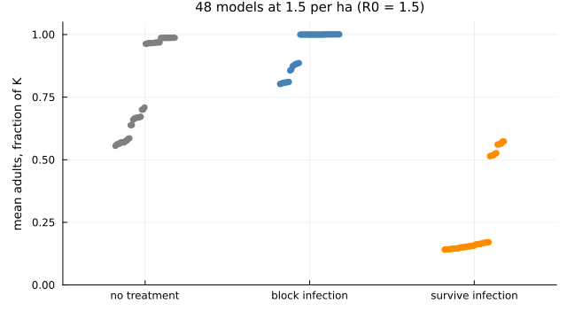
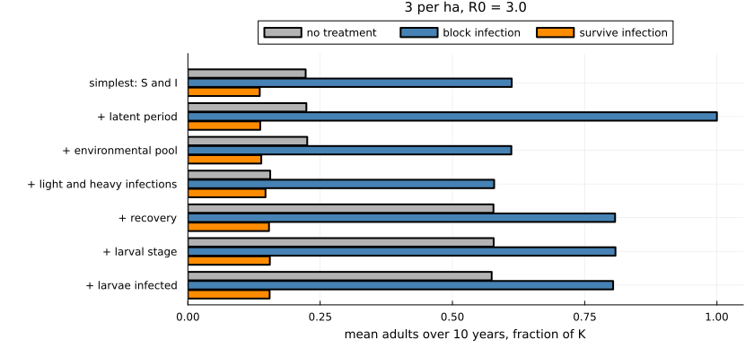
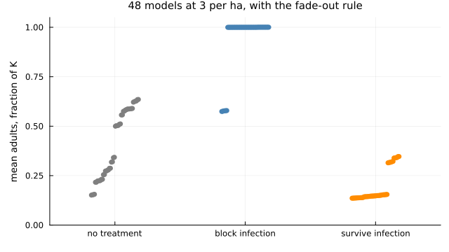
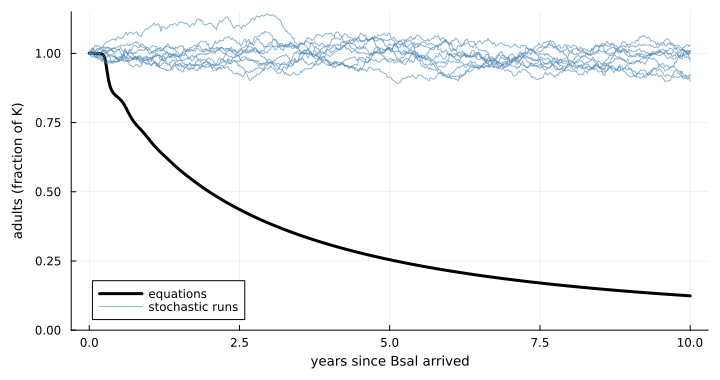
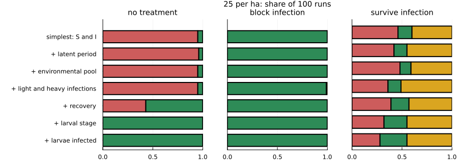
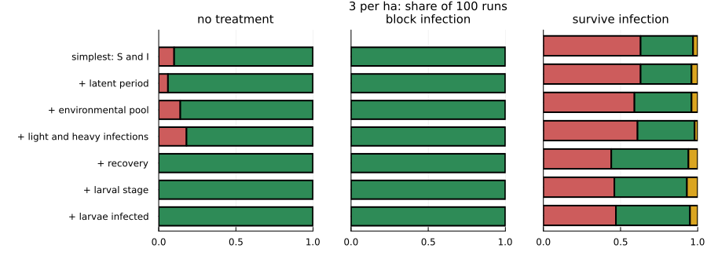
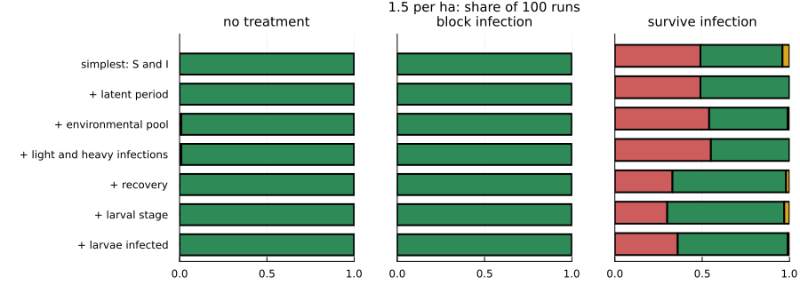

# One model, many switches


- [Why a second vignette](#why-a-second-vignette)
- [The model](#the-model)
  - [State](#state)
  - [The simplest model](#the-simplest-model)
  - [The full model](#the-full-model)
  - [Treatment](#treatment)
  - [Arrival and fade-out](#arrival-and-fade-out)
  - [Symbols](#symbols)
- [The outcomes](#the-outcomes)
- [A ladder in one model](#a-ladder-in-one-model)
- [Every combination](#every-combination)
- [The same comparison nearer the
  threshold](#the-same-comparison-nearer-the-threshold)
- [A fade-out rule](#a-fade-out-rule)
- [Does the order of adding matter?](#does-the-order-of-adding-matter)
- [A stochastic version](#a-stochastic-version)
  - [One run against the equations](#one-run-against-the-equations)
  - [Fates along the ladder](#fates-along-the-ladder)
  - [What chance changes](#what-chance-changes)
  - [Does the size of the population
    matter?](#does-the-size-of-the-population-matter)
- [What this shows](#what-this-shows)
- [Limits](#limits)
- [References](#references)

## Why a second vignette

The [first vignette](01_building_realism.md)
built up realism along a ladder in three host–pathogen systems. Those
systems start from three different published models, so their steps
cannot be compared directly, and a ladder adds things in one order only.

This vignette uses a single **nested model** in which each piece of
biology is a switch. With every switch off it is the simplest possible
model: susceptible and infectious adults. Any combination of switches
can be turned on, so that:

- every model is compared with every other like for like;
- the effect of one piece of realism can be measured against every
  setting of the others;
- the same comparison can be repeated in different conditions.

| Switch | What it adds |
|----|----|
| `latent` | infected animals are not infectious at once |
| `environment` | half of transmission goes through a pool of zoospores that outlasts the animals that shed them (total transmission unchanged) |
| `load` | infections start light (little shedding, no disease death) and progress to heavy |
| `recovery` | infected animals can clear the infection (with `load` on, only light infections) |
| `larvae` | an aquatic larval stage between birth and adulthood |
| `larval_infection` | larvae are infected by adults (and from the pool when `environment` is on), without disease, and half carry the infection through metamorphosis |

> [!IMPORTANT]
>
> The model is anchored on the Bsal model of Schmidt et al. (2017) for
> fire salamanders: with only `latent` on it is their published model,
> with their parameter values. The carry-over through metamorphosis is
> from Wang et al. (2021), read from the package’s compendium.
> **Everything else is new work in this package and is not a published
> result**, and the values attached to the other switches (pool
> half-life 30 days, light infections shedding 10% as much and lasting
> about two weeks (one week when they can also recover), recovery at the
> same rate as progression, a four-month larval stage) are illustrative.

## The model

### State

Each animal is an adult or a larva, untreated (u) or treated (t), and in
one infection class. Adults are susceptible (``S``), latent (``L``), lightly
infected (``Y``) or heavily infected (``I``). Larvae are uninfected (``S^w``)
or infected (``I^w``). With the zoospore pool ``Z`` this gives 17 variables.
Densities are per hectare and time is in years. A class whose switch is
off stays empty.

### The simplest model

With every switch off and no treatment, there are only susceptible and
infectious adults:

```math
\begin{aligned}
\frac{dS}{dt} &= bS - \beta I S - (d + \gamma N) S, \\
\frac{dI}{dt} &= \beta I S - d_I I - (d + \gamma N) I,
\end{aligned}
```

with ``N = S + I`` and ``\gamma = (b - d)/K``, so that the population
without Bsal settles at ``K``. Only susceptible adults reproduce. Turning
on `latent` puts the class ``L`` between ``S`` and ``I``, left at rate ``e``;
this is equation 2.1 of Schmidt et al. (2017).

### The full model


Adults shed zoospores, light infections a fraction ``\rho`` as much as
heavy ones. Adults are infected at rate ``\beta Q`` per susceptible
animal, larvae at ``\beta_w Q``, where

```math
\begin{aligned}
H &= \sum_{\tau} h_\tau \left( \rho Y_\tau + I_\tau \right), \\
Q &= (1 - \phi) H + \phi \mu_Z Z, \\
\frac{dZ}{dt} &= H - \mu_Z Z.
\end{aligned}
```

At equilibrium ``\mu_Z Z = H``, so the pool changes the timing of
transmission but not its total. Larvae do not shed.

For adults with treatment label ``\tau \in \{\mathrm{u}, \mathrm{t}\}``:

```math
\begin{aligned}
\frac{dS_\tau}{dt} &= B^A_\tau + M^S_\tau - f_\tau \beta Q S_\tau + \sigma Y_\tau - D S_\tau + \Omega(S_\tau), \\
\frac{dL_\tau}{dt} &= f_\tau \beta Q S_\tau + M^I_\tau - e L_\tau - D L_\tau + \Omega(L_\tau), \\
\frac{dY_\tau}{dt} &= e L_\tau - (\nu + \sigma) Y_\tau - D Y_\tau + \Omega(Y_\tau), \\
\frac{dI_\tau}{dt} &= \nu Y_\tau - k_\tau d_I I_\tau - D I_\tau + \Omega(I_\tau),
\end{aligned}
```

where ``D = d + \gamma N_A`` and ``N_A`` is the density of all adults.
Density dependence acts on adults only. For larvae:

```math
\begin{aligned}
\frac{dS^w_\tau}{dt} &= B^w_\tau - f_\tau \beta_w Q S^w_\tau - (m + \mu_w) S^w_\tau + \Omega(S^w_\tau), \\
\frac{dI^w_\tau}{dt} &= f_\tau \beta_w Q S^w_\tau - (m + \mu_w) I^w_\tau + \Omega(I^w_\tau).
\end{aligned}
```

Births are

```math
B = b' \sum_{\tau} \left[ S_\tau + Y_\tau + (1 - k_\tau)(L_\tau + I_\tau) \right],
```

and all are untreated: ``B^w_{\mathrm{u}} = B`` with larvae,
``B^A_{\mathrm{u}} = B`` without, and the other birth terms are zero.
Without larvae ``b' = b``; with them ``b' = b (m + \mu_w)/m``, so that each
adult still recruits ``b`` adults a year when there is no Bsal. Untreated
latent and heavily infected adults do not reproduce, as in Schmidt et
al. (2017). Light infections do. Treated latent and heavily infected
adults reproduce in proportion to the treatment’s tolerance.

At metamorphosis (rate ``m``) an infected larva stays infected with
probability ``p`` and enters the latent class; otherwise it becomes a
susceptible adult. Untreated larvae become untreated adults. A fraction
``r`` (`retention`) of treated larvae keep the treatment and the rest lose
it:

```math
\begin{aligned}
M^S_{\mathrm{u}} &= m \left[ S^w_{\mathrm{u}} + (1 - p) I^w_{\mathrm{u}} \right] + (1 - r)\, m \left[ S^w_{\mathrm{t}} + (1 - p) I^w_{\mathrm{t}} \right], \\
M^S_{\mathrm{t}} &= r\, m \left[ S^w_{\mathrm{t}} + (1 - p) I^w_{\mathrm{t}} \right], \\
M^I_{\mathrm{u}} &= p\, m \left[ I^w_{\mathrm{u}} + (1 - r) I^w_{\mathrm{t}} \right], \\
M^I_{\mathrm{t}} &= r\, p\, m\, I^w_{\mathrm{t}}.
\end{aligned}
```

#### Switching pieces off

Each switch removes terms; nothing else changes.

- `latent` off: ``L`` is skipped. New infections, and infected larvae at
  metamorphosis, enter ``Y`` (or ``I`` if `load` is also off).
- `load` off: ``Y`` is skipped. Latent animals, or new infections, go
  straight to ``I``, and recovery is from ``I`` to ``S`` at rate ``\sigma``.
  Shedding is ``H = \sum_\tau h_\tau I_\tau``. With `load` on, only light
  infections recover.
- `recovery` off: ``\sigma = 0``.
- `environment` off: ``\phi = 0``, so ``Q = H`` and ``Z`` plays no part.
- `larvae` off: there are no larval classes and no ``M`` terms; births
  enter ``S_{\mathrm{u}}`` and ``b' = b``.
- `larval_infection` off: ``\beta_w = 0``, so larvae stay uninfected.

Latent animals and infected larvae never recover, and infected larvae do
not die of the disease.

### Treatment

Treatment scales three rates. Each effect is multiplied by the
protection ``g`` that remains:

```math
f_{\mathrm{u}} = h_{\mathrm{u}} = k_{\mathrm{u}} = 1, \qquad
f_{\mathrm{t}} = 1 - g\varepsilon, \qquad
h_{\mathrm{t}} = 1 - g\zeta, \qquad
k_{\mathrm{t}} = 1 - g\theta.
```

Efficacy ``\varepsilon`` cuts the infection rate, tolerance ``\theta`` cuts
disease deaths (the animal stays infectious) and ``\zeta`` cuts shedding.
The **block** treatment of this vignette is ``\varepsilon = 0.99``; the
**survive** treatment is ``\theta = 0.99``. Protection can wane with the
abundance of the applied bacteria,

```math
g(a) = \frac{1 + 1/\kappa}{1 + 2^{a / t_B} / \kappa},
```

where ``a`` is the time since the last application, ``t_B`` the bacteria’s
half-life and ``\kappa`` their starting abundance over the abundance that
gives half the effect. Without waning, as here, ``g = 1``.

Animals also gain and lose the bacteria. For any class ``X`` in stage ``s``,

```math
\Omega(X_{\mathrm{u}}) = -\delta F_s X_{\mathrm{u}} + \omega X_{\mathrm{t}}, \qquad
\Omega(X_{\mathrm{t}}) = \delta F_s X_{\mathrm{u}} - \omega X_{\mathrm{t}},
```

where ``F_s`` is the treated fraction of that stage, ``\delta`` the rate of
spread and ``\omega = \ln 2 / (\text{half-life})`` the rate of loss. Both
are zero in this vignette. At each treatment time a fraction ``c``
(`coverage`) of the untreated animals of the treated stage becomes
treated, and the clock ``a`` restarts.


### Arrival and fade-out

The population starts without Bsal: ``S_{\mathrm{u}} = K`` and, with
larvae, ``S^w_{\mathrm{u}} = bK/m``. Bsal arrives as ``I_0 = 0.01`` heavily
infected untreated adults per hectare (one per km², as in Schmidt et
al. 2017), after any treatment at the same time. The fade-out rule, when
used, is checked after every solver step with threshold ``n_{\min}``
(`fadeout_density`): if all animals together fall below ``n_{\min}`` they
are set to zero; otherwise, once Bsal has arrived, if
``0 < \sum (\text{infected animals}) + \mu_Z Z < n_{\min}``, every
infected class and the pool are set to zero. The infected animals are
removed, not returned to the susceptible class.

The growth rate reported below is the largest real part of the
eigenvalues of the Jacobian of the infected classes (``L``, ``Y``, ``I``,
``I^w`` and ``Z``, untreated) at this disease-free state.

### Symbols

| Symbol | Meaning | Value or source |
|----|----|----|
| ``b`` | recruitment, per adult | 0.39 per yr, compendium (schmidt2017) |
| ``d`` | natural death | 0.125 per yr, compendium (schmidt2017) |
| ``d_I`` | Bsal death of heavy infections | 52 per yr, compendium (schmidt2017) |
| ``e`` | latent to infectious | 364 per yr, compendium (schmidt2017) |
| ``\beta`` | transmission to adults | 52 ha per yr, compendium (schmidt2017) |
| ``K`` | carrying capacity | 25 per ha, compendium (schmidt2017); also 3 and 1.5 below |
| ``\gamma`` | density dependence | ``(b - d)/K`` |
| ``\phi`` | share of transmission through the pool | 0.5, illustrative |
| ``\mu_Z`` | pool decay | ``\ln 2`` / 30 days, illustrative |
| ``\rho`` | shedding of a light infection relative to a heavy one | 0.1, illustrative |
| ``\nu`` | light to heavy | 26 per yr, illustrative |
| ``\sigma`` | recovery | 26 per yr, illustrative |
| ``m`` | metamorphosis, 1/(larval period) | 1/(0.33 yr), illustrative |
| ``\mu_w`` | larval death | 1 per yr, illustrative |
| ``\beta_w`` | transmission from adults to larvae | 5.2 ha per yr, illustrative |
| ``p`` | infected larvae still infected after metamorphosis | 0.5 (5 of 10), compendium (wang2021) |
| ``\varepsilon``, ``\theta``, ``\zeta`` | treatment efficacy, tolerance, shedding reduction | 0.99 (block), 0.99 (survive), 0; illustrative |
| ``g``, ``\kappa``, ``t_B`` | remaining protection and its waning | ``g = 1`` (no waning) |
| ``\delta``, ``\omega`` | spread and loss of the bacteria | 0 |
| ``c``, ``r`` | coverage, retention at metamorphosis | ``c = 1`` when treated, ``r = 0`` |
| ``I_0`` | arriving infected adults | 0.01 per ha |
| ``n_{\min}`` | fade-out threshold | ``10^{-4}`` per ha, illustrative |

``` julia
using Chytridiomycosis, Plots, Printf
default(linewidth = 2, size = (720, 380), legendfontsize = 8, guidefontsize = 9,
    titlefontsize = 10, left_margin = 4Plots.mm, bottom_margin = 4Plots.mm)

T(; kw...) = MicrobiomeTreatment(; kw...)
bio(; kw...) = ChytridBiology(:wang2021; kw...)
schmidt = SchmidtParameters(:schmidt2017)
```

    SchmidtParameters{Float64}(0.39, 0.125, 52.0, 364.0, 52.0, 25.0, 0.0625, 1.0)

## The outcomes

Bsal arrives in a population at carrying capacity. Four things are
recorded for each model:

- the pathogen’s initial **growth rate**;
- **untreated**: mean adults over the next ten years, as a fraction of
  carrying capacity;
- **block**: the same, with every adult treated once with bacteria that
  block 99% of infections for life;
- **survive**: the same, with bacteria that prevent 99% of disease
  deaths and do not block infection. This is the kind of protection seen
  in trials.

``` julia
function outcomes(p, b)
    run(tr; kw...) = solve(NestedChytridProblem(p, b, tr; kw...))
    u = run(T())
    bl, sv = run(T(efficacy = 0.99); coverage = 1.0), run(T(tolerance = 0.99); coverage = 1.0)
    fate(r) = !isnan(r.host_extinction) ? :host_lost : !isnan(r.pathogen_fadeout) ? :pathogen_gone : :both_persist
    return (growth = invasion_growth_rate(p, b), untreated = u.mean_adults, lowest = u.min_adults,
        block = bl.mean_adults, survive = sv.mean_adults, fates = (fate(u), fate(bl), fate(sv)))
end
```

    outcomes (generic function with 1 method)

A check first: with only the latent class switched on, the growth rate
equals the one that follows from the equations of Schmidt et al. (2017).

``` julia
p = schmidt
λ = (sqrt((p.e - p.d_I)^2 + 4 * p.e * p.β * p.K) - 2p.b - p.d_I - p.e) / 2
(nested = invasion_growth_rate(p, bio(latent = true)), schmidt = λ)
```

    (nested = 496.972318234428, schmidt = 496.97231824502785)

## A ladder in one model

The switches are turned on one after another, starting from the simplest
model.

``` julia
order = [:latent, :environment, :load, :recovery, :larvae, :larval_infection]
names_ = ["simplest: S and I", "+ latent period", "+ environmental pool", "+ light and heavy infections",
    "+ recovery", "+ larval stage", "+ larvae infected"]
ladder_models(p) = [outcomes(p, bio(; (k => true for k in order[1:i])...)) for i in 0:length(order)]

function ladder_figure(rows, title)
    k = length(rows)
    bar((1:k) .- 0.27, [r.untreated for r in rows]; orientation = :h, bar_width = 0.25, label = "no treatment",
        color = :gray70, yticks = (1:k, names_), yflip = true, xlims = (0, 1.05), xticks = 0:0.25:1,
        xlabel = "mean adults over 10 years, fraction of K", size = (840, 80 + 44k),
        left_margin = 6Plots.mm, legend = :outertop, legend_column = 3, title)
    bar!(1:k, [r.block for r in rows]; orientation = :h, bar_width = 0.25, label = "block infection", color = :steelblue)
    bar!((1:k) .+ 0.27, [r.survive for r in rows]; orientation = :h, bar_width = 0.25, label = "survive infection",
        color = :darkorange)
end

function ladder_table(rows)
    println("| Model | Growth rate (per yr) | Untreated | Lowest untreated | Block | Survive |")
    println("|---|---|---|---|---|---|")
    for (n, r) in zip(names_, rows)
        @printf("| %s | %.0f | %.3f | %.0e | %.3f | %.3f |\n", n, r.growth, r.untreated, r.lowest, r.block, r.survive)
    end
end

high = ladder_models(schmidt)
ladder_figure(high, "Schmidt's density: 25 per ha, R0 = 24.8")
```



``` julia
ladder_table(high)
```

| Model | Growth rate (per yr) | Untreated | Lowest untreated | Block | Survive |
|----|----|----|----|----|----|
| simplest: S and I | 1248 | 0.003 | 2e-11 | 0.338 | 0.132 |
| \+ latent period | 497 | 0.004 | 2e-11 | 0.338 | 0.132 |
| \+ environmental pool | 309 | 0.005 | 2e-11 | 0.339 | 0.133 |
| \+ light and heavy infections | 111 | 0.012 | 6e-06 | 0.331 | 0.138 |
| \+ recovery | 98 | 0.023 | 2e-03 | 0.382 | 0.139 |
| \+ larval stage | 98 | 0.074 | 2e-02 | 0.380 | 0.140 |
| \+ larvae infected | 98 | 0.073 | 2e-02 | 0.379 | 0.140 |

At the density Schmidt et al. used, where Bsal’s reproduction number is
about 25, **the added biology changes the conclusions very little**. The
epidemic slows more than ten-fold as switches are turned on, but the
population collapses in every model, and each treatment gives almost the
same result throughout. One thing does change: the lowest density the
untreated population reaches rises by many orders of magnitude, which
matters for whether it could go extinct.

## Every combination

A ladder is one path. The four switches for the adult stage are now set
in every combination, with three settings for the larvae (none, present
but not infected, infected): 48 models.

``` julia
configs = vec([(; latent, environment, load, recovery, larvae = lv > 0, larval_infection = lv > 1)
    for latent in (false, true), environment in (false, true), load in (false, true),
        recovery in (false, true), lv in 0:2])
all_models(p; fade = 0.0) = [(c, outcomes(p, bio(; fadeout_density = fade, c...))) for c in configs]

same(c, c2, skip) = all(getfield(c, k) == getfield(c2, k) for k in keys(c) if !(k in skip))
pieces = [
    ("latent period", c -> c.latent, (c, c2) -> !c2.latent && same(c, c2, (:latent,))),
    ("environmental pool", c -> c.environment, (c, c2) -> !c2.environment && same(c, c2, (:environment,))),
    ("light and heavy infections", c -> c.load, (c, c2) -> !c2.load && same(c, c2, (:load,))),
    ("recovery", c -> c.recovery, (c, c2) -> !c2.recovery && same(c, c2, (:recovery,))),
    ("larval stage", c -> c.larvae && !c.larval_infection,
        (c, c2) -> !c2.larvae && same(c, c2, (:larvae, :larval_infection))),
    ("larvae infected", c -> c.larval_infection,
        (c, c2) -> c2.larvae && !c2.larval_infection && same(c, c2, (:larvae, :larval_infection))),
]
# change in an outcome when a piece is switched on, for every setting of the other pieces
effects(res, on, off, f) = [f(o) - f(o2) for (c, o) in res if on(c) for (c2, o2) in res if off(c, c2)]

function effects_table(res)
    println("| Piece switched on | Untreated: mean (range) | Block: mean (range) | Survive: mean (range) |")
    println("|---|---|---|---|")
    for (label, on, off) in pieces
        cells = map((o -> o.untreated, o -> o.block, o -> o.survive)) do f
            d = effects(res, on, off, f)
            @sprintf("%+.2f (%+.2f to %+.2f)", sum(d) / length(d), minimum(d), maximum(d))
        end
        println("| ", label, " | ", join(cells, " | "), " |")
    end
end

function spread_figure(res, title)
    f = (o -> o.untreated, o -> o.block, o -> o.survive)
    labels = ["no treatment", "block infection", "survive infection"]
    plot(; xticks = (1:3, labels), xlims = (0.5, 3.5), ylims = (0, 1.05), ylabel = "mean adults, fraction of K", legend = false,
        title, size = (640, 360))
    for (i, g) in enumerate(f)
        v = [g(o) for (_, o) in res]
        scatter!(i .+ range(-0.18, 0.18; length = length(v)), sort(v); markersize = 4,
            color = (:gray50, :steelblue, :darkorange)[i], markerstrokewidth = 0)
    end
    current()
end

res_high = all_models(schmidt)
spread_figure(res_high, "48 models at 25 per ha (R0 = 24.8)")
```



``` julia
effects_table(res_high)
```

| Piece switched on | Untreated: mean (range) | Block: mean (range) | Survive: mean (range) |
|----|----|----|----|
| latent period | +0.00 (+0.00 to +0.00) | +0.00 (+0.00 to +0.00) | +0.00 (+0.00 to +0.01) |
| environmental pool | -0.02 (-0.08 to +0.00) | +0.00 (+0.00 to +0.00) | +0.00 (-0.00 to +0.00) |
| light and heavy infections | +0.01 (-0.00 to +0.02) | +0.00 (-0.01 to +0.01) | -0.00 (-0.01 to +0.01) |
| recovery | +0.03 (+0.00 to +0.09) | +0.04 (+0.03 to +0.05) | +0.01 (+0.00 to +0.02) |
| larval stage | +0.02 (-0.03 to +0.05) | -0.00 (-0.00 to -0.00) | +0.00 (+0.00 to +0.00) |
| larvae infected | -0.00 (-0.01 to -0.00) | -0.00 (-0.00 to -0.00) | -0.00 (-0.00 to -0.00) |

Each dot is one of the 48 models. At this density they sit almost on top
of each other: no piece of host biology moves any outcome by more than
about 0.1. When the pathogen spreads this fast and kills this quickly,
the simple model gives the same answer as the complex one.

## The same comparison nearer the threshold

Schmidt et al. show that Bsal cannot invade below about one adult female
per hectare. The comparison is repeated at 3 per hectare (reproduction
number 3) and 1.5 per hectare (1.5).

``` julia
mid, low = Chytridiomycosis.with(schmidt; K = 3.0), Chytridiomycosis.with(schmidt; K = 1.5)
res_mid, res_low = all_models(mid), all_models(low)
spread_figure(res_mid, "48 models at 3 per ha (R0 = 3.0)")
```



``` julia
effects_table(res_mid)
```

| Piece switched on | Untreated: mean (range) | Block: mean (range) | Survive: mean (range) |
|----|----|----|----|
| latent period | +0.01 (-0.00 to +0.09) | +0.03 (-0.00 to +0.39) | +0.00 (+0.00 to +0.00) |
| environmental pool | -0.02 (-0.09 to +0.03) | -0.10 (-0.39 to +0.01) | -0.00 (-0.03 to +0.00) |
| light and heavy infections | +0.01 (-0.07 to +0.09) | -0.03 (-0.42 to +0.06) | -0.09 (-0.20 to +0.01) |
| recovery | +0.30 (+0.17 to +0.47) | +0.22 (+0.00 to +0.42) | +0.10 (+0.01 to +0.21) |
| larval stage | +0.04 (-0.06 to +0.13) | +0.00 (-0.00 to +0.00) | -0.00 (-0.01 to +0.00) |
| larvae infected | -0.03 (-0.11 to -0.00) | -0.09 (-0.40 to -0.00) | -0.00 (-0.00 to -0.00) |

``` julia
spread_figure(res_low, "48 models at 1.5 per ha (R0 = 1.5)")
```



``` julia
effects_table(res_low)
```

| Piece switched on | Untreated: mean (range) | Block: mean (range) | Survive: mean (range) |
|----|----|----|----|
| latent period | +0.00 (+0.00 to +0.05) | +0.00 (-0.00 to +0.00) | +0.00 (-0.00 to +0.00) |
| environmental pool | -0.00 (-0.04 to +0.03) | -0.05 (-0.19 to +0.02) | -0.01 (-0.05 to +0.01) |
| light and heavy infections | -0.04 (-0.12 to +0.02) | -0.02 (-0.08 to -0.00) | -0.18 (-0.41 to +0.01) |
| recovery | +0.36 (+0.26 to +0.43) | +0.11 (+0.00 to +0.20) | +0.21 (+0.01 to +0.43) |
| larval stage | -0.00 (-0.04 to +0.01) | +0.00 (-0.00 to +0.00) | -0.00 (-0.01 to +0.00) |
| larvae infected | -0.01 (-0.07 to -0.00) | -0.04 (-0.19 to -0.00) | -0.00 (-0.00 to -0.00) |

Now the models disagree. At 3 per hectare the untreated outcome ranges
from 0.15 to 0.62 depending on which biology is included, and the
infection-blocking treatment from 0.57 to full protection. **Realism
matters most near the threshold.**

The ladder at 3 per hectare:

``` julia
ladder_figure(ladder_models(mid), "3 per ha, R0 = 3.0")
```



Three things stand out.

1.  **Recovery is the piece that matters most**, for the untreated
    population and for the blocking treatment. This project has no
    estimate of it for Bsal.
2.  **Pieces do not have a fixed effect.** The ranges in the tables are
    wide: an environmental pool, or infected larvae, changes the
    blocking treatment by anything from nothing to −0.4 depending on
    what else is in the model.
3.  **Bacteria that let animals survive infection do worse than no
    treatment** at these densities, in every one of the 48 models
    (orange below grey; counts in the table below). Untreated, an
    epidemic at low density burns out and the population recovers.
    Treated animals that survive stay infectious in this model, and keep
    infecting the untreated animals born after them.

``` julia
println("| Density | Models in which the survive treatment does worse than none | Blocking does worse than none |")
println("|---|---|---|")
for (label, res) in (("25 per ha", res_high), ("3 per ha", res_mid), ("1.5 per ha", res_low))
    @printf("| %s | %d of 48 | %d of 48 |\n", label, count(x -> x[2].survive < x[2].untreated, res),
        count(x -> x[2].block < x[2].untreated - 1e-6, res))
end
```

| Density | Models in which the survive treatment does worse than none | Blocking does worse than none |
|----|----|----|
| 25 per ha | 0 of 48 | 0 of 48 |
| 3 per ha | 48 of 48 | 0 of 48 |
| 1.5 per ha | 48 of 48 | 0 of 48 |

## A fade-out rule

The equations are deterministic, so a density can fall to a value that
means far less than one animal and then grow back. Near the threshold
that can decide the result. The model is therefore given a fade-out
rule, itself a piece of realism: once infected animals (adults and
larvae, with the zoospore pool counted in infectious-animal equivalents)
fall below one per 100 km² (0.0001 per hectare) the pathogen is removed,
and if all animals fall below that density the host population is
removed. The threshold is illustrative.

``` julia
fade = 1e-4
fres_high, fres_mid, fres_low = all_models(schmidt; fade), all_models(mid; fade), all_models(low; fade)
nothing
```

With the rule, each run has a fate within the ten years: the host is
lost, the pathogen is lost and the host remains, or both persist.

``` julia
println("| Density | Treatment | Host lost | Pathogen lost, host remains | Both persist | Mean adults: range |")
println("|---|---|---|---|---|---|")
for (label, res) in (("25 per ha", fres_high), ("3 per ha", fres_mid), ("1.5 per ha", fres_low))
    for (i, (name, f)) in enumerate((("none", o -> o.untreated), ("block", o -> o.block), ("survive", o -> o.survive)))
        fates = [o.fates[i] for (_, o) in res]
        v = [f(o) for (_, o) in res]
        @printf("| %s | %s | %d | %d | %d | %.2f to %.2f |\n", label, name, count(==(:host_lost), fates),
            count(==(:pathogen_gone), fates), count(==(:both_persist), fates), minimum(v), maximum(v))
    end
end
```

| Density | Treatment | Host lost | Pathogen lost, host remains | Both persist | Mean adults: range |
|----|----|----|----|----|----|
| 25 per ha | none | 4 | 34 | 10 | 0.00 to 0.10 |
| 25 per ha | block | 0 | 0 | 48 | 0.32 to 0.38 |
| 25 per ha | survive | 0 | 0 | 48 | 0.13 to 0.15 |
| 3 per ha | none | 0 | 48 | 0 | 0.15 to 0.64 |
| 3 per ha | block | 0 | 42 | 6 | 0.57 to 1.00 |
| 3 per ha | survive | 0 | 12 | 36 | 0.14 to 0.35 |
| 1.5 per ha | none | 0 | 48 | 0 | 0.56 to 0.99 |
| 1.5 per ha | block | 0 | 48 | 0 | 1.00 to 1.00 |
| 1.5 per ha | survive | 0 | 12 | 36 | 0.14 to 0.57 |

``` julia
spread_figure(fres_mid, "48 models at 3 per ha, with the fade-out rule")
```



``` julia
effects_table(fres_mid)
```

| Piece switched on | Untreated: mean (range) | Block: mean (range) | Survive: mean (range) |
|----|----|----|----|
| latent period | +0.00 (-0.00 to +0.00) | +0.00 (-0.00 to +0.00) | +0.00 (+0.00 to +0.00) |
| environmental pool | -0.04 (-0.08 to +0.00) | -0.11 (-0.43 to -0.00) | -0.00 (-0.03 to +0.00) |
| light and heavy infections | +0.00 (-0.07 to +0.09) | -0.11 (-0.43 to -0.00) | -0.09 (-0.20 to +0.01) |
| recovery | +0.33 (+0.22 to +0.47) | +0.11 (+0.00 to +0.43) | +0.10 (+0.01 to +0.21) |
| larval stage | +0.05 (-0.00 to +0.13) | -0.00 (-0.00 to +0.00) | -0.00 (-0.01 to +0.00) |
| larvae infected | -0.01 (-0.02 to -0.01) | -0.00 (-0.00 to -0.00) | -0.00 (-0.00 to -0.00) |

What the rule changes, and what it does not:

1.  **One apparent effect was an artefact.** Without the rule, adding a
    latent period at 3 per hectare seemed to turn the blocking treatment
    from partial to full protection (+0.39). With the rule the latent
    period has no effect at all. In both models the pathogen is in fact
    lost; the model without the latent period was regrowing it from a
    meaningless density.
2.  **The blocking treatment now eliminates the pathogen in most models
    near the threshold**: in 42 of 48 at 3 per hectare and in all 48 at
    1.5. The exceptions at 3 per hectare are models with an
    environmental pool and light infections but no recovery.
3.  **Recovery remains the piece that matters most** for the untreated
    population.
4.  **Treatment changes the fate as well as the numbers.** At 25 per
    hectare an untreated epidemic burns itself out in most models, and
    in a few the host is lost. With either treatment, host and pathogen
    both persist in every model: the treated animals keep the population
    going, and with it the pathogen.
5.  **The survive-type treatment still does worse than none** at the
    lower densities. In most models it is the reason the pathogen
    persists.

## Does the order of adding matter?

The effect of each piece when it is the first thing added to the
simplest model, and when it is the last thing added to the otherwise
complete model, at 3 per hectare with the fade-out rule:

``` julia
full = (latent = true, environment = true, load = true, recovery = true, larvae = true, larval_infection = true)
empty_ = (latent = false, environment = false, load = false, recovery = false, larvae = false, larval_infection = false)
get_(res, c) = only(o for (c2, o) in res if c2 == c)
println("| Piece | Untreated: added first | added last | Block: added first | added last |")
println("|---|---|---|---|---|")
for (label, on, off) in (("latent period", (latent = true,), (latent = false,)),
        ("environmental pool", (environment = true,), (environment = false,)),
        ("light and heavy infections", (load = true,), (load = false,)),
        ("recovery", (recovery = true,), (recovery = false,)),
        ("larval stage, infected", (larvae = true, larval_infection = true), (larvae = false, larval_infection = false)))
    first_ = (get_(fres_mid, merge(empty_, on)), get_(fres_mid, empty_))
    last_ = (get_(fres_mid, full), get_(fres_mid, merge(full, off)))
    @printf("| %s | %+.2f | %+.2f | %+.2f | %+.2f |\n", label, first_[1].untreated - first_[2].untreated,
        last_[1].untreated - last_[2].untreated, first_[1].block - first_[2].block, last_[1].block - last_[2].block)
end
```

| Piece | Untreated: added first | added last | Block: added first | added last |
|----|----|----|----|----|
| latent period | +0.00 | +0.00 | -0.00 | -0.00 |
| environmental pool | +0.00 | -0.04 | -0.00 | -0.00 |
| light and heavy infections | -0.07 | +0.08 | -0.00 | -0.00 |
| recovery | +0.33 | +0.37 | +0.00 | +0.42 |
| larval stage, infected | +0.10 | -0.01 | -0.00 | -0.00 |

Where the two columns differ, the piece interacts with the others, and a
ladder would give a different impression depending on where the piece
was placed.

## A stochastic version

A fade-out rule is a crude stand-in for chance. The model also exists in
a stochastic form, `StochasticNestedProblem`, in which animals are whole
numbers in a given area and every transition happens at random. It draws
its events from the same list of transitions as the equations, so with a
large enough area it reproduces them, and with one infected animal its
chance of a major outbreak matches the theoretical ``1 - 1/R_0`` (both are
checked in the package tests). Bsal now arrives as **one infected
adult** in **20 hectares**: 500 adults at Schmidt’s density, 60 at 3 per
hectare and 30 at 1.5. Each model is run 100 times.

The stochastic version counts animals, ``n_i = A x_i`` in an area ``A``.
Time moves in steps of ``\Delta t`` = 6 hours. At the start of each step
every flow of the equations above is turned into a rate per animal,
``\lambda_{ij}`` from class ``i`` to destination ``j`` (a death is one
destination). Then

```math
\begin{aligned}
O_i &\sim \text{Binomial}\left(n_i,\ 1 - e^{-\Lambda_i \Delta t}\right), \qquad \Lambda_i = \sum_j \lambda_{ij}, \\
(O_{i \to j})_j &\sim \text{Multinomial}\left(O_i,\ (\lambda_{ij} / \Lambda_i)_j\right), \\
\text{births} &\sim \text{Poisson}\left(A B \Delta t\right).
\end{aligned}
```

The pool stays continuous and is updated exactly with shedding held at
its value at the start of the step:
``Z \leftarrow Z e^{-\mu_Z \Delta t} + (H/\mu_Z)(1 - e^{-\mu_Z \Delta t})``.
At a treatment each untreated animal is treated with probability ``c``.
The fade-out rule is not used. Bsal is lost when no animal is infected
and the pool is expected to cause fewer than 0.05 more infections
(``\beta \phi Z S < 0.05``, with ``S`` the number of susceptible animals);
the pool is then emptied.

``` julia
using Random: Xoshiro
reps, area = 100, 20.0
function stochastic_fates(p, b, tr, cov; area = area)
    runs = [solve(StochasticNestedProblem(p, b, tr; area, coverage = cov); rng = Xoshiro(s)) for s in 1:reps]
    host = count(r -> !isnan(r.host_extinction), runs) / reps
    gone = count(r -> isnan(r.host_extinction) && !isnan(r.pathogen_extinction), runs) / reps
    return (host = host, gone = gone, both = 1 - host - gone,
        minor = count(r -> r.peak_infected < 10, runs) / reps,
        mean = sum(r.mean_adults for r in runs) / reps)
end
ladder_bios = [bio(; (k => true for k in order[1:i])...) for i in 0:length(order)]
treatments = (("no treatment", T(), 0.0), ("block infection", T(efficacy = 0.99), 1.0),
    ("survive infection", T(tolerance = 0.99), 1.0))
densities = (("25 per ha", schmidt), ("3 per ha", mid), ("1.5 per ha", low))
sto = Dict((d, t, i) => stochastic_fates(p, b, tr, cov)
    for (d, p) in densities for (t, tr, cov) in treatments for (i, b) in enumerate(ladder_bios))
nothing
```

### One run against the equations

At Schmidt’s density, with every adult treated on arrival with bacteria
that block 99% of infections, the equations give about a third of the
population after ten years (step 1 of the ladder above). Ten stochastic
runs of the same model:

``` julia
b1 = bio(latent = true)
det = solve(NestedChytridProblem(schmidt, b1, T(efficacy = 0.99); coverage = 1.0))
plt = plot(det.t, det.adults ./ schmidt.K; color = :black, linewidth = 3, label = "equations",
    xlabel = "years since Bsal arrived", ylabel = "adults (fraction of K)", ylims = (0, 1.15),
    legend = :bottomleft)
for s in 1:10
    r = solve(StochasticNestedProblem(schmidt, b1, T(efficacy = 0.99); area, coverage = 1.0); rng = Xoshiro(s))
    plot!(plt, r.t, r.adults ./ r.adults[1]; color = :steelblue, alpha = 0.6, linewidth = 1,
        label = s == 1 ? "stochastic runs" : "")
end
plt
```



The runs and the equations disagree completely. With 99% of adults
protected, the one infected animal infects about a quarter of an animal
on average, so Bsal almost always dies out within weeks. In the
equations it never quite dies out: a trace of infection, far below one
animal, waits until enough untreated young have been born and then sets
off a second epidemic. The fade-out rule did not catch this, because its
threshold (one animal per 100 km²) is far below one animal in 20
hectares. **A population-level effect of the treatment that appeared in
every deterministic model was produced by fractions of an animal.**

### Fates along the ladder

``` julia
function fate_figure(d)
    plots = map(treatments) do (t, _, _)
        rows = [sto[(d, t, i)] for i in 1:length(ladder_bios)]
        k = length(rows)
        groupedbar_data = hcat([r.host for r in rows], [r.gone for r in rows], [r.both for r in rows])
        bar(1:k, groupedbar_data[:, 1]; orientation = :h, color = :indianred, label = "host lost",
            yticks = (1:k, t == "no treatment" ? names_ : fill("", k)), yflip = true, xlims = (0, 1),
            xticks = 0:0.5:1, title = t, legend = false, bar_width = 0.7)
        bar!(1:k, groupedbar_data[:, 1] .+ groupedbar_data[:, 2]; orientation = :h, color = :seagreen,
            label = "Bsal lost", fillrange = groupedbar_data[:, 1], bar_width = 0.7)
        bar!(1:k, ones(k); orientation = :h, color = :goldenrod, label = "both persist",
            fillrange = groupedbar_data[:, 1] .+ groupedbar_data[:, 2], bar_width = 0.7)
    end
    plot(plots...; layout = (1, 3), size = (900, 330), left_margin = 4Plots.mm,
        plot_title = "$d: share of 100 runs", plot_titlefontsize = 10)
end
fate_figure("25 per ha")
```



Red: the host population is lost within ten years. Green: Bsal is lost
and the host remains. Yellow: both persist.

``` julia
fate_figure("3 per ha")
```



``` julia
fate_figure("1.5 per ha")
```



Mean adults over ten years, as a fraction of the starting number, and
the share of introductions that never became an outbreak (fewer than ten
animals ever infected at once):

``` julia
println("| Density | Model | None: mean (minor) | Block: mean (minor) | Survive: mean (minor) |")
println("|---|---|---|---|---|")
for (d, _) in densities, (i, n) in enumerate(names_)
    cells = [@sprintf("%.2f (%.2f)", sto[(d, t, i)].mean, sto[(d, t, i)].minor) for (t, _, _) in treatments]
    println("| ", d, " | ", n, " | ", join(cells, " | "), " |")
end
```

| Density | Model | None: mean (minor) | Block: mean (minor) | Survive: mean (minor) |
|----|----|----|----|----|
| 25 per ha | simplest: S and I | 0.05 (0.05) | 1.00 (0.97) | 0.17 (0.04) |
| 25 per ha | \+ latent period | 0.04 (0.04) | 1.00 (0.97) | 0.17 (0.04) |
| 25 per ha | \+ environmental pool | 0.05 (0.05) | 0.81 (0.63) | 0.18 (0.05) |
| 25 per ha | \+ light and heavy infections | 0.06 (0.05) | 0.73 (0.52) | 0.18 (0.05) |
| 25 per ha | \+ recovery | 0.07 (0.05) | 0.89 (0.78) | 0.18 (0.05) |
| 25 per ha | \+ larval stage | 0.10 (0.02) | 0.90 (0.80) | 0.18 (0.05) |
| 25 per ha | \+ larvae infected | 0.11 (0.04) | 0.83 (0.71) | 0.19 (0.06) |
| 3 per ha | simplest: S and I | 0.50 (0.39) | 0.99 (1.00) | 0.37 (0.28) |
| 3 per ha | \+ latent period | 0.47 (0.36) | 0.99 (1.00) | 0.37 (0.28) |
| 3 per ha | \+ environmental pool | 0.48 (0.45) | 0.99 (1.00) | 0.40 (0.31) |
| 3 per ha | \+ light and heavy infections | 0.39 (0.29) | 0.98 (1.00) | 0.41 (0.31) |
| 3 per ha | \+ recovery | 0.76 (0.67) | 0.98 (1.00) | 0.51 (0.43) |
| 3 per ha | \+ larval stage | 0.84 (0.70) | 0.99 (1.00) | 0.39 (0.28) |
| 3 per ha | \+ larvae infected | 0.81 (0.60) | 0.99 (1.00) | 0.42 (0.32) |
| 1.5 per ha | simplest: S and I | 0.85 (0.91) | 0.99 (1.00) | 0.51 (0.43) |
| 1.5 per ha | \+ latent period | 0.83 (0.92) | 0.98 (1.00) | 0.51 (0.43) |
| 1.5 per ha | \+ environmental pool | 0.81 (0.98) | 0.98 (1.00) | 0.49 (0.40) |
| 1.5 per ha | \+ light and heavy infections | 0.76 (0.93) | 0.99 (1.00) | 0.51 (0.42) |
| 1.5 per ha | \+ recovery | 0.96 (1.00) | 0.99 (1.00) | 0.61 (0.54) |
| 1.5 per ha | \+ larval stage | 0.97 (1.00) | 0.98 (1.00) | 0.61 (0.55) |
| 1.5 per ha | \+ larvae infected | 0.98 (1.00) | 0.98 (1.00) | 0.58 (0.50) |

### What chance changes

1.  **The blocking treatment given on arrival nearly always works at
    Schmidt’s density** in the simpler models (about 0.99 of adults
    kept), against a third in the equations. Pieces of biology that make
    a chain of infection last longer (an environmental pool, light
    infections, infected larvae) bring it down to between 0.73 and 0.83,
    because they give untreated young time to be born before Bsal is
    gone.
2.  **Without treatment, the simple models lose the host.** At Schmidt’s
    density the host population disappears in almost every run of the
    four simplest models. With recovery it survives in about half, and
    with a larval stage in all. The larval refuge seen in the equations
    is real, not an artefact.
3.  **Near the threshold most introductions fizzle.** At 1.5 per hectare
    most single introductions never become an outbreak, and with
    recovery or larvae nearly all of them.
4.  **The survive-type treatment often loses the host in small
    populations.** In 20 hectares it loses the host in about 30 to 60%
    of runs at every density. Near the threshold, and in every model
    with a larval stage, that is more often than with no treatment at
    all.

### Does the size of the population matter?

The same comparison in 200 hectares (ten times as many animals) for
three models:

``` julia
println("| Density | Model | Treatment | Host lost: 20 ha | 200 ha | Mean adults: 20 ha | 200 ha |")
println("|---|---|---|---|---|---|---|")
for (d, p) in densities[1:2], i in (1, 5, 7), (t, tr, cov) in treatments
    small, big = sto[(d, t, i)], stochastic_fates(p, ladder_bios[i], tr, cov; area = 200.0)
    @printf("| %s | %s | %s | %.2f | %.2f | %.2f | %.2f |\n", d, names_[i], t, small.host, big.host,
        small.mean, big.mean)
end
```

| Density | Model | Treatment | Host lost: 20 ha | 200 ha | Mean adults: 20 ha | 200 ha |
|----|----|----|----|----|----|----|
| 25 per ha | simplest: S and I | no treatment | 0.95 | 0.95 | 0.05 | 0.05 |
| 25 per ha | simplest: S and I | block infection | 0.00 | 0.00 | 1.00 | 0.99 |
| 25 per ha | simplest: S and I | survive infection | 0.46 | 0.00 | 0.17 | 0.15 |
| 25 per ha | \+ recovery | no treatment | 0.43 | 0.00 | 0.07 | 0.06 |
| 25 per ha | \+ recovery | block infection | 0.00 | 0.00 | 0.89 | 0.86 |
| 25 per ha | \+ recovery | survive infection | 0.39 | 0.00 | 0.18 | 0.18 |
| 25 per ha | \+ larvae infected | no treatment | 0.00 | 0.00 | 0.11 | 0.11 |
| 25 per ha | \+ larvae infected | block infection | 0.00 | 0.00 | 0.83 | 0.88 |
| 25 per ha | \+ larvae infected | survive infection | 0.28 | 0.00 | 0.19 | 0.16 |
| 3 per ha | simplest: S and I | no treatment | 0.10 | 0.00 | 0.50 | 0.48 |
| 3 per ha | simplest: S and I | block infection | 0.00 | 0.00 | 0.99 | 1.01 |
| 3 per ha | simplest: S and I | survive infection | 0.63 | 0.06 | 0.37 | 0.38 |
| 3 per ha | \+ recovery | no treatment | 0.00 | 0.00 | 0.76 | 0.81 |
| 3 per ha | \+ recovery | block infection | 0.00 | 0.00 | 0.98 | 1.00 |
| 3 per ha | \+ recovery | survive infection | 0.44 | 0.01 | 0.51 | 0.42 |
| 3 per ha | \+ larvae infected | no treatment | 0.00 | 0.00 | 0.81 | 0.81 |
| 3 per ha | \+ larvae infected | block infection | 0.00 | 0.00 | 0.99 | 1.00 |
| 3 per ha | \+ larvae infected | survive infection | 0.47 | 0.01 | 0.42 | 0.51 |

The mean numbers of adults hold. Whether the host is lost does not: in
200 hectares the host is lost only in the simplest untreated model at
Schmidt’s density, where Bsal kills almost every animal. Under the
survive-type treatment, host and Bsal instead persist together. In 20
hectares, the treated animals that survive and keep Bsal going are too
few to outlast the untreated young it kills.

## What this shows

1.  **Whether realism matters depends on the regime.** For a pathogen
    far above its invasion threshold, six pieces of host biology barely
    change the outcome or the value of treatment. Near the threshold the
    same pieces change both a great deal.
2.  **So the first question is where the system sits.** Far above the
    threshold, the deterministic models agree with each other. In
    sparser populations the answer depends on biology that has not been
    measured, recovery above all.
3.  **Effects of single pieces are not transferable.** They vary with
    the rest of the model, so the result of adding one piece to a simple
    model should not be read as the effect of that piece.
4.  **Protection that keeps infected animals alive can be worse than
    none**, where the untreated epidemic would have burnt out.
5.  **A model can mislead through its mathematics as well as its
    biology.** One apparent effect disappeared under a fade-out rule.
    More importantly, the deterministic models all agreed that blocking
    infection in every adult on arrival leaves about a third of a dense
    population, and the stochastic version shows that result was made of
    fractions of an animal: with whole animals, Bsal nearly always dies
    out first.
6.  **Chance is a piece of realism like the others, and here it was the
    largest.** Agreement among the 48 deterministic models at Schmidt’s
    density did not mean the answer was robust: all of them shared the
    same mathematical assumption.

## Limits

- The nested model covers the salamander system only. The toad and frog
  systems of the first vignette have features it lacks: a seasonal
  cohort, and a continuous load on each animal.
- The fade-out rule is a threshold on a deterministic model, with an
  illustrative value. Its threshold was far too low for a population of
  a few hundred animals; the stochastic version replaces it.
- The stochastic model advances in steps of six hours, approximate for
  the one-day latent period. Bsal arrives as a single infected adult,
  and the area (20 hectares) sets the population size; results for
  treatments that let infected animals survive depend on it.
- Space is not modelled: the area is one well-mixed population.
- Fates are judged within ten years. A population left at a few percent
  of its former density is counted as remaining.
- Treated animals that survive infection never clear it unless
  `recovery` is on.
- The values attached to the switches are illustrative. Different values
  would change the sizes of the effects, though the contrast between
  regimes should hold.

## References

- Schmidt BR, Bozzuto C, Lötters S, Steinfartz S (2017) Dynamics of host
  populations affected by the emerging fungal pathogen *Batrachochytrium
  salamandrivorans*. *Royal Society Open Science* 4:160801.
  [doi:10.1098/rsos.160801](https://doi.org/10.1098/rsos.160801)
- Wang Y, Verbrugghe E, Meuris L, Chiers K, et al. (2021) Epidermal
  galactose spurs chytrid virulence and predicts amphibian colonization.
  *Nature Communications* 12:5788.
  [doi:10.1038/s41467-021-26127-9](https://doi.org/10.1038/s41467-021-26127-9)
