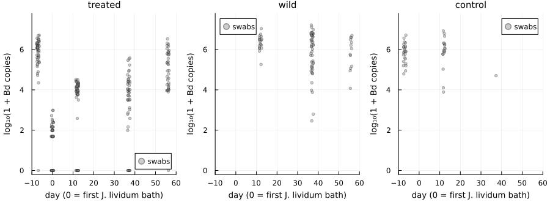
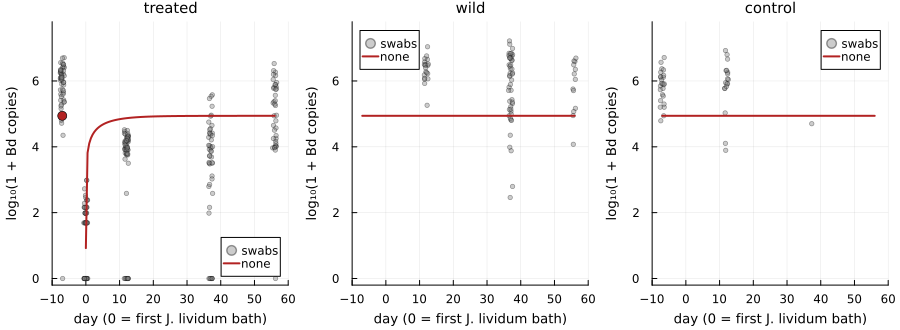
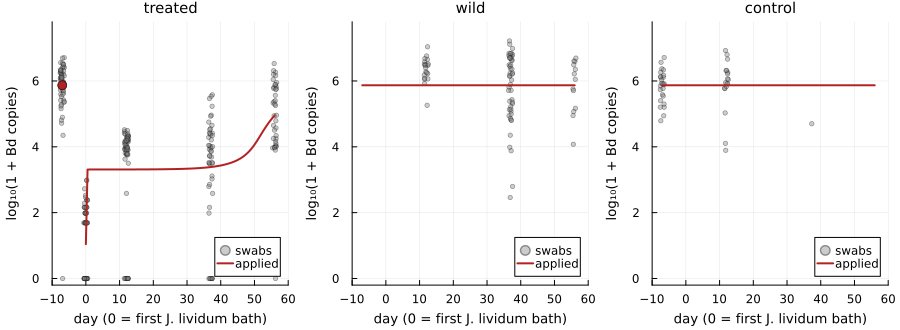
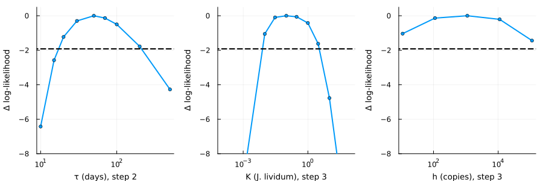

# Fitting the frog load model to a field trial


- [The trial](#the-trial)
- [The data](#the-data)
- [The model](#the-model)
  - [Step 1: no extra clearance](#step-1-no-extra-clearance)
  - [Step 2: suppression that wanes](#step-2-suppression-that-wanes)
  - [Step 3: suppression from the applied
    bacteria](#step-3-suppression-from-the-applied-bacteria)
  - [Step 4: every *J. lividum*
    protects](#step-4-every-j-lividum-protects)
- [Comparing the four](#comparing-the-four)
- [How well are the parameters
  determined?](#how-well-are-the-parameters-determined)
- [What the fit shows](#what-the-fit-shows)
- [Limits](#limits)
- [References](#references)

## The trial

In July 2012, Knapp et al. (2022) treated subadult Sierra Nevada
yellow-legged frogs (*Rana sierrae*) in Dusy Basin, California, during a
Bd epizootic:

- **days −7 to −1**: a daily bath in the antifungal itraconazole;
- **days 0 and 1**: a bath in a culture of *Janthinobacterium lividum*,
  a skin bacterium that inhibits Bd, isolated from a frog in the same
  basin;
- release into the pond, then swabs on days 12, 37 and 56.

Untreated wild frogs and a group of control frogs (marked, never bathed)
were swabbed at the same visits. Every swab was tested for Bd (ITS
copies) and for *J. lividum* (genomic equivalents). Frogs were marked by
group, not individually, so each visit samples the group, not the same
animals.

This vignette fits the frog load equation of the package to these swabs.
It asks why Bd stayed low on treated frogs for weeks, and whether *J.
lividum* had anything to do with it.

> [!IMPORTANT]
>
> The load equation and the fits are **new work in this package, not a
> published analysis**. The data are from Knapp et al. (2022), CC BY
> 4.0, bundled in `data/knapp2022`. The within-frog rate `r0` comes from
> the Briggs et al. (2010) parameters in the package’s compendium;
> everything else is fitted here.

``` julia
using Chytridiomycosis, Plots, Printf
using Distributions: median
default(linewidth = 2, size = (720, 380), legendfontsize = 8, guidefontsize = 9,
    titlefontsize = 10, left_margin = 4Plots.mm, bottom_margin = 4Plots.mm)

swabs = load_knapp2022()
groups = (:treated, :wild, :control)
days = [-7, 0, 12, 37, 56]
nothing
```

## The data

``` julia
println("| Group | Day | Swabs | No Bd | Median Bd load | Median *J. lividum* |")
println("|---|---|---|---|---|---|")
for g in groups, d in days
    s = filter(x -> x.group === g && x.day == d, swabs)
    isempty(s) && continue
    bd = [x.bd for x in s if !isnan(x.bd)]
    jl = [x.jl for x in s if !isnan(x.jl)]
    @printf("| %s | %d | %d | %d | %s | %s |\n", g, d, length(s), count(==(0), bd),
        isempty(bd) ? "–" : @sprintf("%.3g", median(bd)),
        isempty(jl) ? "–" : @sprintf("%.3g", median(jl)))
end
```

| Group   | Day | Swabs | No Bd | Median Bd load | Median *J. lividum* |
|---------|-----|-------|-------|----------------|---------------------|
| treated | -7  | 51    | 1     | 1.13e+06       | –                   |
| treated | 0   | 52    | 20    | 48             | 0                   |
| treated | 12  | 57    | 9     | 9.65e+03       | 155                 |
| treated | 37  | 47    | 7     | 7.44e+03       | 2                   |
| treated | 56  | 39    | 1     | 1.8e+05        | 0                   |
| wild    | 12  | 20    | 0     | 2.72e+06       | 50.5                |
| wild    | 37  | 48    | 0     | 1.42e+06       | 4                   |
| wild    | 56  | 13    | 0     | 1.12e+06       | 0                   |
| control | -7  | 25    | 0     | 8.16e+05       | –                   |
| control | 12  | 18    | 0     | 9.96e+05       | 1.53e+03            |
| control | 37  | 1     | 0     | 5.04e+04       | 158                 |

Three things stand out:

- **Treated frogs stayed low for weeks.** Itraconazole took their loads
  from about a million copies to about 50. Twelve days after release
  they carried about 10,000, and still did on day 37, while wild frogs
  carried more than a million. Only by day 56 had they risen again.
- ***J. lividum* faded on everyone.** On treated frogs it fell from
  about 150 genomic equivalents on day 12 to almost none by day 56. It
  fell at a similar rate on wild frogs, which were never bathed.
- **Controls carried more *J. lividum* than treated frogs** (about 1,500
  on day 12), and their loads were as high as those of wild frogs.

``` julia
using Random: Xoshiro
function data_panel(g; title = string(g))
    s = filter(x -> x.group === g && !isnan(x.bd), swabs)
    jitter = 1.2 .* (rand(Xoshiro(1), length(s)) .- 0.5)
    scatter([x.day for x in s] .+ jitter, log10.(1 .+ [x.bd for x in s]); ms = 2.5, alpha = 0.4,
        color = :grey, label = "swabs", title = title, xlabel = "day (0 = first J. lividum bath)",
        ylabel = "log₁₀(1 + Bd copies)", ylim = (-0.2, 7.8), xlim = (-10, 60))
end
plot(data_panel.(groups)...; layout = (1, 3), size = (900, 330))
```



## The model

Each group is described by its median load $L$ (ITS copies per swab):

$$\frac{dL}{dt} = \iota + r_0 L - s(t)\,\frac{L}{h + L}.$$

- $\iota$ is infection from outside the frog, by zoospores in the pond.
- $r_0 = \eta\nu f - \sigma$ is the within-frog rate of the Briggs et
  al. (2010) model. It is negative, so a frog’s own zoospores cannot
  sustain its load.
- $s(t)\,L/(h + L)$ is extra clearance. It is strongest when the load is
  small and saturates when the load is large.

Without extra clearance, every frog settles at $L^\ast = \iota/(-r_0)$,
with a time scale of $1/|r_0| \approx 6$ days. That is the problem: on
its own the equation would return treated frogs to the wild level within
two weeks of release.

Untreated groups start at their equilibrium. Treated frogs start at a
fitted load on day 0; their swabs on day −7, before treatment, are
predicted by the untreated equilibrium. *J. lividum* falls exponentially
from its day-12 level, at one rate on treated frogs and another on wild
and control frogs. Swabs are lognormal around the median, and a swab
with nothing detected is counted as below one copy.

``` julia
mechanisms = (:none, :decay, :applied, :bacteria)
models = Dict(mech => KnappLoadModel(mech) for mech in mechanisms)
fits = Dict(mech => maximum_likelihood(models[mech]) for mech in mechanisms)
r0 = models[:none].r0
@printf("r0 = %.4f per day\n", r0)
```

    r0 = -0.1562 per day

The fits below compare four explanations for $s(t)$, from simplest to
most complex. Each is fitted to every swab, Bd and *J. lividum* alike,
from eight starting points. In the figures, the red line is the fitted
median load. Swabs with no Bd detected are plotted at 0 and count in the
fit, so the median for treated frogs lies below the cloud of positive
swabs.

``` julia
fine = vcat(-7.0, 0.0:0.5:56.0)
function fit_panels(mech; label = string(mech))
    pred = predicted_loads(models[mech], fits[mech].x; days = fine)
    panels = map(groups) do g
        p = data_panel(g)
        y = getfield(pred, g).bd
        keep = g === :treated ? (fine .>= 0) : trues(length(fine))
        plot!(p, fine[keep], log10.(1 .+ y[keep]); color = :firebrick, label = label)
        g === :treated && scatter!(p, [-7], [log10(1 + y[1])]; color = :firebrick, ms = 5,
            label = "")
        p
    end
    plot(panels...; layout = (1, 3), size = (900, 330))
end
nothing
```

### Step 1: no extra clearance

``` julia
fit_panels(:none)
```



Treated frogs return to the common level by day 12 and stay there. The
fit compromises: it sets that level between treated and untreated frogs,
too low for wild frogs and too high for treated ones.

### Step 2: suppression that wanes

Now treated frogs get extra clearance $s(t) = \Delta c\, e^{-t/\tau}$
from day 0 on, as leftover antifungal drug would provide. Untreated
frogs get none.

``` julia
fit_panels(:decay)
```


### Step 3: suppression from the applied bacteria

The extra clearance on treated frogs now follows their *J. lividum*:
$s(t) = \Delta c\, J(t)/(J(t) + K)$. It is strong while the bacteria are
abundant and fades as they disappear. Resident *J. lividum* on wild and
control frogs is assumed to have no effect, as if the applied isolate
differed from the residents (the assay cannot tell them apart).

``` julia
fit_panels(:applied)
```



### Step 4: every *J. lividum* protects

The same relation now applies to every frog, using each group’s own *J.
lividum*. If the species protects in proportion to its abundance, the
residents on wild and control frogs should protect them too.

``` julia
fit_panels(:bacteria)
```


## Comparing the four

``` julia
best = minimum(f.aic for f in values(fits))
println("| Step | Mechanism | Parameters | log-likelihood | AIC | ΔAIC | Starts within 0.1 of the best |")
println("|---|---|---|---|---|---|---|")
for (i, mech) in enumerate(mechanisms)
    f = fits[mech]
    @printf("| %d | `%s` | %d | %.1f | %.1f | %.1f | %d of %d |\n", i, mech, length(f.x),
        f.loglik, f.aic, f.aic - best, count(>=(f.loglik - 0.1), f.logliks), length(f.logliks))
end
```

| Step | Mechanism | Parameters | log-likelihood | AIC | ΔAIC | Starts within 0.1 of the best |
|----|----|----|----|----|----|----|
| 1 | `none` | 9 | -5745.4 | 11508.8 | 178.8 | 8 of 8 |
| 2 | `decay` | 12 | -5656.1 | 11336.3 | 6.2 | 8 of 8 |
| 3 | `applied` | 12 | -5653.0 | 11330.0 | 0.0 | 7 of 8 |
| 4 | `bacteria` | 12 | -5745.4 | 11514.8 | 184.8 | 7 of 8 |

``` julia
fa, fd, fn = fits[:applied], fits[:decay], fits[:none]
@printf("Steps 2 and 3 improve the log-likelihood over step 1 by %.0f and %.0f units. ",
    fd.loglik - fn.loglik, fa.loglik - fn.loglik)
@printf("In step 3, ι = %.3g copies per day, so untreated frogs sit at %.3g copies; ",
    fa.estimates.ι, fa.estimates.ι / -r0)
@printf("treated frogs start at %.3g copies on day 0; and Bd varies between swabs with a ",
    fa.estimates.L0)
@printf("standard deviation of %.2f on the natural-log scale (a factor of %.0f). ",
    fa.estimates.σ, exp(fa.estimates.σ))
@printf("*J. lividum* halves every %.1f days on treated frogs and every %.1f days on wild and control frogs.\n",
    fa.estimates.hT, fa.estimates.hW)
```

Steps 2 and 3 improve the log-likelihood over step 1 by 89 and 92 units.
In step 3, ι = 1.15e+05 copies per day, so untreated frogs sit at
7.38e+05 copies; treated frogs start at 10.1 copies on day 0; and Bd
varies between swabs with a standard deviation of 2.94 on the
natural-log scale (a factor of 19). *J. lividum* halves every 4.3 days
on treated frogs and every 5.4 days on wild and control frogs.

- **Extra clearance on treated frogs is essential.** Steps 2 and 3 are
  far better than step 1, for three more parameters.
- **Resident *J. lividum* does not protect.** In step 4 the fit switches
  the effect off and ends where step 1 does. Controls carried more of
  the species than treated frogs and had high loads, so the abundance
  measured by this assay cannot by itself explain the protection.
- **The applied bacteria fit slightly better than a waning drug** (ΔAIC
  about 6), but the next section shows that this preference rests on
  very little.

## How well are the parameters determined?

Profile likelihoods fix one parameter at a time and refit all the
others. Values above the dashed line, 1.92 log-likelihood units below
the best, form an approximate 95% confidence interval.

``` julia
function profile_plot(fit, name, values; xlabel = string(name))
    pl = profile_likelihood(fit, name, values)
    plot(values, pl .- fit.loglik; xscale = :log10, marker = :circle, ms = 3, label = "",
        xlabel = xlabel, ylabel = "Δ log-likelihood", ylim = (-8, 0.5))
    hline!([-1.92]; color = :black, linestyle = :dash, label = "")
end
τs = [10, 15, 20, 30, 50, 70, 100, 200, 500]
Ks = [1e-4, 1e-3, 0.01, 0.03, 0.1, 0.3, 1, 3, 10, 100]
hs = fa.estimates.h .* [0.01, 0.1, 1, 10, 100]
plot(profile_plot(fd, :τ, τs; xlabel = "τ (days), step 2"),
     profile_plot(fa, :K, Ks; xlabel = "K (J. lividum), step 3"),
     profile_plot(fa, :h, hs; xlabel = "h (copies), step 3"); layout = (1, 3), size = (900, 300))
```



- **Step 2:** the suppression wanes on a time scale $\tau$ of between
  roughly 17 and 200 days.
- **Step 3:** the half-saturation $K$ is between about 0.01 and 3
  genomic equivalents, at or below one cell’s worth of DNA on a swab.
  The fit says the bacteria protect fully until they are almost
  undetectable. The rise in Bd between days 37 and 56 coincides with the
  last *J. lividum* vanishing, and that coincidence is all step 3 uses.
- **The saturating load $h$ is not identified.** No group’s load passes
  through the saturating range slowly enough to measure it.

## What the fit shows

1.  Without an extra effect on treated frogs, the load equation returns
    them to the wild level within two weeks. Something held their loads
    down for five to seven weeks after release.
2.  Waning suppression from leftover itraconazole and protection by the
    applied *J. lividum* explain the data about equally well. Every
    treated frog received both, and no group received only one, so this
    trial cannot separate them.
3.  If *J. lividum* is responsible, it is not because of the species’
    abundance as measured by this assay. Controls carried more of it and
    were not protected, so it would have to be a property of the applied
    isolate, or of how it combines with the drug.

## Limits

- **Groups, not individuals.** Swabs are treated as independent draws.
  Repeated swabs of the same frogs and the loss of frogs that died both
  bias the sample. Survivors may carry less Bd than the frogs that died.
- **A fixed outside infection rate.** $\iota$ is constant, although the
  zoospores in the pond depend on the loads of all frogs. Treating many
  frogs would lower it. The package’s load tipping model includes this
  feedback; the fit does not.
- **Lab parameters.** $r_0$ is taken from Briggs et al. (2010). ITS
  copies per swab are not sporangia, so $\iota$, $h$ and $\Delta c$ are
  on the swab scale and cannot be moved into the sporangium models
  without a conversion factor.
- **A species-level assay.** The *J. lividum* qPCR does not distinguish
  the applied isolate from resident strains.
- **Few controls.** Controls were rarely recaptured after day 12, and no
  group was given only itraconazole or only bacteria.

## References

- Briggs CJ, Knapp RA, Vredenburg VT (2010) Enzootic and epizootic
  dynamics of the chytrid fungal pathogen of amphibians. *Proceedings of
  the National Academy of Sciences* 107:9695–9700.
  [doi:10.1073/pnas.0912886107](https://doi.org/10.1073/pnas.0912886107)
- Knapp RA, Joseph MB, Smith TC, Hegeman EE, et al. (2022) Effectiveness
  of antifungal treatments during chytridiomycosis epizootics in
  populations of an endangered frog. *PeerJ* 10:e12712.
  [doi:10.7717/peerj.12712](https://doi.org/10.7717/peerj.12712)
