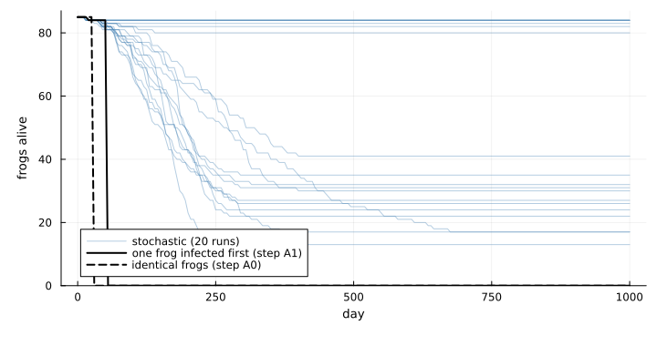
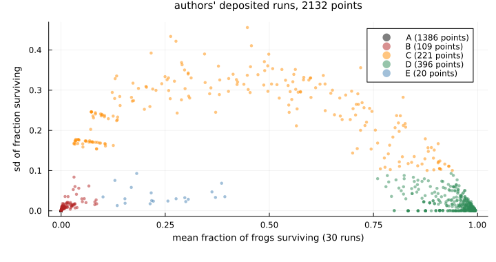
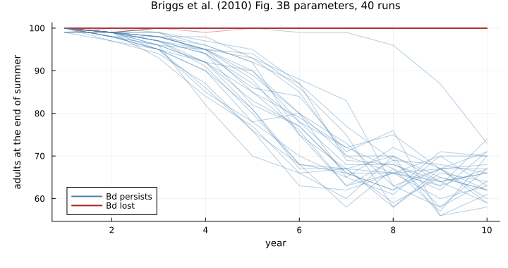
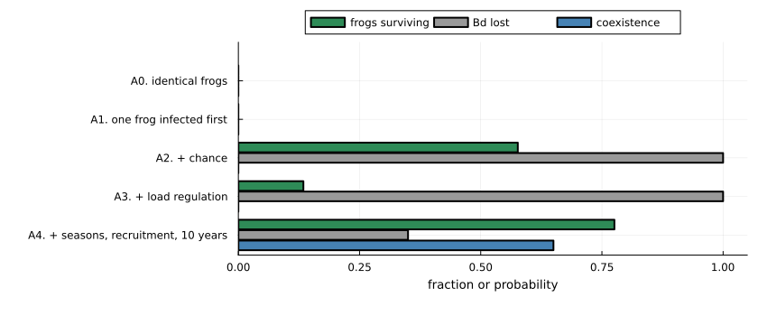
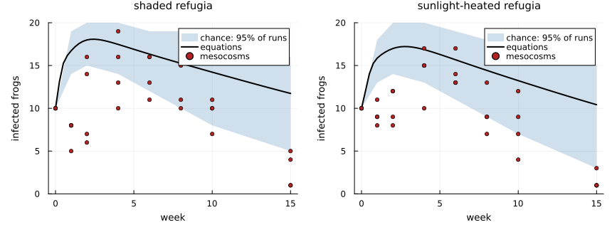
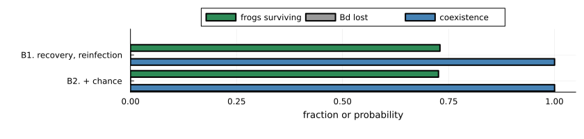

# Does chance decide whether frogs survive Bd?


- [The question and the method](#the-question-and-the-method)
- [Part A. One outbreak in a frog
  population](#part-a-one-outbreak-in-a-frog-population)
  - [Step A0. Identical frogs, mean
    loads](#step-a0-identical-frogs-mean-loads)
  - [Step A1. Frogs infected one after
    another](#step-a1-frogs-infected-one-after-another)
  - [Step A2. Chance](#step-a2-chance)
  - [Step A3. Loads regulated on the
    frog](#step-a3-loads-regulated-on-the-frog)
  - [Step A4. Seasons, births and
    years](#step-a4-seasons-births-and-years)
  - [Chance and one-time
    interventions](#chance-and-one-time-interventions)
  - [Part A summary](#part-a-summary)
- [Part B. Recovery and reinfection in
  mesocosms](#part-b-recovery-and-reinfection-in-mesocosms)
  - [Step B1. Deterministic](#step-b1-deterministic)
  - [Step B2. Chance](#step-b2-chance)
  - [Part B summary](#part-b-summary)
- [All steps](#all-steps)
- [What the exercise shows](#what-the-exercise-shows)
- [Limits](#limits)
- [References](#references)

> [!NOTE]
>
> ### Models in this tutorial
>
> | Model | Source | Category | API page |
> |----|----|----|----|
> | Load model, deterministic and seasonal stochastic, `BriggsLoadProblem`, `BriggsSeasonalProblem` | Briggs et al. 2010 | published | `api/briggs2010.md` |
> | Individual-based model, `DrawertIBMProblem`, `DrawertODEProblem` | Drawert et al. 2017 | published | `api/drawert2017.md` |
> | Refugia CTMC, `RefugiaCTMCProblem`, `RefugiaODEProblem` | Miller et al. 2025 | published | `api/miller2025.md` |
>
> Categories: **published** models reimplement a paper’s equations and
> are checked against it; **modified** models add structure to a
> published model; **new** models are new structure. Results from
> modified and new models are not published results.

## The question and the method

The load model of Briggs et al. (2010) makes a sharp prediction. In a
pond with more frogs than a threshold density, Bd loads grow on every
frog until every frog dies. Below the threshold, every frog clears its
infection. Real populations are less tidy: some lose Bd, some survive an
outbreak, some live with Bd for decades. Chance is one candidate
explanation, because an outbreak starts from a single infected frog and
a frog dies when its own load, a whole number of sporangia, happens to
reach the lethal load.

This vignette starts from the deterministic model and adds one piece of
biology at a time, reporting the same three outcomes at every step:

1.  **frogs that survive**, as a fraction of the starting population;
2.  **Bd lost**: the probability that the fungus disappears while frogs
    remain;
3.  **coexistence**: the probability that frogs and Bd are both present
    at the end.

A deterministic model gives probabilities of 0 or 1. Part A follows Bd
in Sierra Nevada yellow-legged frogs (*Rana muscosa* and *R. sierrae*)
through one outbreak, then over years. Part B follows Bd in green and
golden bell frogs (*Litoria aurea*) in outdoor mesocosms, where frogs
recover and can be reinfected.

| Step | Model | Piece of biology added |
|----|----|----|
| A0 | Briggs et al. (2010), mean field | loads grow on identical frogs from a shared zoospore pool |
| A1 | Drawert et al. (2017), deterministic | frogs are infected one after another, each with its own load |
| A2 | Drawert et al. (2017), stochastic | whole sporangia and zoospores; every event is random |
| A3 | Drawert et al. (2017), Nu and Sigma | loads are regulated on the frog |
| A4 | Briggs et al. (2010), seasonal | winters, recruitment and ten years |
| B1 | Miller et al. (2025), deterministic | recovery, reinfection with acquired resistance, refugia |
| B2 | Miller et al. (2025), stochastic | whole frogs and random events in a mesocosm |

> [!IMPORTANT]
>
> The models are reference implementations of the published models, with
> parameters read from the package’s compendium. Where a published
> number is compared, it comes from the package’s validation registry,
> and its status there (reproduced, qualitative or discrepant) is given.
> Every simulation below is **our run of the model, not a published
> result**, and uses small numbers of replicates to keep the vignette
> quick.

``` julia
using Chytridiomycosis, Plots, Printf
using Random: Xoshiro
default(linewidth = 2, size = (720, 380), legendfontsize = 8, guidefontsize = 9,
    titlefontsize = 10, left_margin = 4Plots.mm, bottom_margin = 4Plots.mm)

# One row per step, filled in as we go.
ladder = NamedTuple[]
function step!(part, label, survive, lost, coexist, note)
    push!(ladder, (; part, label, survive, lost, coexist, note))
    return (survive = round(survive, digits = 3), Bd_lost = round(lost, digits = 3),
            coexist = round(coexist, digits = 3))
end

# A published value from the validation registry, with its status.
function registry(id)
    t = validation_target(id)
    return (; published = t.published, status = t.status,
            ours = t.regression === nothing ? nothing : t.regression["value"])
end

# The package's stored output of the heavy Drawert et al. (2017) runs (our runs, not the paper's)
stored = Chytridiomycosis.TOML.parsefile(joinpath(dirname(drawert2017_path()), "reproduction.toml"))
nothing
```

## Part A. One outbreak in a frog population

Part A uses one parameter point throughout: point 182 of the 2132 points
that Drawert et al. (2017) sampled, which their ESM Table S9 gives as
the representative of their Group C (“highly variable outcomes”). Its 85
frogs share a pool of volume 1, and one frog starts with 100 sporangia.

``` julia
q = DrawertParameters(:drawert2017; point = 182)
bp = BriggsParameters(q)                    # the same rates, as the Briggs et al. (2010) model
@printf("N = %d frogs; γ = %.3g pool frog⁻¹ day⁻¹; η = %.2f zoospores sporangium⁻¹ day⁻¹; ν = %.3f; f = %.2f; σ = %.3f day⁻¹; μ = %.2f day⁻¹; Smax = %d sporangia\n",
    q.N, q.γ, q.η, q.ν0, q.f, q.σ0, q.μ, q.Smax)
```

    N = 85 frogs; γ = 3.2e-06 pool frog⁻¹ day⁻¹; η = 11.61 zoospores sporangium⁻¹ day⁻¹; ν = 0.078; f = 0.56; σ = 0.201 day⁻¹; μ = 1.25 day⁻¹; Smax = 10000 sporangia

### Step A0. Identical frogs, mean loads

In the model of Briggs et al. (2010), each frog’s load ``S_i`` (sporangia)
grows by infection from the pool of zoospores ``Z`` and by reinfection
from its own sporangia, and the pool is fed by every frog (time in days,
pool volume ``V = 1``):

```math
\frac{dS_i}{dt} = \nu\gamma Z + \nu\eta f S_i - \sigma S_i, \qquad
\frac{dZ}{dt} = \eta(1 - f)\sum_i S_i - \gamma N Z - \mu Z .
```

A frog dies when its load reaches ``S_{\max} = 10^4`` sporangia. Bd grows
when there are more frogs than a threshold ``N^\ast``, and declines
otherwise. With Briggs et al.’s own parameters (their Fig. 2C) the
threshold is:

``` julia
r = registry("briggs2010_density_threshold")
Nstar_b = host_density_threshold(BriggsParameters(:briggs2010))
@printf("N* = %.2f frogs per pool (paper: about %g; status: %s)\n", Nstar_b, r.published, r.status)
```

    N* = 23.15 frogs per pool (paper: about 20; status: reproduced)

The legend of their Fig. 2C says “about 20 frogs”; the figure’s
parameter values give 23.15, within the registry’s tolerance.

At point 182 there is no threshold at all: a frog’s own zoospores make
its load grow (``\eta\nu f > \sigma``), so Bd grows on a single frog. The
simplest version of an outbreak gives every frog the same share of the
initial 100 sporangia.

``` julia
Nstar = host_density_threshold(bp)
λ = load_growth_rate(bp, q.N)
mf = solve(BriggsLoadProblem(bp; N = q.N, S0 = fill(q.S0 / q.N, q.N), tspan = (0.0, 1000.0));
    abstol = 1e-8, reltol = 1e-8)
@printf("N* = %.1f frogs; growth rate of Bd with 85 frogs λ = %.3f day⁻¹; all frogs dead on day %.0f\n",
    Nstar, λ, maximum(mf.death_time))
step!("A", "A0. identical frogs (Briggs 2010)", count(mf.alive) / q.N, 0.0, 0.0,
    "every frog dies on the same day")
```

    N* = 0.0 frogs; growth rate of Bd with 85 frogs λ = 0.305 day⁻¹; all frogs dead on day 30

    (survive = 0.0, Bd_lost = 0.0, coexist = 0.0)

### Step A1. Frogs infected one after another

Drawert et al. (2017) start the same equations from one infected frog
and 84 uninfected ones. The equations are unchanged; only the start
differs, so frogs are infected in sequence and carry different loads.

``` julia
det = solve(DrawertODEProblem(q))
dt = sort(filter(!isnan, det.death_time))
@printf("outcome: %s; first death on day %.0f, last on day %.0f\n", det.outcome, dt[1], dt[end])
step!("A", "A1. one frog infected first", det.surviving_fraction, 0.0, 0.0,
    "every frog still dies, over a longer period")
```

    outcome: frogs_extinct; first death on day 15, last on day 52

    (survive = 0.0, Bd_lost = 0.0, coexist = 0.0)

Every frog still dies. Drawert et al. chose their 2132 points so that
this happens at every one of them, and it does in the package
(validation target `drawert2017_deterministic_extinction`, reproduced).
Their text says all frogs die “within 14–275 days”; that window is in
fact the range of the day of the *first* death:

``` julia
for id in ("drawert2017_first_death_window", "drawert2017_all_frogs_window")
    t = validation_target(id)
    v = check_target(t).value
    println("- `", id, "` (", t.status, "): ", t.quantity, ". Paper: ", t.published,
        "; ours: ", v isa AbstractVector ? join(round.(v; digits = 1), "–") : round(v; digits = 1), ".")
end
```

- `drawert2017_first_death_window` (reproduced): range of the day of the
  first death in the deterministic Baseline over the 2132 points. Paper:
  \[14, 275\]; ours: 14.0–275.0.
- `drawert2017_all_frogs_window` (discrepant): latest day by which all
  frogs are dead in the deterministic Baseline (paper: within 14–275
  days). Paper: 275; ours: 567.1.

### Step A2. Chance

Now every sporangium and zoospore is a whole number, and each event (a
zoospore encysting, a sporangium reinfecting its own frog, a zoospore
released, a sporangium lost, a zoospore dying) happens at random with
the rate of the corresponding term above (`DrawertIBMProblem`, exact
simulation by Gillespie’s direct method). A run ends when all frogs are
dead, when no sporangia or zoospores are left, or after 1000 days.

``` julia
days = 0:5:1000
runs = [solve(DrawertIBMProblem(q; saveat = days); rng = Xoshiro(i)) for i in 1:20]
plot(xlabel = "day", ylabel = "frogs alive", legend = :bottomleft, ylim = (0, q.N + 2))
for (i, r) in enumerate(runs)
    plot!(r.t, r.frogs; color = :steelblue, alpha = 0.4, linewidth = 1,
        label = i == 1 ? "stochastic (20 runs)" : "")
end
alive_det = [count(x -> isnan(x) || x > t, det.death_time) for t in days]
alive_mf = [count(x -> isnan(x) || x > t, mf.death_time) for t in days]
plot!(days, alive_det; color = :black, label = "one frog infected first (step A1)")
plot!(days, alive_mf; color = :black, linestyle = :dash, label = "identical frogs (step A0)")
```



``` julia
counts = Dict(o => count(r -> r.outcome === o, runs) for o in (:frogs_extinct, :fungus_extinct, :persistence))
surv = sum(r.surviving_fraction for r in runs) / length(runs)
@printf("Bd lost in %d of 20 runs; mean fraction of frogs surviving %.2f\n", counts[:fungus_extinct], surv)
step!("A", "A2. + chance (Drawert 2017)", surv, counts[:fungus_extinct] / 20,
    counts[:persistence] / 20, "Bd dies out, leaving a variable number of survivors")
```

    Bd lost in 20 of 20 runs; mean fraction of frogs surviving 0.58

    (survive = 0.576, Bd_lost = 1.0, coexist = 0.0)

In every run Bd now dies out before all the frogs are dead. Frogs die
when their loads reach ``S_{\max}``, and their sporangia die with them;
once the pool has been depleted by many deaths, the last infections fade
by chance. How many frogs are left varies widely from run to run, which
is what puts point 182 in Group C.

The same calculation at the five representative points of Drawert et
al. (2017) compares our runs with the authors’ own 30 runs per point,
which they deposited with the paper. At points A (120) and E (192) Bd
grows slowly, so each run lasts hundreds of days and many millions of
events; to keep the vignette quick, only the authors’ runs are shown for
them.

``` julia
authors = load_drawert2017()
live = Dict(id => drawert_summary(DrawertIBMProblem(DrawertParameters(:drawert2017; point = id));
            nruns = 20, rng = Xoshiro(1)) for id in (1094, 182, 982))
println("| Group | Point | Frogs | λ (day⁻¹) | Authors: survive (sd) | Authors: Bd lost | Ours: survive (sd) | Ours: Bd lost |")
println("|---|---|---|---|---|---|---|---|")
for (g, id) in zip("ABCDE", (120, 1094, 182, 982, 192))
    a = authors[findfirst(x -> x.id == id, authors)]
    o = get(live, id, nothing)
    @printf("| %s | %d | %d | %.3f | %.3f (%.3f) | %.2f | %s | %s |\n", g, id, a.N, a.λ,
        a.mean_surviving, a.std_surviving, a.frac_fungus_extinct,
        o === nothing ? "not run" : @sprintf("%.3f (%.3f)", o.mean_surviving, o.std_surviving),
        o === nothing ? "–" : @sprintf("%.2f", o.frac_fungus_extinct))
end
```

| Group | Point | Frogs | λ (day⁻¹) | Authors: survive (sd) | Authors: Bd lost | Ours: survive (sd) | Ours: Bd lost |
|----|----|----|----|----|----|----|----|
| A | 120 | 194 | 0.054 | 0.000 (0.000) | 0.00 | not run | – |
| B | 1094 | 111 | 0.105 | 0.004 (0.006) | 0.33 | 0.005 (0.005) | 0.45 |
| C | 182 | 85 | 0.305 | 0.582 (0.326) | 1.00 | 0.558 (0.332) | 1.00 |
| D | 982 | 142 | 0.232 | 0.942 (0.088) | 1.00 | 0.930 (0.085) | 1.00 |
| E | 192 | 127 | 0.040 | 0.393 (0.035) | 1.00 | not run | – |

Our runs use 20 replicates, so they agree with the authors’ 30 only
within sampling error; the package’s stratified check on 116 points
(below) is the real comparison.

#### Across all 2132 points

The authors’ deposit has 30 runs at every point. Sorted into the groups
of their Fig. 3 by the mean and standard deviation of the surviving
fraction:

``` julia
gcolor = Dict(:A => :black, :B => :firebrick, :C => :darkorange, :D => :seagreen, :E => :steelblue)
grp = [survival_group(a.mean_surviving, a.std_surviving) for a in authors]
p1 = plot(xlabel = "mean fraction of frogs surviving (30 runs)", ylabel = "sd of fraction surviving",
    legend = :topright, title = "authors' deposited runs, 2132 points")
for g in (:A, :B, :C, :D, :E)
    i = grp .== g
    scatter!(p1, [a.mean_surviving for a in authors[i]], [a.std_surviving for a in authors[i]];
        ms = 2.5, alpha = 0.5, color = gcolor[g], markerstrokewidth = 0,
        label = @sprintf("%s (%d points)", g, count(i)))
end
p1
```



The paper reports the fraction of points at which all 30 runs end the
same way (§4). The package re-ran a stratified sample of 116 points, 30
runs each, and weights them by group size (validation targets
`drawert2017_*_fraction`):

``` julia
cls = [outcome_class(a.frac_frogs_extinct, a.frac_fungus_extinct, a.frac_persistence) for a in authors]
println("| Outcome at a point | Paper | Authors' table | Ours (116 points) | Status |")
println("|---|---|---|---|---|")
for (label, id, c) in (("frogs die in all 30 runs", "drawert2017_frog_extinction_fraction", :frog_extinction),
        ("Bd lost in all 30 runs", "drawert2017_fungal_extinction_fraction", :fungal_extinction),
        ("variable", "drawert2017_variable_fraction", :variable),
        ("coexistence in all 30 runs", "drawert2017_coexistence_fraction", :coexistence))
    t = validation_target(id)
    ours = c === :coexistence ? "–" : @sprintf("%.3f", check_target(t).value)
    @printf("| %s | %g | %.4f | %s | %s |\n", label, t.published, count(==(c), cls) / length(cls), ours, t.status)
end
```

| Outcome at a point | Paper | Authors’ table | Ours (116 points) | Status |
|----|----|----|----|----|
| frogs die in all 30 runs | 0.65 | 0.6501 | 0.653 | reproduced |
| Bd lost in all 30 runs | 0.24 | 0.2439 | 0.242 | reproduced |
| variable | 0.1 | 0.1046 | 0.104 | reproduced |
| coexistence in all 30 runs | 0.0001 | 0.0014 | – | discrepant |

The one discrepancy is in the paper’s text. It says frogs and Bd coexist
in “about 0.01%” of cases; the authors’ own table has 3 of 2132 points
(0.14%), so 0.1% was probably meant. In the Baseline model, chance saves
frogs at a third of the points, but almost never lets them live with Bd.

### Step A3. Loads regulated on the frog

In the Baseline model a load grows exponentially until the frog dies.
Drawert et al. also studied two variants in which the frog regulates its
load: encystment falls with load (Nu, ``\nu(S) = \nu_0 e^{-\nu_1 S}``), or
sporangium loss rises with it (Sigma,
``\sigma(S) = \sigma_0 + \sigma_1 S``). ``\nu_1`` or ``\sigma_1`` is set so
that loads would level off at ``S^\ast S_{\max}``, with ``S^\ast = 1.2``:
just above the lethal load, so that the deterministic model still kills
every frog (`drawert2017_deterministic_extinction`).

``` julia
variants = Dict(v => drawert_summary(DrawertIBMProblem(drawert_variant(q, v; S_star = 1.2));
                nruns = 10, rng = Xoshiro(3)) for v in (:nu, :sigma))
for v in (:nu, :sigma)
    s = variants[v]
    @printf("%-5s: surviving %.2f; frogs die in %.0f%%, Bd lost in %.0f%%, coexist in %.0f%% of 10 runs\n",
        v, s.mean_surviving, 100s.frac_frogs_extinct, 100s.frac_fungus_extinct, 100s.frac_persistence)
end
s = variants[:sigma]
step!("A", "A3. + load regulation (Sigma, S* = 1.2)", s.mean_surviving, s.frac_fungus_extinct,
    s.frac_persistence, "fewer survivors at this point: infections last longer")
```

    nu   : surviving 0.01; frogs die in 50%, Bd lost in 50%, coexist in 0% of 10 runs
    sigma: surviving 0.13; frogs die in 0%, Bd lost in 100%, coexist in 0% of 10 runs

    (survive = 0.134, Bd_lost = 1.0, coexist = 0.0)

At point 182 regulation makes things worse for the frogs. Loads that
level off just above ``S_{\max}`` take longer to kill, so infected frogs
shed for longer and more frogs are infected before Bd fades. The
package’s stored runs of the variants
(`scripts/drawert2017_variants.jl`, 10 runs per point, stored in
`data/drawert2017/reproduction.toml`; our runs, not the paper’s) show
the same at 70 points of Groups C and D, and show the other side at 12
random points, most of which are Group A:

``` julia
v = stored["variants"]
println("| Sample | Model | Points | Mean surviving | Runs with coexistence |")
println("|---|---|---|---|---|")
for (sample, label) in (("groupCD", "Groups C/D"), ("random", "random"))
    b = v[sample * "_nu_1.2"]
    @printf("| %s | Baseline (authors' runs) | %d | %.2f | %.1f%% |\n", label, b["n_points"],
        b["baseline_authors_mean_surviving"], 100b["baseline_authors_runs_persistence"])
    for var in ("nu", "sigma")
        s = v[sample * "_" * var * "_1.2"]
        @printf("| | %s, S* = 1.2 | %d | %.2f | %.1f%% |\n", titlecase(var), s["n_points"],
            s["mean_surviving"], 100s["runs_persistence"])
    end
end
```

| Sample | Model | Points | Mean surviving | Runs with coexistence |
|----|----|----|----|----|
| Groups C/D | Baseline (authors’ runs) | 70 | 0.73 | 4.8% |
|  | Nu, S\* = 1.2 | 70 | 0.50 | 0.6% |
|  | Sigma, S\* = 1.2 | 70 | 0.56 | 0.9% |
| random | Baseline (authors’ runs) | 12 | 0.01 | 0.0% |
|  | Nu, S\* = 1.2 | 12 | 0.08 | 18.3% |
|  | Sigma, S\* = 1.2 | 12 | 0.09 | 31.7% |

Where Bd would otherwise kill every frog, regulation lets frogs and Bd
coexist in a fifth to a third of runs (validation target
`drawert2017_variants_coexistence`, qualitative). The paper’s own Fig.
2a fractions for the variants need the full design and are not
reproduced (`drawert2017_variants_fig2a`, pending).

### Step A4. Seasons, births and years

Drawert et al. follow one outbreak. Briggs et al. (2010) also ran a
stochastic version over ten years, with a summer of 100 days, winters
that kill a fraction of frogs and zoospores, and recruits each spring up
to a ceiling of 100 frogs (their Fig. 3). It has its own parameter set
(their Fig. 3B), so the outcomes below are not for point 182.

``` julia
seasonal = Dict(set => [solve(BriggsSeasonalProblem(BriggsSeasonalParameters(:briggs2010; set));
                            rng = Xoshiro(i)) for i in 1:40] for set in ("fig3b", "fig3d", "fig3f"))
function seasonal_outcomes(rs)
    K = 100
    (survive = sum(r.adults[end] for r in rs) / (K * length(rs)),
     lost = count(r -> r.hosts_final > 0 && r.bd_final == 0, rs) / length(rs),
     coexist = count(r -> r.persisted, rs) / length(rs))
end
for (set, label) in (("fig3b", "no reservoir (Fig. 3B)"), ("fig3d", "external zoospores (Fig. 3D)"),
        ("fig3f", "long-lived tadpoles (Fig. 3F)"))
    o = seasonal_outcomes(seasonal[set])
    @printf("%-30s adults after 10 years %.2f of K; Bd lost %.2f; coexistence %.2f\n", label,
        o.survive, o.lost, o.coexist)
end
o = seasonal_outcomes(seasonal["fig3b"])
step!("A", "A4. + seasons, recruitment, 10 years (Briggs 2010)", o.survive, o.lost, o.coexist,
    "coexistence becomes common: recruits replace frogs that die")
```

    no reservoir (Fig. 3B)         adults after 10 years 0.78 of K; Bd lost 0.35; coexistence 0.65
    external zoospores (Fig. 3D)   adults after 10 years 1.00 of K; Bd lost 0.00; coexistence 1.00
    long-lived tadpoles (Fig. 3F)  adults after 10 years 1.00 of K; Bd lost 0.00; coexistence 1.00

    (survive = 0.776, Bd_lost = 0.35, coexist = 0.65)

``` julia
plot(xlabel = "year", ylabel = "adults at the end of summer", legend = :bottomleft,
    title = "Briggs et al. (2010) Fig. 3B parameters, 40 runs")
for (i, r) in enumerate(seasonal["fig3b"])
    plot!(1:10, r.adults; color = r.persisted ? :steelblue : :firebrick, alpha = 0.4, linewidth = 1,
        label = "")
end
plot!([NaN], [NaN]; color = :steelblue, label = "Bd persists")
plot!([NaN], [NaN]; color = :firebrick, label = "Bd lost")
```



Recruitment changes the picture. Frogs that die are replaced, loads stay
lower because the pool is diluted, and Bd persists in about two thirds
of the runs. Briggs et al. map this probability over parameter space and
find persistence without a reservoir only in a narrow band; at their
starred point the registry accepts any value between 0.3 and 0.95
(`briggs2010_fig3a_band`, qualitative). With an external source of
zoospores, or tadpoles that carry Bd over winter, Bd persists in every
run and no adult dies (`briggs2010_fig3d_reservoir` and
`briggs2010_fig3f_tadpoles`, qualitative).

### Chance and one-time interventions

Drawert et al. used their stochastic model to compare one-time
interventions on day 14, 28 or 56: clearing all sporangia from 25–75% of
frogs (antifungal treatment), culling 25–75% of frogs, or removing
zoospores from the pool. The package ran all 27 strategies at point 182
(30 runs each; `data/drawert2017/reproduction.toml`, our runs). The
change in the mean fraction of frogs surviving:

``` julia
grid = stored["interventions"]["grid_182"]
@printf("Without intervention: mean surviving %.2f.\n\n", grid["baseline_mean_surviving"])
println("| Intervention | Day | 25% | 50% | 75% |")
println("|---|---|---|---|---|")
for k in ("clean_frogs", "cull_frogs", "clean_environment")
    g = grid[k]
    for d in (14, 28, 56)
        v = [g["delta"][i] for i in eachindex(g["day"]) if g["day"][i] == d]
        @printf("| %s | %d | %+.2f | %+.2f | %+.2f |\n", replace(k, "_" => " "), d, v...)
    end
end
```

Without intervention: mean surviving 0.61.

| Intervention      | Day | 25%   | 50%   | 75%   |
|-------------------|-----|-------|-------|-------|
| clean frogs       | 14  | -0.09 | +0.07 | +0.26 |
| clean frogs       | 28  | +0.08 | +0.05 | +0.12 |
| clean frogs       | 56  | -0.07 | +0.03 | +0.21 |
| cull frogs        | 14  | +0.03 | -0.17 | -0.37 |
| cull frogs        | 28  | +0.04 | -0.10 | -0.26 |
| cull frogs        | 56  | +0.06 | -0.13 | -0.11 |
| clean environment | 14  | -0.09 | -0.02 | +0.06 |
| clean environment | 28  | -0.03 | -0.02 | -0.06 |
| clean environment | 56  | -0.08 | -0.16 | -0.11 |

With 30 runs and a standard deviation of about 0.3 per run, differences
below about 0.15 are within noise. Cleaning frogs never lowers survival
by more than noise and helps most when many are treated; culling harms
more the larger it is; cleaning the pool does nothing reliable. These
are the paper’s conclusions (validation targets
`drawert2017_cleaning_rarely_harms`, `drawert2017_culling_risky`,
`drawert2017_environment_cleaning_ineffective`, all qualitative). Chance
is what makes the comparison necessary: in the deterministic model every
strategy that does not clear Bd leaves every frog dead.

### Part A summary

``` julia
function ladder_plot(part)
    rows = filter(r -> r.part == part, ladder)
    k = length(rows)
    labels = [String(first(split(r.label, " ("))) for r in rows]
    bar((1:k) .- 0.27, [r.survive for r in rows]; orientation = :h, bar_width = 0.25,
        label = "frogs surviving", color = :seagreen, yticks = (1:k, labels), yflip = true,
        xlims = (0, 1.05), xlabel = "fraction or probability", size = (840, 100 + 50k),
        left_margin = 6Plots.mm, legend = :outertop, legend_column = 3)
    bar!((1:k), [r.lost for r in rows]; orientation = :h, bar_width = 0.25,
        label = "Bd lost", color = :gray60)
    bar!((1:k) .+ 0.27, [r.coexist for r in rows]; orientation = :h, bar_width = 0.25,
        label = "coexistence", color = :steelblue)
end
ladder_plot("A")
```



## Part B. Recovery and reinfection in mesocosms

Miller et al. (2025, a preprint) model Bd in outdoor mesocosms of green
and golden bell frogs (Waddle et al. 2024). Each mesocosm starts with 20
frogs, 10 of them infected, and half of them previously infected and
recovered. The model has no loads: an infected frog passes through three
stages of rising, high and falling load, and then recovers. Recovered
frogs can be reinfected, at a fraction ``\alpha`` of the naive rate. Each
mesocosm had refugia that were either shaded or warmed by the sun; the
transmissibility ``\beta`` depends on which. Frogs are lost (death or not
found) at rate ``\mu`` whatever their state. Time is in weeks.

In environment ``h`` a naive frog is infected at rate ``\beta_h F/(N - 1)``
and a recovered frog at rate ``\alpha\beta_h F/(N - 1)``, where ``F`` sums
the infected frogs weighted by their relative infectiousness. The
parameters are the posterior means of the paper’s Table 3, read from the
compendium:

``` julia
m = RefugiaParameters(:miller2025)
data = load_miller2025()
@printf("β_sh = %.3f, β_un = %.3f week⁻¹; α = %.3f; recovery ω = %.3f week⁻¹; loss μ = %.3f week⁻¹\n",
    m.β_sh, m.β_un, m.α, m.ω, m.μ)
@printf("loss rate from the data (Eq. 3): %.4f week⁻¹ (paper: %g; %s)\n", loss_rate(data),
    registry("miller2025_loss_rate").published, registry("miller2025_loss_rate").status)
```

    β_sh = 0.675, β_un = 0.401 week⁻¹; α = 0.072; recovery ω = 0.569 week⁻¹; loss μ = 0.021 week⁻¹
    loss rate from the data (Eq. 3): 0.0214 week⁻¹ (paper: 0.021; reproduced)

Because there is no load, a frog does not die of Bd in this model; frogs
that disappear are lost at the same rate whether infected or not. “Frogs
surviving” below is the fraction of the 20 still present at week 15, the
last survey, and “Bd lost” means no infected frog is left.

### Step B1. Deterministic

``` julia
infected(u) = u[2] + u[3] + u[4] + u[6] + u[7] + u[8]
weeks = 0:0.25:15
ode = Dict(env => solve(RefugiaODEProblem(m; environment = env); saveat = weeks) for env in (:shaded, :unshaded))
for env in (:shaded, :unshaded)
    u = ode[env].u[end]
    @printf("%-8s week 15: %.1f frogs, %.1f infected\n", env, sum(u), infected(u))
end
u = ode[:shaded].u[end]
step!("B", "B1. recovery, reinfection (Miller 2025, ODE)", sum(u) / 20, 0.0, 1.0,
    "Bd never disappears in the equations")
```

    shaded   week 15: 14.6 frogs, 11.7 infected
    unshaded week 15: 14.6 frogs, 10.4 infected

    (survive = 0.73, Bd_lost = 0.0, coexist = 1.0)

### Step B2. Chance

The same rates as a continuous-time Markov chain, simulated exactly
(`RefugiaCTMCProblem`), 2000 runs per environment:

``` julia
ctmc = Dict(env => [solve(RefugiaCTMCProblem(m; environment = env); rng = Xoshiro(i)) for i in 1:2000]
            for env in (:shaded, :unshaded))
function ctmc_outcomes(rs)
    N = [sum(r.u[:, end]) for r in rs]
    I = [infected(r.u[:, end]) for r in rs]
    (survive = sum(N) / (20 * length(rs)), lost = count(i -> N[i] > 0 && I[i] == 0, eachindex(rs)) / length(rs),
     coexist = count(i -> N[i] > 0 && I[i] > 0, eachindex(rs)) / length(rs))
end
for env in (:shaded, :unshaded)
    o = ctmc_outcomes(ctmc[env])
    @printf("%-8s week 15: %.2f of frogs present; Bd lost in %.2f%% of runs\n", env, o.survive, 100o.lost)
end
o = ctmc_outcomes(ctmc[:shaded])
step!("B", "B2. + chance (Miller 2025, CTMC)", o.survive, o.lost, o.coexist,
    "Bd is almost never lost within 15 weeks")
```

    shaded   week 15: 0.73 of frogs present; Bd lost in 0.00% of runs
    unshaded week 15: 0.73 of frogs present; Bd lost in 0.05% of runs

    (survive = 0.726, Bd_lost = 0.0, coexist = 1.0)

``` julia
function env_panel(env)
    k = findall(==(env === :shaded), data.shaded)
    p = plot(title = env === :shaded ? "shaded refugia" : "sunlight-heated refugia",
        xlabel = "week", ylabel = "infected frogs", ylim = (0, 20), legend = :topright)
    obs = data.weeks
    sims = reduce(hcat, [[infected(r.u[:, j]) for j in eachindex(obs)] for r in ctmc[env]])
    lo = [sort(sims[j, :])[50] for j in eachindex(obs)]
    hi = [sort(sims[j, :])[1950] for j in eachindex(obs)]
    plot!(p, obs, lo; fillrange = hi, fillalpha = 0.25, color = :steelblue, linewidth = 0,
        label = "chance: 95% of runs")
    plot!(p, weeks, [infected(u) for u in ode[env].u]; color = :black, label = "equations")
    for (n, i) in enumerate(k)
        scatter!(p, obs, [infected(data.counts[:, j, i]) for j in eachindex(obs)]; color = :firebrick,
            ms = 3, label = n == 1 ? "mesocosms" : "")
    end
    p
end
plot(env_panel(:shaded), env_panel(:unshaded); layout = (1, 2), size = (860, 340))
```



In a mesocosm of 20 frogs over 15 weeks, chance matters little to the
outcomes of the ladder: the equations run through the middle of the
simulated runs, and Bd is essentially never lost, because infected frogs
remain throughout. At the posterior means the model predicts more
infected frogs in weeks 1–6 than were found in most mesocosms, and
several mesocosms fall outside the range of the runs. The ABC below
scores all eight states at every survey at once, and its posterior is
wide, so the posterior means are not a close fit to any one summary.

#### What the data say about the parameters

Miller et al. fitted the model by ABC rejection: draw parameters from
uniform priors, simulate one shaded and one sunlit mesocosm, and keep
the 0.2% of draws closest to the data. The paper drew ``10^6`` times. One
run of ``10^5`` draws takes seconds:

``` julia
abc = refugia_abc(data; nsamples = 10^5, seed = 1)
post = refugia_abc_summary(abc)
nothing
```

``` julia
println("| Quantity | Paper (Table 3) | Ours, 10⁵ draws (95% interval) | Registry status |")
println("|---|---|---|---|")
for (name, id) in ((:β_sh, "miller2025_beta_sh"), (:β_un, "miller2025_beta_un"), (:α, "miller2025_alpha"),
        (:αβ_sh, "miller2025_alphabeta_sh"), (:ω, "miller2025_omega"))
    r, s = registry(id), getfield(post, name)
    @printf("| %s | %.3f | %.3f (%.3f–%.3f) | %s |\n", name, r.published, s.mean, s.lo, s.hi, r.status)
end
r = registry("miller2025_refugia_effect")
@printf("| refugia effect, 1 − β_un/β_sh | %.3f | %.3f | %s |\n", r.published, post.refugia_effect, r.status)
```

| Quantity | Paper (Table 3) | Ours, 10⁵ draws (95% interval) | Registry status |
|----|----|----|----|
| β_sh | 0.675 | 0.652 (0.036–1.799) | reproduced |
| β_un | 0.401 | 0.441 (0.009–1.791) | reproduced |
| α | 0.072 | 0.075 (0.003–0.326) | reproduced |
| αβ_sh | 0.018 | 0.018 (0.001–0.059) | reproduced |
| ω | 0.569 | 0.605 (0.146–1.817) | reproduced |
| refugia effect, 1 − β_un/β_sh | 0.406 | 0.323 | reproduced |

The registry’s “reproduced” refers to the package’s full run (20 seeds
of ``10^6`` draws), whose means lie within three seed-to-seed standard
deviations of Table 3; a single run of ``10^5`` draws is noisier,
especially for the refugia effect. The intervals show what the paper’s
means hide. The two transmissibilities each span most of their prior,
and so do ``\alpha`` and ``\omega``; only the product ``\alpha\beta_{sh}``,
the reinfection rate, is well determined
(`miller2025_alphabeta_identifiable`, qualitative). In the package’s
full run the posterior probability that sunlit refugia lower
transmission (``\beta_{un} < \beta_{sh}``) is only 0.74.

### Part B summary

``` julia
ladder_plot("B")
```



## All steps

``` julia
println("| Part | Step | Frogs surviving | Bd lost | Coexistence | What changed |")
println("|---|---|---|---|---|---|")
for r in ladder
    @printf("| %s | %s | %.2f | %.2f | %.2f | %s |\n", r.part, r.label, r.survive, r.lost, r.coexist, r.note)
end
```

| Part | Step | Frogs surviving | Bd lost | Coexistence | What changed |
|----|----|----|----|----|----|
| A | A0. identical frogs (Briggs 2010) | 0.00 | 0.00 | 0.00 | every frog dies on the same day |
| A | A1. one frog infected first | 0.00 | 0.00 | 0.00 | every frog still dies, over a longer period |
| A | A2. + chance (Drawert 2017) | 0.58 | 1.00 | 0.00 | Bd dies out, leaving a variable number of survivors |
| A | A3. + load regulation (Sigma, S\* = 1.2) | 0.13 | 1.00 | 0.00 | fewer survivors at this point: infections last longer |
| A | A4. + seasons, recruitment, 10 years (Briggs 2010) | 0.78 | 0.35 | 0.65 | coexistence becomes common: recruits replace frogs that die |
| B | B1. recovery, reinfection (Miller 2025, ODE) | 0.73 | 0.00 | 1.00 | Bd never disappears in the equations |
| B | B2. + chance (Miller 2025, CTMC) | 0.73 | 0.00 | 1.00 | Bd is almost never lost within 15 weeks |

## What the exercise shows

1.  **Chance turned certain death into a lottery.** At point 182 the
    deterministic models kill every frog; the stochastic model loses Bd
    in every run, with a variable number of survivors. Across the
    design, the same happens at about a third of the points. The
    threshold density of the deterministic model is therefore not a
    reliable guide to the fate of a single outbreak.
2.  **Chance alone does not give coexistence.** In the Baseline model
    frogs and Bd almost never coexist: Bd either kills every frog or
    burns out. Coexistence needed a further piece of biology: loads
    regulated on the frog (where Bd would otherwise kill every frog), or
    recruitment and seasons (Briggs et al. 2010).
3.  **The same piece of biology can help or harm.** Load regulation
    lowered survival at point 182, because infections lasted longer, and
    raised it where Bd kills every frog.
4.  **In a small, short experiment, chance is a minor player.** In the
    mesocosms, where frogs recover and are reinfected, the equations run
    through the middle of the stochastic runs, and Bd is not lost by
    chance within 15 weeks.

## Limits

- The stochastic runs use 20 replicates (40 for step A4), so their
  fractions carry a sampling error of about ±0.1.
- Steps A0–A3 are one parameter point; step A4 and Part B are other
  systems with their own parameters, so the ladder compares models, not
  one model with pieces switched on.
- Groups A and E, where Bd grows slowly, are shown from the authors’
  runs only.
- The Miller et al. model has no loads and no death from Bd; it
  describes 15 weeks in a mesocosm and is not a population model.
- Miller et al. (2025) is a preprint.

## References

- Briggs CJ, Knapp RA, Vredenburg VT (2010) Enzootic and epizootic
  dynamics of the chytrid fungal pathogen of amphibians. *Proceedings of
  the National Academy of Sciences* 107:9695–9700.
  [doi:10.1073/pnas.0912886107](https://doi.org/10.1073/pnas.0912886107)
- Drawert B, Griesemer M, Petzold LR, Briggs CJ (2017) Using stochastic
  epidemiological models to evaluate conservation strategies for
  endangered amphibians. *Journal of the Royal Society Interface*
  14:20170480.
  [doi:10.1098/rsif.2017.0480](https://doi.org/10.1098/rsif.2017.0480)
- Miller CM, Lydeamore MJ, Berger L, et al. (2025) Sunlight-heated
  refugia protect frogs from chytridiomycosis: a mathematical modelling
  study. arXiv:2503.06846 (preprint).
  [doi:10.48550/arXiv.2503.06846](https://doi.org/10.48550/arXiv.2503.06846)
- Waddle AW, Clulow S, Aquilina A, et al. (2024) Hotspot shelters
  stimulate frog resistance to chytridiomycosis. *Nature* 631:344–349.
  [doi:10.1038/s41586-024-07582-y](https://doi.org/10.1038/s41586-024-07582-y)
