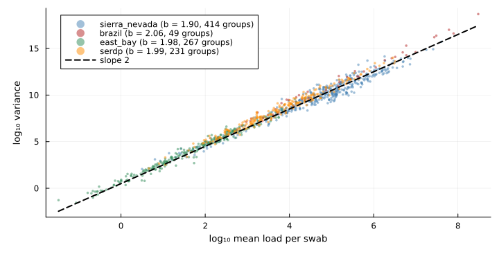
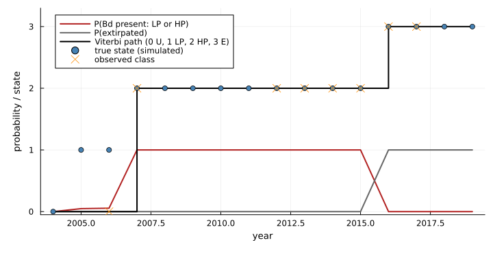
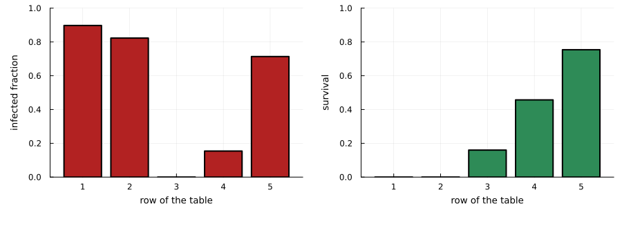

# What do field data say about Bd?


- [The question and the method](#the-question-and-the-method)
- [Step 1. One swab: what a qPCR number
  means](#step-1-one-swab-what-a-qpcr-number-means)
- [Step 2. Many swabs: how loads are
  spread](#step-2-many-swabs-how-loads-are-spread)
- [Step 3. A lake each year: outbreak
  states](#step-3-a-lake-each-year-outbreak-states)
- [Step 4. Individual frogs over years: survival with
  infection](#step-4-individual-frogs-over-years-survival-with-infection)
- [All steps](#all-steps)
- [What the exercise shows](#what-the-exercise-shows)
- [Limits](#limits)
- [References](#references)

> [!NOTE]
>
> ### Models in this tutorial
>
> | Model | Source | Category | API page |
> |----|----|----|----|
> | qPCR units map, `QPCRStandardCurve`, `restandardize` | Longo et al. 2013 | published | `api/observation_load.md` |
> | Hurdle load likelihood with a limit of detection, `LoadHurdleModel` | standard two-part model | package choice | `api/observation_load.md` |
> | Observation operator, `swab_distribution` (noise `σ`, limit `lod`) | — | package choice | `api/observation_load.md` |
> | Taylor’s power law across groups of swabs, `TaylorPowerLawProblem` | Schrock et al. 2025 | published | `api/observation_load.md` |
> | Outbreak-state HMM, `OutbreakHMMProblem`, `outbreak_transition_matrix` | Wilber et al. 2022 | published | `api/wilber2022.md` |
> | Decline regression, `Wilber2022DeclineProblem` | Wilber et al. 2022 | published | `api/wilber2022.md` |
> | Continuous-time multistate survival, `CTMultistateProblem`, `load_hazard_ratio` | Hollanders et al. 2023 | published | `api/multistate.md` |
> | Multi-event survival, `MultiEventProblem`, `palomar2023_structure` | Palomar et al. 2023 | published | `api/multistate.md` |
>
> Categories: **published** models reimplement a paper’s equations and
> are checked against it; **modified** models add structure to a
> published model; **new** models are new structure. Results from
> modified and new models are not published results.

## The question and the method

Every model of Bd needs numbers from the field: how heavily frogs are
infected, how many are infected, whether a population has Bd, and how
fast infected frogs die. None of these is measured directly. A swab
gives a qPCR reading; a survey gives a count of positive swabs; a
mark–recapture study gives a list of the occasions on which a frog was
seen. This tutorial follows four published analyses that turn such
records into quantities a model can use, from one swab to individual
frogs followed over years. Each layer makes an assumption that the
records themselves cannot check, and the tutorial puts a number on each
one.

At every step it reports the same three outcomes, with “–” where one
does not apply:

1.  **infected fraction**: the fraction of hosts (or swabs) infected
    that the step estimates or implies;
2.  **survival**: the fraction of hosts that survive, as the step
    defines it (per year, or through an outbreak);
3.  **unchecked assumption**: a choice the data cannot test, and how far
    the answer moves between two readings the data cannot tell apart.

| Step | Field record | Analysis | What it hands to a model |
|----|----|----|----|
| 1 | one swab | qPCR units (Longo et al. 2013); hurdle likelihood | a load on a stated basis; prevalence and load distribution |
| 2 | many swabs | Taylor’s power law (Schrock et al. 2025) | how load variance scales with mean load across groups |
| 3 | a lake each year | outbreak-state HMM, decline regression (Wilber et al. 2022) | yearly transition probabilities between outbreak states; decline |
| 4 | individual frogs over years | multistate survival (Hollanders et al. 2023; Palomar et al. 2023) | mortality of infected and uninfected frogs, corrected for detection |

> [!IMPORTANT]
>
> The analyses are reference implementations of the published ones, with
> parameters read from the package’s compendium. Published values quoted
> for comparison come from the package’s validation registry, with their
> status (reproduced, qualitative, discrepant or pending). The outcomes
> of the ladder are **our calculations**. Two deposits are not bundled:
> the Wilber et al. (2022) data (no open licence) and the Hollanders et
> al. (2023) posterior draws (no licence). Palomar et al. (2023)
> deposited no data. Where a step needs one of these, it uses the
> published summaries, or simulated records that are labelled as such.

``` julia
using Chytridiomycosis, Plots, Printf
using Random: Xoshiro
using Distributions: LogNormal, Binomial, Normal, cdf
include("../diagram.jl")
default(linewidth = 2, size = (720, 380), legendfontsize = 8, guidefontsize = 9,
    titlefontsize = 10, left_margin = 4Plots.mm, bottom_margin = 4Plots.mm)

ladder = NamedTuple[]
function step!(n, analysis, infected, survival, assumption)
    push!(ladder, (; n, analysis, infected, survival, assumption))
    return (infected = round(infected, digits = 3), survival = round(survival, digits = 3),
            assumption = assumption)
end

function registry(id)
    t = validation_target(id)
    return (; published = t.published, status = t.status,
            ours = t.regression === nothing ? nothing : t.regression["value"])
end
nothing
```

## Step 1. One swab: what a qPCR number means

A swab passes through a chain before it becomes a number. The qPCR reads
a cycle threshold Ct, the cycle at which the signal crosses a threshold.
A standard curve turns it into a quantity ``q`` of template in the
reaction:

```math
\mathrm{Ct} = m \log_{10} q + c, \qquad \text{efficiency} = 10^{-1/m} - 1 .
```

If the standards were counted zoospores of strain ``s``, ``q`` is in
zoospore equivalents (ZE) of that strain. Strains differ in the number
``n_s`` of ITS1 copies per zoospore, so a load in ZE of strain ``s`` is
``x\,n_s`` ITS1 copies, or ``x\,n_s/n_t`` ZE of strain ``t`` (Longo et
al. 2013).


The eight strains of Longo et al. (2013) and the reading of one reaction
at Ct = 30 against each strain’s zoospore standards (Table 1, Set A):

``` julia
strains = longo_strains()
copies = strain_copy_number.(strains)
q30 = [standard_quantity(QPCRStandardCurve(:longo2013, s), 30.0) for s in strains]
for (s, n, q) in zip(strains, copies, q30)
    @printf("%-11s %4.0f ITS1 copies per zoospore; Ct 30 reads %6.2f zoospores in the reaction\n", s, n, q)
end
r = registry("longo2013_copy_number_range")
@printf("copy-number range %.1f-fold (paper %g; %s)\n", maximum(copies) / minimum(copies), r.published, r.status)
@printf("1000 ZE against JEL404 standards = %.0f ZE against CLFT023, %.0f against MexMkt\n",
    load_value(restandardize(ZEPerSwab(1000), "JEL404" => "CLFT023")),
    load_value(restandardize(ZEPerSwab(1000), "JEL404" => "MexMkt")))
```

    JEL404        39 ITS1 copies per zoospore; Ct 30 reads   3.24 zoospores in the reaction
    MexMkt        10 ITS1 copies per zoospore; Ct 30 reads  15.07 zoospores in the reaction
    JEL427        65 ITS1 copies per zoospore; Ct 30 reads   1.79 zoospores in the reaction
    PAB01         59 ITS1 copies per zoospore; Ct 30 reads   1.83 zoospores in the reaction
    LFT001_01    125 ITS1 copies per zoospore; Ct 30 reads   1.41 zoospores in the reaction
    CLFT023      144 ITS1 copies per zoospore; Ct 30 reads   1.32 zoospores in the reaction
    CLFT024      118 ITS1 copies per zoospore; Ct 30 reads   1.41 zoospores in the reaction
    LBAbercrom   107 ITS1 copies per zoospore; Ct 30 reads   1.33 zoospores in the reaction
    copy-number range 14.4-fold (paper 14.4; reproduced)
    1000 ZE against JEL404 standards = 271 ZE against CLFT023, 3900 against MexMkt

The same swab can read up to 14.4-fold differently depending on the
lab’s standard strain. `restandardize` removes this difference between
labs. It cannot fix a deeper problem: a ZE value assumes the frog’s own
strain has the standard’s copy number. The field strain’s copy number is
not measured, so ZE count ITS1 copies, not zoospores. This is why
Hollanders et al. (2023) and Knapp et al. (2022) report ITS1 copies per
swab.

**Many swabs: a likelihood.** A group of swabs mixes uninfected hosts
(zeros) with infected ones. The package’s `LoadHurdleModel` is a
standard two-part model, not taken from one paper: a fraction ``\pi`` of
swabbed hosts is infected, and an infected host’s load ``Y`` follows a
distribution ``f_D``, here lognormal. A load below a limit of detection
``L`` reads as zero:

```math
P(\text{zero}) = (1-\pi) + \pi\,P(Y < L), \qquad f(y \ge L) = \pi\, f_D(y).
```

The swabs of Knapp et al. (2022) from Dusy Basin are ITS1 copies per
swab (371 swabs, with zeros among the treated frogs). The deposit
records no limit of detection. With ``L = 0`` every zero is an uninfected
frog; with ``L`` just below the smallest positive load, a zero may also be
an infected frog with a load too small to detect:

``` julia
y = [s.bd for s in load_knapp2022() if !isnan(s.bd)]
L = minimum(filter(>(0), y))
f0 = maximum_likelihood(LoadHurdleModel(y; family = :lognormal))
fL = maximum_likelihood(LoadHurdleModel(y; family = :lognormal, lod = L))
@printf("%d swabs, %d zeros, smallest positive %.0f copies\n", length(y), count(==(0), y), L)
@printf("L = 0:       infected fraction %.3f, median load %.3g copies, AIC %.1f\n",
    f0.prevalence, exp(f0.distribution.μ), f0.aic)
@printf("L = %.0f:     infected fraction %.3f, median load %.3g copies, AIC %.1f\n",
    L, fL.prevalence, exp(fL.distribution.μ), fL.aic)
```

    371 swabs, 38 zeros, smallest positive 48 copies
    L = 0:       infected fraction 0.898, median load 8.87e+04 copies, AIC 9569.0
    L = 48:     infected fraction 0.911, median load 7.8e+04 copies, AIC 9560.8

The two readings differ in how many zeros are infected frogs below
detection (an infected fraction of 0.898 against 0.911). The AIC favours
the limit slightly, only because the fitted lognormal puts some mass
below 48 copies; the swabs cannot show whether that limit was real. Only
a known limit of detection, or repeated swabs of the same frog, could.

**From a model to swabs.** The reverse step predicts what swabs would
read from a model’s state. `swab_distribution` does this for the Wilber
et al. (2016) IPM, whose load *is* the swab load in ZE. Any noise or
limit of detection added to it is the package’s choice, not the paper’s.
With a 10 ZE limit and 0.3 log₁₀ units of noise (our values) at 20 °C:

``` julia
sol16 = solve(BdIPMProblem(WilberParameters(:wilber2016; set = "deposited"); temperature = 20))
d_exact = swab_distribution(sol16)
d_noisy = swab_distribution(sol16; σ = 0.3, lod = 10.0)
@printf("prevalence %.3f; P(positive swab) %.3f without and %.3f with the limit (our choice)\n",
    d_exact.prevalence, detection_probability(d_exact), detection_probability(d_noisy))
step!(1, "one swab: qPCR units, hurdle likelihood (Knapp 2022 swabs)", f0.prevalence, NaN,
    @sprintf("standard strain: 14.4-fold in ZE; zeros below detection: π %.2f vs %.2f", f0.prevalence, fL.prevalence))
```

    prevalence 0.985; P(positive swab) 0.985 without and 0.959 with the limit (our choice)

    (infected = 0.898, survival = NaN, assumption = "standard strain: 14.4-fold in ZE; zeros below detection: π 0.90 vs 0.91")

## Step 2. Many swabs: how loads are spread

Schrock et al. (2025) grouped swabs by species, life stage, site, season
and year, and related each group’s variance of load to its mean, zeros
included (Taylor’s power law):

```math
\operatorname{Var}(Y) = a\,\bar Y^{\,b}, \qquad \log_{10}\operatorname{Var} = \log_{10} a + b \log_{10} \bar Y ,
```

fitted by least squares over groups with at least 10 swabs and 3
positives. A slope ``b`` near 2 says the spread of log load is about the
same in every group, which is what a lognormal load with a fixed
log-scale spread gives. Their group summaries are bundled:

``` julia
groups = load_schrock2024()
slopes = schrock_taylor_slopes(groups)
plot(xlabel = "log₁₀ mean load per swab", ylabel = "log₁₀ variance", legend = :topleft)
for (k, c) in ((:sierra_nevada, :steelblue), (:brazil, :firebrick), (:east_bay, :seagreen), (:serdp, :darkorange))
    gs = filter(g -> g.dataset === k && g.num_infected >= 3 && g.mean > 0 && g.variance > 0, groups)
    scatter!(log10.(getfield.(gs, :mean)), log10.(getfield.(gs, :variance)); ms = 2, msw = 0,
        alpha = 0.5, color = c, label = @sprintf("%s (b = %.2f, %d groups)", k, slopes[k].slope, slopes[k].n))
end
plot!(x -> 2x + 0.5; color = :black, linestyle = :dash, label = "slope 2")
```



``` julia
for id in ("schrock2024_tpl_sierra", "schrock2024_tpl_brazil", "schrock2024_tpl_enzootic", "schrock2024_lognormal_best")
    t = validation_target(id)
    ours = t.regression === nothing ? "" : @sprintf(", ours %.3g", t.regression["value"])
    @printf("- `%s`: %s. Paper %s%s (%s).\n", id, t.quantity, string(t.published), ours, t.status)
end
```

- `schrock2024_tpl_sierra`: Taylor’s power law slope, Sierra Nevada
  dataset. Paper 1.9 (reproduced).
- `schrock2024_tpl_brazil`: Taylor’s power law slope, Brazil dataset.
  Paper 2.06 (reproduced).
- `schrock2024_tpl_enzootic`: Taylor’s power law slope, enzootic Sierra
  Nevada populations (and its contrast with post-invasion). Paper 2.08,
  ours 1.98 (discrepant).
- `schrock2024_lognormal_best`: fraction of groups (\>= 10 infected)
  where the lognormal fits best or within 2 AIC. Paper 0.767
  (reproduced).

The dataset slopes are reproduced. The enzootic Sierra slope is not
(ours 1.98 against the printed 2.08), so the claimed difference between
enzootic and post-invasion populations is not reproduced either.

The zeros matter. With a fraction ``\pi`` infected, the
variance-to-squared-mean ratio is ``(e^{\sigma^2} - \pi)/\pi`` for
lognormal loads with log-scale sd ``\sigma``, so groups whose prevalence
rises with their mean load give a slope below 2. Twenty-five lognormal
groups with ``\sigma = 2`` (our choice), with every swab positive and then
with prevalence rising from 0.1 to 0.9 along the mean (our choice):

``` julia
μs = range(0, 12; length = 25)
slope_of(prev) = solve(TaylorPowerLawProblem(
    [load_moments(prev(i), LogNormal(μs[i], 2.0)).mean for i in eachindex(μs)],
    [load_moments(prev(i), LogNormal(μs[i], 2.0)).variance for i in eachindex(μs)])).slope
b_all = slope_of(i -> 1.0)
b_rise = slope_of(i -> 0.1 + 0.8 * (i - 1) / (length(μs) - 1))
@printf("slope with every swab positive: %.3f; with prevalence rising with the mean: %.3f\n", b_all, b_rise)
```

    slope with every swab positive: 2.000; with prevalence rising with the mean: 1.859

The same groups, summarised over the positive swabs only (recovered from
each group’s count, mean and variance with zeros; our calculation), give
a different slope:

``` julia
function positive_moments(g)
    k = g.num_infected
    s1 = g.N * g.mean
    s2 = (g.N - 1) * g.variance + g.N * g.mean^2
    m = s1 / k
    return (mean = m, variance = (s2 - k * m^2) / (k - 1))
end
sierra = filter(g -> g.dataset === :sierra_nevada && g.num_infected >= 3 && g.mean > 0 && g.variance > 0, groups)
pm = [positive_moments(g) for g in sierra]
ok = [p.variance > 0 for p in pm]
b_pos = solve(TaylorPowerLawProblem(getfield.(pm[ok], :mean), getfield.(pm[ok], :variance))).slope
prev2 = sum(g.num_infected for g in sierra) / sum(g.N for g in sierra)
@printf("Sierra Nevada: slope with zeros %.3f, positives only %.3f; %.3f of swabs positive\n",
    slopes[:sierra_nevada].slope, b_pos, prev2)
step!(2, "many swabs: Taylor's power law (Schrock 2025), Sierra Nevada", prev2, NaN,
    @sprintf("zeros as uninfected: slope %.2f with zeros, %.2f positives only", slopes[:sierra_nevada].slope, b_pos))
```

    Sierra Nevada: slope with zeros 1.901, positives only 2.087; 0.823 of swabs positive

    (infected = 0.823, survival = NaN, assumption = "zeros as uninfected: slope 1.90 with zeros, 2.09 positives only")

A slope from Taylor’s law is a target a load model can be tested
against: a model’s swab distribution (step 1) has a mean and variance
(`load_moments`), so it can be placed on the plot. Whether a zero is an
uninfected frog or an undetected infection changes the slope, and the
group summaries cannot say which.

## Step 3. A lake each year: outbreak states

Wilber et al. (2022) followed 79 lakes of *Rana sierrae* and *R.
muscosa* in the Sierra Nevada from 2004 to 2019. Each June a lake is in
one of four hidden states: U (Bd-free), LP (Bd at prevalence at most
``\rho``), HP (above ``\rho``) or E (frogs extirpated). The yearly
transition matrix (rows: this year; columns: next year) is

```math
P = \begin{pmatrix}
1-a & a\omega & a(1-\omega) & 0\\
\varphi & \omega(1-\varphi) & (1-\omega)(1-\varphi) & 0\\
0 & 0 & 1-e & e\\
0 & 0 & 0 & 1
\end{pmatrix},
\qquad
\Phi^{-1}(\varphi) = \beta_0 + \beta_1 D_t + \beta_2 T_t + \beta_3 S_{t+1} + \beta_4 \mathrm{Tad}_t + \beta_5 T_t S_{t+1},
```

and likewise for ``\omega``, with ``D`` host abundance, ``T`` summer
temperature, ``S`` snow of the following spring (all z-scored) and Tad
tadpole presence. ``\varphi`` is a failed invasion (LP → U); ``\omega``
keeps Bd at low prevalence. The states are hidden: a survey swabs ``n``
frogs and finds ``y`` positive, and the emission weights allow a lake in
LP to show no positive swab.


The authors’ data are on Zenodo without an open licence, so they are not
bundled; with the deposit installed, `OutbreakHMMProblem()` and
`wilber2022_fit()` refit the model (the MCMC takes minutes per cutoff).
The paper prints the probit slopes (Fig. 3, in the compendium), not the
intercepts or ``a`` and ``e``. The slopes show what the covariates do:

``` julia
fig3 = Dict(ρ => parameter_set(:wilber2022; set = "abundance_rho$ρ") for ρ in ("0.25", "0.5"))
p25 = fig3["0.25"]
for n in (:phi_abundance, :phi_temperature, :phi_tadpole, :omega_abundance, :omega_temperature)
    @printf("%-18s %+.2f (ρ = 0.25)   %+.2f (ρ = 0.5)\n", n, getfield(p25, n), getfield(fig3["0.5"], n))
end
```

    phi_abundance      -0.21 (ρ = 0.25)   +0.01 (ρ = 0.5)
    phi_temperature    +0.45 (ρ = 0.25)   +0.37 (ρ = 0.5)
    phi_tadpole        -3.03 (ρ = 0.25)   -1.22 (ρ = 0.5)
    omega_abundance    +0.24 (ρ = 0.25)   +0.18 (ρ = 0.5)
    omega_temperature  +0.19 (ρ = 0.25)   +0.23 (ρ = 0.5)

Warm summers raise the chance of a failed invasion, tadpoles lower it,
and abundance has little effect on ``\varphi``
(`wilber2022_density_phi_none`, `wilber2022_temperature_phi`). To see
how the HMM reads surveys, the next cell **simulates** 60 lakes over 16
years. The intercepts and ``a``, ``e`` are our illustrative values (a 15%
yearly chance of arrival, a 10% yearly chance of extirpation from HP,
``\omega = 0.5`` and ``\varphi = \Phi(-0.5) = 0.31`` at mean conditions); a
warm summer adds the published temperature slope to ``\varphi``. Each lake
is surveyed in a year with probability 0.45, ten frogs are swabbed, and
prevalence is uniform within LP or HP (our choices):

``` julia
ρ = 0.25
Φn(x) = cdf(Normal(), x)                          # the probit link
a3, e3, ω3 = 0.15, 0.10, 0.5
φ_mean = Φn(-0.5)
φ_warm = Φn(-0.5 + p25.phi_temperature)
@printf("φ at mean conditions %.2f; after a summer 1 sd warmer %.2f (published slope, our intercept)\n", φ_mean, φ_warm)
P3 = outbreak_transition_matrix(a3, e3, ω3, φ_mean)
display(round.(P3; digits = 3))

function simulate_lake(rng; years = 16, nswab = 10, psurvey = 0.45)
    truth = hmm_sample(rng, [1.0, 0, 0, 0], P3, years)
    obs, Lk = fill(-1, years), ones(years, 4)
    for t in 2:years                                  # the first year is not used, as in the paper
        rand(rng) < psurvey || continue
        s = truth[t]
        if s == 4
            obs[t] = 3
        else
            prev = s == 1 ? 0.0 : s == 2 ? ρ * rand(rng) : ρ + (1 - ρ) * rand(rng)
            y = rand(rng, Binomial(nswab, prev))
            obs[t] = y == 0 ? 0 : y <= nswab ÷ floor(Int, 1 / ρ) ? 1 : 2
        end
        Lk[t, :] .= wilber2022_emission(obs[t], nswab, obs[t] == 3 ? 0 : y, ρ)
    end
    return (; truth, obs, Lk)
end
rng = Xoshiro(2022)
lakes = [simulate_lake(rng) for _ in 1:60]
nothing
```

    φ at mean conditions 0.31; after a summer 1 sd warmer 0.48 (published slope, our intercept)

    4×4 Matrix{Float64}:
     0.85   0.075  0.075  0.0
     0.309  0.346  0.346  0.0
     0.0    0.0    0.9    0.1
     0.0    0.0    0.0    1.0

For each lake the forward–backward recursion gives the probability of
each hidden state each year (`hmm_posterior`), and the Viterbi algorithm
the single most probable path (`hmm_viterbi`):

``` julia
lk = lakes[findfirst(l -> count(==(2), l.truth) >= 2 && count(==(3), l.truth) >= 2, lakes)]
post = hmm_posterior([1.0, 0, 0, 0], P3, lk.Lk; emit_first = false)
vit = hmm_viterbi([1.0, 0, 0, 0], P3, lk.Lk; emit_first = false).path
yrs = 2004:2019
plot(yrs, post[:, 2] .+ post[:, 3]; label = "P(Bd present: LP or HP)", color = :firebrick,
    xlabel = "year", ylabel = "probability / state", ylim = (-0.05, 3.3), legend = :topleft)
plot!(yrs, post[:, 4]; label = "P(extirpated)", color = :gray40)
plot!(yrs, vit .- 1; seriestype = :steppost, label = "Viterbi path (0 U, 1 LP, 2 HP, 3 E)", color = :black)
scatter!(yrs, lk.truth .- 1; label = "true state (simulated)", color = :steelblue, ms = 4)
sv = findall(>=(0), lk.obs)
scatter!(yrs[sv], lk.obs[sv]; label = "observed class", color = :darkorange, marker = :x, ms = 6)
```



``` julia
nv = sum(sum(hmm_viterbi([1.0, 0, 0, 0], P3, l.Lk; emit_first = false).path[2:end] .== l.truth[2:end]) for l in lakes)
nall = sum(length(l.truth) - 1 for l in lakes)
surv = [(l.obs[t], l.truth[t] - 1) for l in lakes for t in 2:16 if l.obs[t] >= 0]
naive = count(x -> x[1] == x[2], surv) / length(surv)
lp_missed = count(x -> x[2] == 1 && x[1] == 0, surv) / max(count(x -> x[2] == 1, surv), 1)
vs = [(hmm_viterbi([1.0, 0, 0, 0], P3, l.Lk; emit_first = false).path[t], l.truth[t]) for l in lakes for t in 2:16 if l.obs[t] >= 0]
@printf("Viterbi state correct in %.2f of all lake-years and %.2f of surveyed ones; the observed class in %.2f of surveyed ones\n",
    nv / nall, count(x -> x[1] == x[2], vs) / length(vs), naive)
@printf("surveyed LP lake-years read as Bd-free: %.2f\n", lp_missed)
```

    Viterbi state correct in 0.87 of all lake-years and 0.94 of surveyed ones; the observed class in 0.92 of surveyed ones
    surveyed LP lake-years read as Bd-free: 0.44

Ten swabs often miss Bd at low prevalence: almost half the surveyed LP
lake-years read as Bd-free. The HMM fills the unsurveyed years, and in
surveyed years it does better than the raw class because a lake cannot
jump from HP back to U, nor from E back to anything. Those rules are
part of the model, not something the surveys test; in this simulation
they are true by construction.

**How far the frogs decline.** Wilber et al. (2022) then regressed the
decline from the maximum to the minimum count on the z-scored log₁₀
maximum count ``z``, for lakes where Bd prevalence peaked in between (a
beta-binomial regression):

```math
n_{\max} - n_{\min} \sim \operatorname{BetaBinomial}\bigl(n_{\max},\, p\phi,\, (1-p)\phi\bigr),
\qquad \operatorname{logit} p = \beta_0 + \beta_1 z .
```

The refit needs the deposit; the published values (Fig. 5C and Results)
are in the compendium and the registry:

``` julia
r7 = registry("wilber2022_decline_7_frogs")
@printf("decline of a population of 7 frogs: paper %.2f (%s); slope β₁ 95%% interval [%.2f, %.2f]\n",
    r7.published, r7.status, p25.decline_slope_subadult_abundance_lower, p25.decline_slope_subadult_abundance_upper)
step!(3, "a lake each year: outbreak HMM, decline (Wilber 2022)", NaN, 1 - r7.published,
    @sprintf("prevalence cutoff ρ: φ-temperature slope %.2f (ρ = 0.25), %.2f (ρ = 0.5)",
        p25.phi_temperature, fig3["0.5"].phi_temperature))
```

    decline of a population of 7 frogs: paper 0.84 (reproduced); slope β₁ 95% interval [0.12, 0.73]

    (infected = NaN, survival = 0.16, assumption = "prevalence cutoff ρ: φ-temperature slope 0.45 (ρ = 0.25), 0.37 (ρ = 0.5)")

Even a population of seven frogs loses about five in six: low density
offers little protection. The survival entry of the ladder is
``1 - 0.84``, the fraction left after the outbreak. The cutoff ``\rho`` that
splits LP from HP is a definition, and the fitted effects move with it.

## Step 4. Individual frogs over years: survival with infection

Mark–recapture follows frogs, not lakes. A frog not seen may be dead, or
alive and missed; a frog seen may not be swabbed. Multistate models
separate these. Hollanders et al. (2023) followed *Mixophyes fleayi* at
three streams with a robust design (three surveys within each primary
occasion), in continuous time. The states are alive uninfected (U),
alive infected (I) and dead, with hazards per six weeks:

```math
Q = \begin{pmatrix}
-(\psi_{12} + \phi_1) & \psi_{12} & \phi_1\\
\psi_{21} & -(\psi_{21} + \phi_2) & \phi_2\\
0 & 0 & 0
\end{pmatrix}, \qquad
\phi_2 = \phi_1 \exp\!\Bigl(\beta_{\text{status}} + \beta_{\text{load}}\,\frac{x - \bar x}{2 s_x}\Bigr),
```

where ``x`` is the frog’s log₁₀ swab load (ITS1 copies). An interval of
length ``\tau`` has transition matrix ``e^{Q\tau}``, so unequal gaps between
surveys need no special treatment.


Their data are bundled (Dryad, CC0); the posterior medians are in the
compendium:

``` julia
hd = hollanders2023_summary_data()
h = parameter_set(:hollanders2023)
r_inf = registry("hollanders2023_infected_detections")
@printf("%d frogs, %d primary detections, %d infected (paper %d; %s)\n",
    sum(hd.individuals), hd.primary_detections, hd.infected_detections, r_inf.published, r_inf.status)
@printf("log₁₀ load: mean %.3f, sd %.3f\n", hd.mean, hd.sd)
hr(x) = load_hazard_ratio(x; status = h.mortality_status, load = h.mortality_load, mean = hd.mean, sd = hd.sd)
r5 = registry("hollanders2023_hazard_ratio_1e5")
@printf("hazard ratio at 10^5 copies: %.2f at the posterior medians (ours); paper %.1f; from the draws %.2f (%s)\n",
    hr(5.0), r5.published, r5.ours, r5.status)
```

    686 frogs, 1609 primary detections, 248 infected (paper 248; reproduced)
    log₁₀ load: mean 3.174, sd 0.911
    hazard ratio at 10^5 copies: 5.99 at the posterior medians (ours); paper 4.4; from the draws 6.46 (discrepant)

At the posterior medians, scaled by the bundled loads, the hazard ratio
at 10⁵ copies is 5.99; over the authors’ draws its median is 6.46.
Neither is the 4.4 printed in the Discussion, and the registry records
the discrepancy. The yearly consequence for a frog whose load stays
fixed while it is infected (the published rates; holding the load fixed
is our simplification):

``` julia
μU = h.mortality_annual * 6 / 52                  # six-weekly baseline hazard
τyear = 52 / 6
clear(x) = h.clearance * exp(h.clear_load * (x - hd.mean) / (2hd.sd))
surv_inf(x) = 1 - ctmc_transition(infection_generator(h.gain, clear(x), μU, μU * hr(x)), τyear)[2, 3]
surv_U = 1 - ctmc_transition(infection_generator(h.gain, h.clearance, μU, μU), τyear)[1, 3]
xs = range(hd.minimum, hd.maximum; length = 60)
plot(xs, surv_inf.(xs); label = "infected at the start of the year", color = :firebrick,
    xlabel = "log₁₀ load (ITS1 copies per swab)", ylabel = "survival over one year", ylim = (0, 0.6))
hline!([surv_U]; label = "uninfected, no extra risk", color = :black, linestyle = :dash)
ra = registry("hollanders2023_annual_survival")
@printf("annual survival without Bd: %.3f (paper %.3f; %s). Infected at 10^%.2f: %.3f; at 10^5: %.3f; at 10^6: %.3f\n",
    exp(-h.mortality_annual), ra.published, ra.status, hd.mean, surv_inf(hd.mean), surv_inf(5.0), surv_inf(6.0))
```

    annual survival without Bd: 0.457 (paper 0.457; reproduced). Infected at 10^3.17: 0.464; at 10^5: 0.317; at 10^6: 0.185

Frogs clear infection fast (a hazard of 2.6 per six weeks), so a frog
infected at the mean load survives the year as well as an uninfected one
(0.464 against 0.457). At 10⁶ copies its survival falls to 0.185: a
heavy load kills before it clears.

The paper’s printed slopes are posterior summaries conditional on
inclusion in a reversible jump MCMC. The package’s reduced
maximum-likelihood refit (stored; not re-run here) shows why status and
load are hard to separate:

``` julia
hf = hollanders2023_fit()
hs = hollanders2023_summary(hf)
names_h = hf.problem.names
i_s, i_l = findfirst(==(:mortality_status), names_h), findfirst(==(:mortality_load), names_h)
ρsl = hf.vcov[i_s, i_l] / sqrt(hf.vcov[i_s, i_s] * hf.vcov[i_l, i_l])
rs = registry("hollanders2023_refit_status_effect")
@printf("status effect: paper %.3f, our refit %.2f [%.2f, %.2f] (%s); load effect: paper %.3f, ours %.2f\n",
    rs.published, hs.phi_status.estimate, hs.phi_status.lower, hs.phi_status.upper, rs.status,
    h.mortality_load, hs.phi_load.estimate)
@printf("sampling correlation of the two effects: %.2f\n", ρsl)
step!(4, "frogs over years: CT multistate (Hollanders 2023)", hd.infected_detections / hd.primary_detections,
    exp(-h.mortality_annual),
    @sprintf("status vs load confounded (r = %.2f): status effect %.2f printed, %.2f refit", ρsl, h.mortality_status, hs.phi_status.estimate))
```

    status effect: paper -0.167, our refit 1.22 [-1.09, 3.49] (discrepant); load effect: paper 1.953, ours 1.29
    sampling correlation of the two effects: -0.89

    (infected = 0.154, survival = 0.457, assumption = "status vs load confounded (r = -0.89): status effect -0.17 printed, 1.22 refit")

The infected fraction in the ladder is the share of primary detections
that were infected; it is not corrected for detection.

**Status recorded, or not.** Palomar et al. (2023) fitted a multi-event
model to 13 years of male *Bufo spinosus* at Laguna Grande (Peñalara).
Each year a toad survives (probability ``S_I`` or ``S_U``), may change state
(``\psi``), is recaptured (``p``), and if recaptured its status is recorded
with probability ``\delta``; otherwise the event is “seen, status
unknown”:

```math
\Phi = \begin{pmatrix}
S_I(1-\psi_{IU}) & S_I\psi_{IU} & 1 - S_I\\
S_U\psi_{UI} & S_U(1-\psi_{UI}) & 1 - S_U\\
0 & 0 & 1
\end{pmatrix}, \qquad
B = \begin{pmatrix}
1 - p & p\,\delta_I & 0 & p(1-\delta_I)\\
1 - p & 0 & p\,\delta_U & p(1-\delta_U)\\
1 & 0 & 0 & 0
\end{pmatrix},
```

with events (not seen, seen I, seen U, seen unknown). The capture
histories were not deposited, so nothing is refitted. Two checks need
only the printed numbers:

``` julia
pp = parameter_set(:palomar2023)
ri = registry("palomar2023_implied_prevalence")
rd = registry("palomar2023_assignment_design")
@printf("published: S_I %.3f, S_U %.3f, ψ_U→I %.3f, ψ_I→U %.3f, δ_I %.3f, δ_U %.3f\n",
    pp.survival_infected, pp.survival_uninfected, pp.infection, pp.clearance,
    pp.assignment_infected, pp.assignment_uninfected)
@printf("implied prevalence among living males %.3f, observed swab prevalence %.3f (%s)\n",
    palomar2023_implied_prevalence(), ri.published, ri.status)
@printf("fraction of captures swabbed %.3f, published δ_U %.3f (%s)\n",
    pp.swabbed_captures / pp.captures_2008_2016, rd.published, rd.status)
```

    published: S_I 0.754, S_U 0.883, ψ_U→I 0.583, ψ_I→U 0.225, δ_I 0.119, δ_U 1.000
    implied prevalence among living males 0.714, observed swab prevalence 0.278 (discrepant)
    fraction of captures swabbed 0.430, published δ_U 1.000 (discrepant)

Swabbing was a random subsample of captures, so whether a toad’s status
is recorded cannot depend on its state; yet the fit gives ``\delta_U = 1``
and ``\delta_I = 0.12``. One explanation fits both checks: the model reads
captures of unknown status as infected toads. The package tests it on
**simulated** histories with the same design (632 males, 13 years, 43%
of captures swabbed, four years without swabbing) and survival **equal**
in both states. This is our experiment, not a published result (about a
minute and a half):

``` julia
ex = palomar2023_swabbing_experiment()
for (lab, v) in (("truth", ex.truth), ("published structure", ex.published), ("unswabbed years unassessed", ex.unassessed))
    @printf("%-27s S_I %.3f  S_U %.3f  ψ_U→I %.2f  ψ_I→U %.2f  δ_I %.3f  δ_U %.3f\n",
        lab, v.S_I, v.S_U, v.infection, v.clearance, v.δ_I, v.δ_U)
end
step!(4, "frogs over years: multi-event (Palomar 2023; data not deposited)", palomar2023_implied_prevalence(),
    pp.survival_infected,
    @sprintf("δ by state: implied prevalence %.2f vs %.2f observed; simulated δ_I %.2f, δ_U %.2f (truth %.2f)",
        palomar2023_implied_prevalence(), ri.published, ex.published.δ_I, ex.published.δ_U, ex.truth.δ_I))
```

    truth                       S_I 0.800  S_U 0.800  ψ_U→I 0.20  ψ_I→U 0.60  δ_I 0.430  δ_U 0.430
    published structure         S_I 0.791  S_U 0.802  ψ_U→I 0.66  ψ_I→U 0.25  δ_I 0.112  δ_U 1.000
    unswabbed years unassessed  S_I 0.715  S_U 0.815  ψ_U→I 0.18  ψ_I→U 0.57  δ_I 0.759  δ_U 0.368

    (infected = 0.714, survival = 0.754, assumption = "δ by state: implied prevalence 0.71 vs 0.28 observed; simulated δ_I 0.11, δ_U 1.00 (truth 0.43)")

On simulated data the published structure reproduces the published
pattern (``\delta_U`` at 1, ``\delta_I`` near 0.11, infection and clearance
reversed: 0.66 and 0.25 against the true 0.20 and 0.60), while survival
stays close to the true 0.80 in both states. Declaring the unswabbed
years unassessed recovers the transitions (0.18 and 0.57), but not
``\delta``, and it pulls the survival of infected toads down to 0.72 in
this one data set. Survival of infected against uninfected toads (0.754
against 0.883 in the paper) cannot be checked this way: it needs the
histories.

## All steps

``` julia
fmt(x) = isnan(x) ? "–" : @sprintf("%.3g", x)
println("| Step | Analysis | Infected fraction | Survival | Unchecked assumption |")
println("|---|---|---|---|---|")
for r in ladder
    println("| ", r.n, " | ", r.analysis, " | ", fmt(r.infected), " | ", fmt(r.survival), " | ", r.assumption, " |")
end
```

| Step | Analysis | Infected fraction | Survival | Unchecked assumption |
|----|----|----|----|----|
| 1 | one swab: qPCR units, hurdle likelihood (Knapp 2022 swabs) | 0.898 | – | standard strain: 14.4-fold in ZE; zeros below detection: π 0.90 vs 0.91 |
| 2 | many swabs: Taylor’s power law (Schrock 2025), Sierra Nevada | 0.823 | – | zeros as uninfected: slope 1.90 with zeros, 2.09 positives only |
| 3 | a lake each year: outbreak HMM, decline (Wilber 2022) | – | 0.16 | prevalence cutoff ρ: φ-temperature slope 0.45 (ρ = 0.25), 0.37 (ρ = 0.5) |
| 4 | frogs over years: CT multistate (Hollanders 2023) | 0.154 | 0.457 | status vs load confounded (r = -0.89): status effect -0.17 printed, 1.22 refit |
| 4 | frogs over years: multi-event (Palomar 2023; data not deposited) | 0.714 | 0.754 | δ by state: implied prevalence 0.71 vs 0.28 observed; simulated δ_I 0.11, δ_U 1.00 (truth 0.43) |

``` julia
k = length(ladder)
plot(layout = (1, 2), size = (900, 340), bottom_margin = 8Plots.mm)
bar!([isnan(r.infected) ? 0.0 : r.infected for r in ladder]; subplot = 1, xticks = (1:k, string.(1:k)),
    legend = false, ylabel = "infected fraction", xlabel = "row of the table", color = :firebrick, ylim = (0, 1))
bar!([isnan(r.survival) ? 0.0 : r.survival for r in ladder]; subplot = 2, xticks = (1:k, string.(1:k)),
    legend = false, ylabel = "survival", xlabel = "row of the table", color = :seagreen, ylim = (0, 1))
```



Rows 1 and 2 have no survival and row 3 no infected fraction; their bars
are left empty. The survival entries are not comparable with each other:
row 3 is the fraction of frogs left after an outbreak, row 4 the yearly
survival of uninfected frogs, and row 5 the yearly survival of infected
toads.

## What the exercise shows

1.  **Each layer turns a field record into a model quantity.** A Ct
    becomes a load on a stated basis; a group of swabs becomes a
    prevalence and a load distribution, and many groups a scaling of
    variance with mean; yearly surveys become transition probabilities
    between outbreak states; capture histories become mortality hazards
    of infected and uninfected frogs. These are the inputs and the tests
    of the transmission and load models of the other tutorials.
2.  **Each layer rests on an assumption the records cannot check.** The
    standard strain’s copy number (14.4-fold across strains), whether a
    zero is an uninfected frog (it changes the fitted prevalence and the
    Taylor slope), the prevalence cutoff that defines an outbreak state,
    and whether infection status and load can be told apart, or whether
    status is recorded at random. Each moves the answer, and only a
    different design (a known detection limit, repeated swabs, recorded
    swabbing decisions) could settle it.
3.  **Correcting for detection changes the answer.** The HMM reads
    unsurveyed and misread years from the structure of the chain; the
    multistate models separate death from not being seen. Both
    corrections are only as good as the structure they assume: an
    absorbing E state, a constant load over six weeks, a state-dependent
    ``\delta``.
4.  **Published numbers can disagree with their own data or text.** The
    enzootic Taylor slope, the hazard ratios in Hollanders et al.’s
    Discussion and Palomar et al.’s implied prevalence are recorded as
    discrepant.

## Limits

- The Wilber et al. (2022) data are not bundled, so step 3 uses the
  printed slopes and a simulated set of lakes with our own intercepts,
  arrival and extirpation probabilities. The Viterbi accuracy shown is a
  property of that simulation, not of the Sierra lakes.
- The Hollanders et al. (2023) survival curve holds the load fixed while
  a frog is infected and uses site-averaged posterior medians; the
  paper’s own curve averages over its posterior.
- The Palomar et al. (2023) step uses one simulated data set; its
  conclusion is a hypothesis about the real histories, which are not
  available.
- The observation operator’s noise and limit of detection in step 1 are
  our choices, and the package refuses conversions from swab loads to
  zoospores or sporangia on the host that no source gives.

## References

- Hollanders M, Grogan LF, Nock CJ, McCallum HI, Newell DA (2023)
  Recovered frog populations coexist with endemic *Batrachochytrium
  dendrobatidis* despite load-dependent mortality. *Ecological
  Applications* 33:e2724.
  [doi:10.1002/eap.2724](https://doi.org/10.1002/eap.2724)
- Knapp RA, Joseph MB, Smith TC, Hegeman EE, Vredenburg VT, Erdody JE
  Jr, Boiano DM, Jani AJ, Briggs CJ (2022) Effectiveness of antifungal
  treatments during chytridiomycosis epizootics in populations of an
  endangered frog. *PeerJ* 10:e12712.
  [doi:10.7717/peerj.12712](https://doi.org/10.7717/peerj.12712)
- Longo AV, Rodriguez D, da Silva Leite D, Toledo LF, Mendoza Almeralla
  C, Burrowes PA, Zamudio KR (2013) ITS1 copy number varies among
  *Batrachochytrium dendrobatidis* strains: implications for qPCR
  estimates of infection intensity from field-collected amphibian skin
  swabs. *PLoS ONE* 8:e59499.
  [doi:10.1371/journal.pone.0059499](https://doi.org/10.1371/journal.pone.0059499)
- Palomar G, Fernández-Chacón A, Bosch J (2023) Amphibian survival
  compromised by long-term effects of chytrid fungus. *Biodiversity and
  Conservation* 32:793–809.
  [doi:10.1007/s10531-022-02525-3](https://doi.org/10.1007/s10531-022-02525-3)
- Schrock SAR, Walsman JC, DeMarchi J, et al. (2025) Do fungi look like
  macroparasites? Quantifying the patterns and mechanisms of aggregation
  for host–fungal parasite relationships. *Proceedings of the Royal
  Society B* 292:20242013.
  [doi:10.1098/rspb.2024.2013](https://doi.org/10.1098/rspb.2024.2013)
- Wilber MQ, Langwig KE, Kilpatrick AM, McCallum HI, Briggs CJ (2016)
  Integral projection models for host–parasite systems with an
  application to amphibian chytrid fungus. *Methods in Ecology and
  Evolution* 7:1182–1194.
  [doi:10.1111/2041-210X.12561](https://doi.org/10.1111/2041-210X.12561)
- Wilber MQ, Knapp RA, Smith TC, Briggs CJ (2022) Host density has
  limited effects on pathogen invasion, disease-induced declines and
  within-host infection dynamics across a landscape of disease. *Journal
  of Animal Ecology* 91:2451–2464.
  [doi:10.1111/1365-2656.13823](https://doi.org/10.1111/1365-2656.13823)
