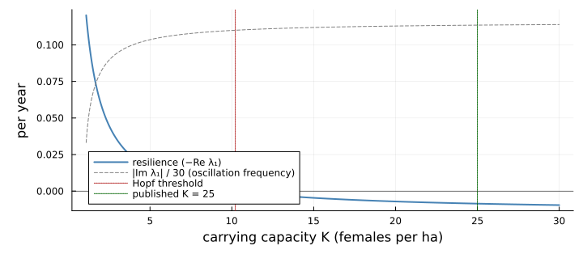
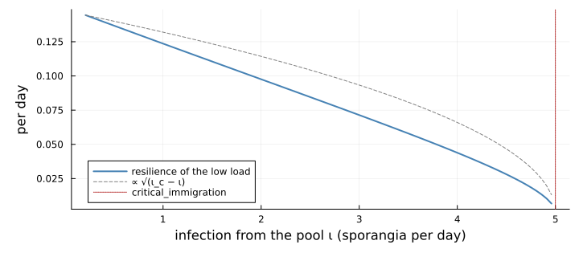

# Thresholds and resilience


- [The question](#the-question)
- [Bsal in fire salamanders: a Hopf
  bifurcation](#bsal-in-fire-salamanders-a-hopf-bifurcation)
- [A load that runs away: a fold](#a-load-that-runs-away-a-fold)
- [What the two thresholds mean for
  management](#what-the-two-thresholds-mean-for-management)

## The question

Most chytrid models are read through thresholds: Bsal invades a fire
salamander population above a carrying capacity, and an infection’s load
runs away above a rate of infection from the pool. Thresholds say
*whether* a state persists. They do not say how robust it is on the way:
how quickly the system returns after a disturbance (a pulse of
infection, a bad winter, a treatment that stops), or how close the next
threshold is.

That is what **resilience** measures. Linearise the model at an
equilibrium; the Jacobian’s eigenvalue with the largest real part, λ₁,
sets the slowest return rate, and resilience is −Re λ₁. **Reactivity**
is the largest initial rate at which a small perturbation can grow
before it decays. As a parameter brings an equilibrium to a threshold,
its resilience falls to zero: recovery becomes slower and slower
(“critical slowing down”), which is what early-warning indicators look
for in data.

How resilience reaches zero tells two kinds of threshold apart:

- at a **Hopf bifurcation** a pair of complex eigenvalues crosses into
  the right half-plane: the equilibrium persists but becomes unstable
  and the system starts to oscillate;
- at a **fold** a real eigenvalue reaches zero as the equilibrium meets
  an unstable one and both disappear: the system jumps somewhere else.

This vignette uses two models from this package. The machinery is in
[DynamicalResilience.jl](https://ecorecipes.github.io/DynamicalResilience.jl/dev/)
and
[ResilienceCore.jl](https://ecorecipes.github.io/ResilienceCore.jl/dev/);
this package supplies only where each model’s equilibria are
([`equilibrium_state`](@ref)) and which of its terms are new infections.

``` julia
using Chytridiomycosis, DynamicalResilience, Plots, Printf
using Chytridiomycosis: with
default(; size = (720, 330), titlefontsize = 10, left_margin = 4Plots.mm, bottom_margin = 4Plots.mm)
```

## Bsal in fire salamanders: a Hopf bifurcation

Schmidt et al. (2017) model susceptible, latent and infectious adult
females with logistic density dependence (carrying capacity `K`, females
per ha). Bsal invades when `K` exceeds the invasion threshold; above it
there is an endemic equilibrium.

R₀ by the general next-generation method of DynamicalResilience, with
`L` and `I` as the infected states and `βSI` as the only new infections,
agrees with the package’s closed form `K / K_threshold`:

``` julia
p = SchmidtParameters(:schmidt2017)
prob = SchmidtSLIProblem(p)
r = reproduction_number(prob)
@printf("R₀ = %.3f (next-generation matrix), %.3f (closed form); K_threshold = %.4f\n",
        r.R0, basic_reproduction_number(p), invasion_threshold(p))
```

    R₀ = 24.787 (next-generation matrix), 24.787 (closed form); K_threshold = 1.0086

Now follow the endemic equilibrium as the carrying capacity rises, from
just above the invasion threshold to well beyond the published `K = 25`.
`resilience_along` finds the equilibrium at each `K` by Newton’s method,
starting from the previous one, and computes resilience (yr⁻¹) and
reactivity on the way.

``` julia
Ks = collect(1.1:0.05:30.0)
start = equilibrium_state(SchmidtSLIProblem(with(p; K = Ks[1])), :endemic)
path = resilience_along(to_ode_problem(prob), (q, K) -> with(q; K = K), Ks; u0 = start)
KH = hopf_threshold(p)
@printf("stability is lost at a %s bifurcation near K = %.2f; hopf_threshold(p) = %.2f\n",
        path.transition.kind, path.transition.estimate, KH)
```

    stability is lost at a hopf bifurcation near K = 10.21; hopf_threshold(p) = 10.21

``` julia
plot(Ks, path.metrics.resilience; label = "resilience (−Re λ₁)", color = :steelblue, lw = 2,
     xlabel = "carrying capacity K (females per ha)", ylabel = "per year")
plot!(Ks, abs.(imag.(path.leading)) ./ 30; label = "|Im λ₁| / 30 (oscillation frequency)",
      color = :gray, ls = :dash)
hline!([0]; color = :black, lw = 0.5, label = false)
vline!([KH]; color = :firebrick, ls = :dot, label = "Hopf threshold")
vline!([p.K]; color = :darkgreen, ls = :dot, label = "published K = 25")
```



``` julia
i = argmax(path.metrics.resilience)
@printf("most resilient at K = %.2f: %.3f per year, an e-folding return time of %.1f years\n",
        Ks[i], path.metrics.resilience[i], 1 / path.metrics.resilience[i])
@printf("oscillation periods 2π/|Im λ₁|: %.1f to %.1f years\n",
        extrema(2π ./ abs.(imag.(path.leading)))...)
```

    most resilient at K = 1.10: 0.120 per year, an e-folding return time of 8.3 years
    oscillation periods 2π/|Im λ₁|: 1.8 to 6.3 years

The endemic state is never very resilient. It is most resilient just
above the invasion threshold, and even there a disturbance takes years
to decay. Resilience falls as `K` rises and reaches zero at the Hopf
threshold. The leading eigenvalues are a complex pair all along the path
(the dashed line: their imaginary part, the frequency of the damped
oscillations, stays well away from zero), so the return is a slowly
damped multi-year oscillation. Beyond the threshold the equilibrium is
unstable and Bsal and its hosts cycle. At the published `K = 25` the
endemic state is past this point.

> [!NOTE]
>
> The Hopf threshold here is the package’s `hopf_threshold(p)` ≈ 10.2,
> computed from the Jacobian at the verified equilibrium. The paper
> reports K_H ≈ 9.5; the discrepancy is recorded in the package’s
> validation registry. The continuation reproduces the package’s value,
> not the paper’s.

Reactivity of the endemic state shows a second feature. A perturbation
can grow at first even where the equilibrium is stable, and here it can
grow fast:

``` julia
stable = path.stable
@printf("stable endemic states with positive reactivity: %d of %d (reactivity %.0f to %.0f per year)\n",
        count(path.metrics.reactivity[stable] .> 0), count(stable),
        extrema(path.metrics.reactivity[stable])...)
```

    stable endemic states with positive reactivity: 183 of 183 (reactivity 61 to 61 per year)

Every stable endemic state is reactive: the size of a small perturbation
can at first grow at about 61 per year, doubling in about four days,
before the slow return sets in. Latent animals become infectious within
days (`e` = 364 per year), long before the host population responds.
Stability alone says nothing about how far a small disturbance can push
the system first.

## A load that runs away: a fold

The load-tipping model is new in this package (not a published model):
the Briggs et al. (2010) within-host equation with a saturating
clearance by skin defences, `dS/dt = ι + (λ − σ) S − c S/(h + S)`. For a
range of infection rates from the pool, `ι`, a host has a stable low
load and an unstable threshold above which the load runs away. At
`critical_immigration` the two meet and the low load disappears. The
values of `c` and `h` are illustrative.

``` julia
m = LoadTipping(; ι = 0.5, λ = 0.25, σ = 0.2, c = 20.0, h = 100.0)
ιc = critical_immigration(m)
ιs = collect(0.21:0.05:6.0)                     # …, 4.96, 5.01, …: ι_c = 5 is not on the grid
setι(q, ι) = LoadTipping(ι, q.λ, q.σ, q.c, q.h, q.κ)
lpath = resilience_along(to_ode_problem(setι(m, ιs[1])), setι, ιs;
                         u0 = equilibrium_state(setι(m, ιs[1]), :low_load))
@printf("stability is lost at a %s near ι = %.2f; critical_immigration = %.2f sporangia per day\n",
        lpath.transition.kind, lpath.transition.estimate, ιc)
```

    stability is lost at a fold near ι = 4.98; critical_immigration = 5.00 sporangia per day

``` julia
ok = lpath.converged
plot(ιs[ok], lpath.metrics.resilience[ok]; label = "resilience of the low load", color = :steelblue,
     lw = 2, xlabel = "infection from the pool ι (sporangia per day)", ylabel = "per day")
plot!(ιs[ok], sqrt.(max.(ιc .- ιs[ok], 0)) .* lpath.metrics.resilience[1] ./ sqrt(ιc - ιs[1]);
      label = "∝ √(ι_c − ι)", color = :gray, ls = :dash)
vline!([ιc]; color = :firebrick, ls = :dot, label = "critical_immigration")
```



Resilience of the low load falls like the square root of the distance to
the threshold, the signature of a fold, and the leading eigenvalue is
real all the way. Past `ι_c` there is no low load at all: Newton’s
method finds no equilibrium (the path stops), and in the full model the
load runs away to the lethal `Smax`. Near the threshold a host’s load
takes longer and longer to settle after a disturbance, well before any
change in its average load would show.

## What the two thresholds mean for management

- **A Hopf threshold is crossed gradually.** Above it the endemic state
  does not vanish; it starts to oscillate, with growing amplitude.
  Reducing `K` (host removal) below about 10 females per ha would
  stabilise the endemic state, but only below the invasion threshold
  (about 1 female per ha) does Bsal fail to invade.
- **A fold is crossed abruptly.** The low-load state is lost entirely,
  so small increases in zoospore pressure near `ι_c` can tip a host from
  tolerating infection to dying of it. Its falling resilience, a slower
  return after a disturbance, is the warning.

These are statements about the deterministic models at their equilibria.
The stochastic models in this package ([`StochasticNestedProblem`](@ref)
for Bsal, [`mean_time_to_runaway`](@ref) for the load) add demographic
noise, under which a system near a threshold can cross it early.
