# Does a protective skin microbiome save the population?


- [The question and the method](#the-question-and-the-method)
- [Part A. Bsal in fire salamanders](#part-a-bsal-in-fire-salamanders)
  - [Host and pathogen](#host-and-pathogen)
  - [Treatment](#treatment)
  - [Part A summary](#part-a-summary)
- [Part B. Bd in common toads](#part-b-bd-in-common-toads)
  - [Host and pathogen](#host-and-pathogen-1)
  - [Treatment](#treatment-1)
  - [Part B summary](#part-b-summary)
- [Part C. Bd in frogs](#part-c-bd-in-frogs)
  - [Host and pathogen](#host-and-pathogen-2)
  - [Treatment](#treatment-2)
  - [Part C summary](#part-c-summary)
- [How much did each step move the
  answer?](#how-much-did-each-step-move-the-answer)
- [Does the effect of one piece of realism depend on the
  others?](#does-the-effect-of-one-piece-of-realism-depend-on-the-others)
- [All steps](#all-steps)
- [What the exercise shows](#what-the-exercise-shows)
- [What is not in the models](#what-is-not-in-the-models)
- [References](#references)

## The question and the method

Amphibians can be treated with skin bacteria that inhibit the chytrid
fungi *Batrachochytrium dendrobatidis* (Bd) and *B. salamandrivorans*
(Bsal). Would that protect a population?

The answer a model gives depends on how much biology is in it. This
vignette makes that dependence visible. For each of three host–pathogen
systems it:

1.  starts from the **simplest model** of the host and the pathogen;
2.  adds the **biology of the host and pathogen** one piece at a time,
    with no treatment;
3.  adds the **biology of the treatment** one piece at a time;
4.  after every step, records the same two outcomes: the population
    **without treatment**, and the population under one fixed
    **reference treatment**.

Each step adds one thing, and the step before it is recovered by
switching that thing off. The final sections measure how much each
addition moved the answer, and check with a factorial design whether the
effect of one piece of realism depends on the others.

| Part | System                   | Simplest model                    |
|------|--------------------------|-----------------------------------|
| A    | Bsal in fire salamanders | susceptible and infectious adults |
| B    | Bd in common toads       | Mitchell et al. (2008) pond model |
| C    | Bd in frogs              | Briggs et al. (2010) load model   |

> [!IMPORTANT]
>
> The published models (Schmidt et al. 2017, Mitchell et al. 2008,
> Briggs et al. 2010) are reproduced from their papers. Everything added
> to them is new work in this package and **is not a published result**.
> Values taken from experiments are read from the package’s parameter
> compendium and are named where they are used. All other added values
> (efficacy, coverage, spread, exposure windows, clearance) are
> illustrative: they show what the model does, not what a real treatment
> would achieve.

``` julia
using Chytridiomycosis, Plots, Printf
using Distributions: LogNormal, quantile
using Random: Xoshiro
default(linewidth = 2, size = (720, 380), legendfontsize = 8, guidefontsize = 9,
    titlefontsize = 10, left_margin = 4Plots.mm, bottom_margin = 4Plots.mm)

T(; kw...) = MicrobiomeTreatment(; kw...)

# One row per step, filled in as we go. `untreated` and `treated` are the two outcomes;
# NaN where one does not apply.
ladder = NamedTuple[]
function step!(system, phase, added, untreated, treated, note)
    n = count(r -> r.system == system, ladder)
    push!(ladder, (; system, n, phase, added, untreated, treated, note))
    return (step = n, untreated = round(untreated, digits = 3), treated = round(treated, digits = 3))
end

function ladder_plot(system, xlabel)
    rows = filter(r -> r.system == system, ladder)
    k = length(rows)
    labels = ["$(r.n). $(r.added)" for r in rows]
    z(x) = isnan(x) ? 0.0 : x
    bar((1:k) .- 0.2, [z(r.untreated) for r in rows]; orientation = :h, bar_width = 0.38,
        label = "no treatment", color = :gray70, yticks = (1:k, labels), yflip = true, xlabel,
        xlims = (0, 1.05), xticks = 0:0.25:1, size = (840, 80 + 36k), left_margin = 6Plots.mm,
        legend = :outertop, legend_column = 2)
    bar!((1:k) .+ 0.2, [z(r.treated) for r in rows]; orientation = :h, bar_width = 0.38,
        label = "with treatment", color = :steelblue)
end
```

    ladder_plot (generic function with 1 method)

## Part A. Bsal in fire salamanders

The outcome in Part A is the **mean number of adults over the ten years
after Bsal arrives, as a fraction of carrying capacity**. The reference
treatment is: every adult treated once, on the day Bsal arrives, with
bacteria that block 99% of infections for life.

### Host and pathogen

#### Step 0. Susceptible and infectious adults

The simplest model: an adult is susceptible or infectious, infection
passes by contact, and infectious animals die of the disease. This is
the model of Schmidt et al. (2017) with its latent period made
negligibly short.

``` julia
p = SchmidtParameters(:schmidt2017)
p_si = Chytridiomycosis.with(p; e = 5000.0)          # latent period under two hours
block = T(efficacy = 0.99)

sli(q, tr; kw...) = solve(ProbioticSLIProblem(q, tr; kw...))
u0, t0 = sli(p_si, T()), sli(p_si, block; coverage = 1.0)
@printf("R0 = %.1f\n", basic_reproduction_number(p_si))
step!("Bsal", "host", "susceptible and infectious adults", u0.mean_hosts, t0.mean_hosts,
    "collapse; treated adults live but are not replaced")
```

    R0 = 24.8

    (step = 0, untreated = 0.003, treated = 0.338)

#### Step 1. A latent period

Infected animals are not infectious at once (Schmidt et al. 2017, as
published).

``` julia
u1, t1 = sli(p, T()), sli(p, block; coverage = 1.0)
@printf("R0 = %.1f\n", basic_reproduction_number(p))
step!("Bsal", "host", "+ latent period (Schmidt 2017)", u1.mean_hosts, t1.mean_hosts,
    "almost no change: a one-day delay against a one-week illness")
```

    R0 = 24.8

    (step = 1, untreated = 0.004, treated = 0.338)

``` julia
plot(u1.t, u1.hosts ./ p.K; label = "no treatment", xlabel = "years since Bsal arrived",
    ylabel = "adults (fraction of K)")
plot!(t1.t, t1.hosts ./ p.K; label = "all adults treated once")
plot!(t1.t, t1.treated ./ p.K; label = "of which still treated", linestyle = :dash)
```

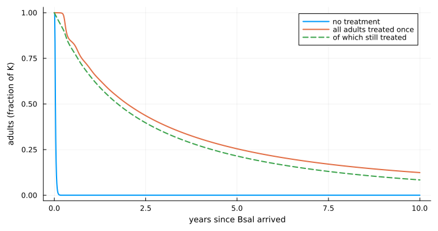

Treated adults survive, but the population still declines: recruits are
born untreated and Bsal is still circulating.

#### Step 2. A larval stage

Salamanders have aquatic larvae. Here they are added as a stage that
Bsal does not infect.

``` julia
clean_larvae = BsalLarvalStage(carry_over = 0.0)
lar(st, tr; kw...) = solve(ProbioticLarvalProblem(p, st, tr; kw...))
u2, t2 = lar(clean_larvae, T()), lar(clean_larvae, block; coverage = 1.0)
step!("Bsal", "host", "+ larval stage, not infected", u2.mean_adults, t2.mean_adults,
    "untreated population no longer vanishes: larvae are a refuge")
```

    (step = 2, untreated = 0.044, treated = 0.336)

``` julia
plot(u1.t, max.(u1.hosts ./ p.K, 1e-12); yscale = :log10, label = "adults only (step 1)",
    xlabel = "years since Bsal arrived", ylabel = "adults (fraction of K), no treatment",
    legend = :bottomright)
plot!(u2.t, u2.adults ./ p.K; label = "with a larval stage (step 2)")
```

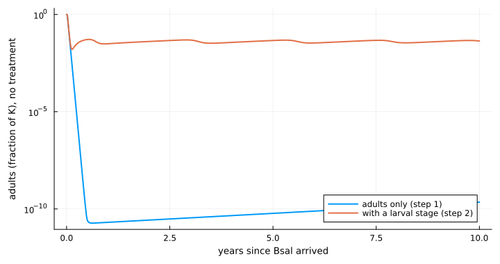

Larvae already in the water metamorphose after the adult epidemic has
burnt out. The near-extinction in the adults-only model was partly a
result of having no other stage.

#### Step 3. Larvae can be infected

Fire salamander larvae can be infected experimentally without showing
disease, and half carried the infection through metamorphosis (Wang et
al. 2021; the count is read from the compendium). The transmission rate
from adults to larvae is illustrative.

``` julia
stage = BsalLarvalStage(:wang2021; adult_to_larva = 5.2)
@printf("carry-over through metamorphosis: %.1f; R0 = %.1f\n", stage.carry_over,
    basic_reproduction_number(p, stage))
u3, t3 = lar(stage, T()), lar(stage, block; coverage = 1.0)
step!("Bsal", "host", "+ larvae infected, carry-over 0.5", u3.mean_adults, t3.mean_adults,
    "small change at this carry-over")
```

    carry-over through metamorphosis: 0.5; R0 = 24.9

    (step = 3, untreated = 0.039, treated = 0.334)

This is the host model used for the rest of Part A.

### Treatment

The reference treatment of step 3 is now made more realistic. Each step
states what changed.

#### Step 4. Protection is lost

A treated animal reverts to untreated, with a half-life of one year.

``` julia
a = lar(stage, T(efficacy = 0.99, half_life = 1.0); coverage = 1.0)
step!("Bsal", "treatment", "+ protection lost, half-life 1 year", u3.mean_adults, a.mean_adults,
    "collapse only delayed")
```

    (step = 4, untreated = 0.039, treated = 0.133)

#### Step 5. The bacteria spread between animals

Treated animals pass the bacteria to others, so protection can reach the
recruits.

``` julia
spread = T(efficacy = 0.99, half_life = 1.0, direct = 50.0)
@printf("microbiome reproduction number %.0f, long-run coverage %.2f\n",
    microbiome_reproduction_number(spread; turnover = p.b), equilibrium_coverage(spread; turnover = p.b))
a = lar(stage, spread; coverage = 1.0)
step!("Bsal", "treatment", "+ bacteria spread between animals", u3.mean_adults, a.mean_adults,
    "full protection: the microbiome maintains itself")
```

    microbiome reproduction number 46, long-run coverage 0.98

    (step = 5, untreated = 0.039, treated = 0.999)

A model stopped here says: **a self-spreading, strongly protective
microbiome works, and nothing else does.**

#### Step 6. What trials show: survival, not fewer infections

In challenge trials, treated animals were infected as often as untreated
ones, but fewer died. The compendium holds the counts from one trial in
*Rana muscosa*:

``` julia
h = parameter_set(:harris2009ismej)
mortality_reduction(h.deaths_treated, h.n_treated, h.deaths_control, h.n_control; rng = Xoshiro(1))
```

    (median = 0.9528399509303813, lower = 0.5571631729768851, upper = 0.9998974605554769)

So the mechanism is changed: treatment reduces disease-induced death
(`tolerance`) and does not block infection. A treated, infected animal
stays infectious. Loss and spread are as in step 5.

``` julia
tolerant = T(tolerance = 0.9, half_life = 1.0, direct = 50.0)
@printf("Bsal reproduction number if everyone is treated: %.0f (untreated %.0f)\n",
    effective_reproduction_number(p, tolerant, 1.0), basic_reproduction_number(p))
a = lar(stage, tolerant; coverage = 1.0)
step!("Bsal", "treatment", "mechanism as in trials: survive, still infected", u3.mean_adults,
    a.mean_adults, "fails; survivors shed for longer, so transmission rises")
```

    Bsal reproduction number if everyone is treated: 232 (untreated 25)

    (step = 6, untreated = 0.039, treated = 0.025)

#### Step 7. Lower load: less death and less shedding

Bacteria that suppress the fungus should lower the load on the animal,
and so reduce shedding as well as death. Both now follow from one
reduction in load: shedding in proportion to load, death in proportion
to load raised to a power `k`.

``` julia
reductions = [0.5, 0.9, 0.99, 0.999]
ks = [0.0, 0.5, 1.0, 2.0]
R = [effective_reproduction_number(p, load_reducing_treatment(ρ; death_exponent = k), 1.0)
     for ρ in reductions, k in ks]
plot(string.(reductions), R; yscale = :log10, marker = :circle, xlabel = "reduction in load",
    ylabel = "Bsal reproduction number, all treated",
    label = permutedims(["k = $k" for k in ks]), legend = :topright)
hline!([1.0]; color = :black, linestyle = :dash, label = "threshold")
```

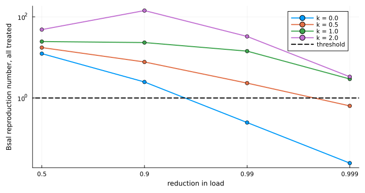

With death proportional to load (`k = 1`) the two effects nearly cancel:
the animal sheds less but for longer.

``` julia
a = lar(stage, load_reducing_treatment(0.99; half_life = 1.0, direct = 50.0); coverage = 1.0)
step!("Bsal", "treatment", "+ lower load (99%): also less shedding", u3.mean_adults, a.mean_adults,
    "partial; survivors remain infected")
```

    (step = 7, untreated = 0.039, treated = 0.189)

#### Step 8. Treat larvae as well

With larvae in the host model they can be treated too. Whether a treated
larva keeps the bacteria through metamorphosis (`retention`) has not
been measured. This step goes back to bacteria that block infection and
last, with no spread, to isolate the effect of the stage.

``` julia
quarterly = 0:0.25:9.75
options = [("adults, once", (;)),
    ("larvae, quarterly; lost at metamorphosis", (treat = :larvae, treat_times = quarterly)),
    ("larvae, quarterly; kept", (treat = :larvae, treat_times = quarterly, retention = 1.0)),
    ("both stages, quarterly; kept", (treat = :both, treat_times = quarterly, retention = 1.0))]
vals = [lar(stage, block; coverage = 1.0, kw...).mean_adults for (_, kw) in options]
bar(vals; orientation = :h, yticks = (1:4, first.(options)), yflip = true, legend = false,
    xlabel = "mean adults (fraction of K)", xlims = (0, 1.05), xticks = 0:0.25:1,
    left_margin = 6Plots.mm, size = (820, 230), color = :steelblue)
```

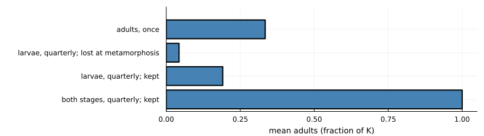

``` julia
step!("Bsal", "treatment", "treat both stages, kept through metamorphosis", u3.mean_adults, vals[4],
    "full protection with no spread at all")
```

    (step = 8, untreated = 0.039, treated = 1.0)

This overturns step 5. Once recruits can be treated before they become
adults, the bacteria do not need to spread.

#### Step 9. How long the bacteria really last

Two open datasets (a field trial in *Rana sierrae*, Knapp et al. 2022,
and a laboratory trial in *Xenopus laevis*, Madison et al. 2025) give
the abundance of applied bacteria over time. Fitting an exponential
decline gives half-lives of 3 to 14 days, and 4 to 5 days in the field.
(The fits are this project’s own.) Protection now wanes with abundance.
`protective_fold` is how far abundance can fall before half the effect
is lost; it has not been measured.

``` julia
days = 0:1:150
plot(xlabel = "days since application", ylabel = "fraction of full protection", legend = :topright)
for F in (10.0, 100.0, 1000.0)
    w = T(efficacy = 0.99, abundance_half_life = 5 / 365, protective_fold = F)
    plot!(days, [protection(w, d / 365) for d in days];
        label = @sprintf("fold %g: half gone after %.0f days", F, 365 * protection_duration(w)))
end
current()
```

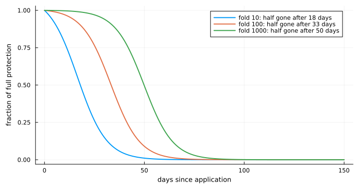

``` julia
waning = T(efficacy = 0.99, abundance_half_life = 5 / 365, protective_fold = 100.0)
a = lar(stage, waning; coverage = 1.0, treat = :both, treat_times = quarterly, retention = 1.0)
monthly = lar(stage, waning; coverage = 1.0, treat = :both, treat_times = 0:(1 / 12):9.95, retention = 1.0)
@printf("dosed monthly instead of quarterly: %.2f\n", monthly.mean_adults)
step!("Bsal", "treatment", "+ measured decay (half-life 5 days)", u3.mean_adults, a.mean_adults,
    "fails: protection lasts about a month")
```

    dosed monthly instead of quarterly: 0.28

    (step = 9, untreated = 0.039, treated = 0.064)

### Part A summary

``` julia
ladder_plot("Bsal", "mean adults over 10 years, fraction of K")
```

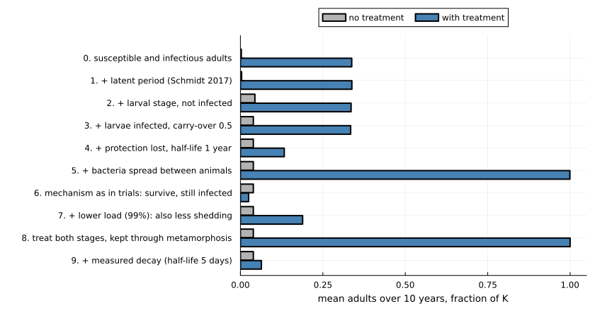

## Part B. Bd in common toads

The outcome in Part B is the **number of adults in years 25 to 35 after
Bd arrives, as a fraction of the number without Bd**. The reference
treatment is: 80% of tadpoles treated at hatching every year with
bacteria that block 90% of infections for the season. The parameter set
is the one behind Figure 2d of Mitchell et al. (2008).

### Host and pathogen

#### Step 0. The pond model

Mitchell’s model is the simplest available for this system, though it is
not as simple as step 0 of Part A: tadpoles are infected by zoospores in
the pond, infected tadpoles are removed at metamorphosis, and juveniles
and adults are never infected.

``` julia
m = MitchellParameters(:mitchell2008; set = "fig2d")
none = PostMetamorphicInfection()
pond(tr; stages = none, kw...) = solve(ProbioticPondProblem(m, tr; stages, kw...))
rel(r) = r.A_mean / r.A_disease_free
ref = T(efficacy = 0.9)

u, t = pond(T()), pond(ref; coverage = 0.8)
@printf("Bd persists: untreated %s, treated %s\n", u.bd_persist, t.bd_persist)
step!("Bd toad", "host", "Mitchell 2008 pond model", rel(u), rel(t),
    "untreated: toads and Bd both die out; treated: toads saved, Bd gone")
```

    Bd persists: untreated false, treated false

    (step = 0, untreated = 0.0, treated = 0.975)

``` julia
series(r) = (r.t[r.t .>= -2], r.A[r.t .>= -2] ./ r.A_disease_free)
plot(series(u)...; label = "no treatment", xlabel = "years since Bd arrived",
    ylabel = "adults (fraction of disease-free)", legend = :right)
plot!(series(t)...; label = "tadpoles treated every year")
```

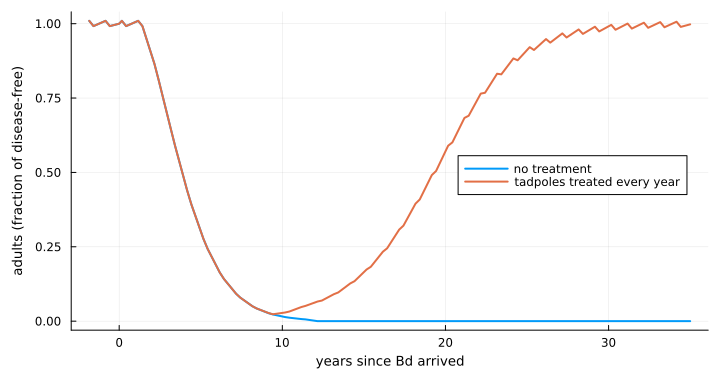

Unlike Bsal, the simplest treatment works here: the infected stage is
short and a new cohort can be treated each year. It does not prevent the
initial crash.

#### Step 1. Infected metamorphs can survive

Experiments show that toadlets exposed to Bd are infected, that most
die, and that some survive (Smith et al. 2022; counts from the
compendium).

``` julia
s = parameter_set(:smith2022)
survival = 1 - s.deaths_exposed / s.n_exposed
@printf("toadlet survival after exposure: %.2f\n", survival)
st1 = PostMetamorphicInfection(metamorph_survival = survival)
u, t = pond(T(); stages = st1), pond(ref; coverage = 0.8, stages = st1)
@printf("Bd persists: untreated %s, treated %s\n", u.bd_persist, t.bd_persist)
step!("Bd toad", "host", "+ infected metamorphs can survive (0.29)", rel(u), rel(t),
    "toads no longer die out, so nor does Bd; treatment now protects poorly")
```

    toadlet survival after exposure: 0.29
    Bd persists: untreated true, treated true

    (step = 1, untreated = 0.046, treated = 0.085)

One added survival probability reverses both outcomes. The published
“both die out” result depended on every infected animal dying; once some
survive, the host persists, Bd persists with it, and blocking 90% of
infections is no longer enough.

#### Step 2. Metamorphs are exposed as they leave the pond

``` julia
st2 = PostMetamorphicInfection(metamorph_survival = survival, metamorph_exposure_days = 7.0)
u, t = pond(T(); stages = st2), pond(ref; coverage = 0.8, stages = st2)
step!("Bd toad", "host", "+ metamorphs exposed for a week on leaving", rel(u), rel(t),
    "little further change")
```

    (step = 2, untreated = 0.046, treated = 0.082)

#### Step 3. Adults carry Bd between years

Breeding adults carry Bd at low prevalence in field surveys. Here adults
are infected while at the pond, shed there, and clear the infection over
about a year. (Treatment is not yet combined with infected adults in the
package, so only the untreated outcome is shown.)

``` julia
st3 = PostMetamorphicInfection(metamorph_survival = survival, metamorph_exposure_days = 7.0,
    adult_exposure_days = 30.0, adult_relative_shedding = 1.0, adult_clearance = 1.0)
r = solve(ToadStageProblem(m, st3))
@printf("Bd persists: %s; adult prevalence after breeding: %.2f\n", r.bd_persist, r.adult_prevalence)
step!("Bd toad", "host", "+ adults carry Bd between years", r.A_mean / r.A_disease_free, NaN,
    "untreated only; little change in this parameter set")
```

    Bd persists: true; adult prevalence after breeding: 0.99

    (step = 3, untreated = 0.044, treated = NaN)

The host model of step 2 is used for the rest of Part B.

### Treatment

#### Step 4. Protection is lost

``` julia
u = pond(T(); stages = st2)
a = pond(T(efficacy = 0.9, half_life = 0.05); coverage = 0.8, stages = st2)
step!("Bd toad", "treatment", "+ protection lost, half-life 18 days", rel(u), rel(a), "slightly worse")
```

    (step = 4, untreated = 0.046, treated = 0.056)

#### Step 5. Mechanism as in trials: survival, not fewer infections

``` julia
effs, tols = [0.5, 0.9, 0.99], [0.3, 0.7, 1.0]
blocking = [rel(pond(T(efficacy = e); coverage = 0.8, stages = st2)) for e in effs]
tolerating = [rel(pond(T(tolerance = τ); coverage = 0.8, stages = st2)) for τ in tols]
plot(["weak", "medium", "strong"], blocking; marker = :circle,
    label = "blocks infection (0.5, 0.9, 0.99)", xlabel = "strength of treatment",
    ylabel = "adults (fraction of disease-free)", ylims = (0, 1), legend = :topleft)
plot!(["weak", "medium", "strong"], tolerating; marker = :square,
    label = "survives infection (0.3, 0.7, 1.0)")
```

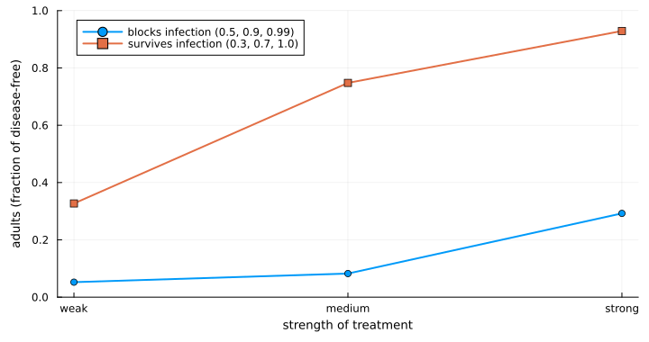

``` julia
a = pond(T(tolerance = 0.7); coverage = 0.8, stages = st2)
step!("Bd toad", "treatment", "mechanism as in trials: survive, still infected", rel(u), rel(a),
    "much better than blocking here; Bd persists")
```

    (step = 5, untreated = 0.046, treated = 0.748)

For Bsal the observed mechanism made treatment fail. Here it makes
treatment work better, because Bd is going to persist anyway and what
matters is how many infected animals live.

#### Step 6. Lower load

``` julia
a = pond(load_reducing_treatment(0.7); coverage = 0.8, stages = st2)
step!("Bd toad", "treatment", "+ lower load (70%): also less shedding", rel(u), rel(a),
    "little changed: untreated tadpoles and the pond keep Bd going")
```

    (step = 6, untreated = 0.046, treated = 0.751)

#### Step 7. How long the bacteria really last

With the measured decay, one dose at hatching wanes during the 95-day
tadpole season.

``` julia
waning_t = T(tolerance = 0.7, abundance_half_life = 5 / 365, protective_fold = 100.0)
schedules = [("at hatching only", Float64[]), ("+ day 45", [45.0]), ("+ days 30, 60", [30.0, 60.0]),
    ("+ days 20, 40, 60, 80", [20.0, 40.0, 60.0, 80.0])]
doses = [rel(pond(waning_t; coverage = 0.8, stages = st2, redose_days = d)) for (_, d) in schedules]
bar(doses; orientation = :h, yticks = (1:4, first.(schedules)), yflip = true, legend = false,
    xlabel = "adults (fraction of disease-free)", xlims = (0, 1.05), xticks = 0:0.25:1,
    left_margin = 6Plots.mm, size = (820, 230), color = :steelblue)
```

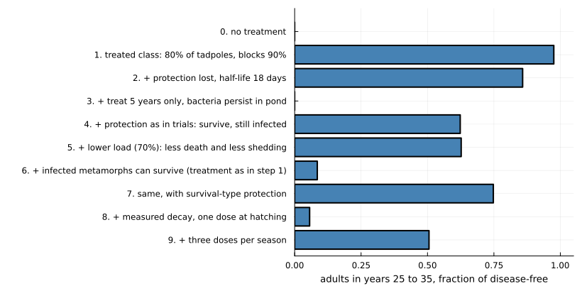

``` julia
step!("Bd toad", "treatment", "+ measured decay, one dose at hatching", rel(u), doses[1],
    "protection gone before the season ends")
```

    (step = 7, untreated = 0.046, treated = 0.056)

#### Step 8. Several doses in a season

``` julia
step!("Bd toad", "treatment", "+ five doses per season", rel(u), doses[4], "most of the benefit restored")
```

    (step = 8, untreated = 0.046, treated = 0.804)

### Part B summary

``` julia
ladder_plot("Bd toad", "adults in years 25 to 35, fraction of disease-free")
```

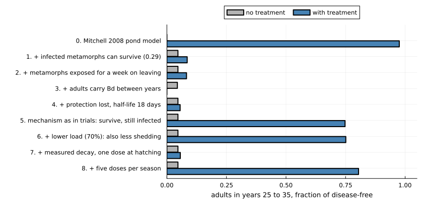

## Part C. Bd in frogs

The outcome in Part C is the **fraction of 80 frogs sharing one pool
that are alive after two years**. Disease here depends on the fungal
load on each frog. The reference treatment is introduced at step 2.

### Host and pathogen

#### Step 0. Load on each frog

In the model of Briggs et al. (2010) each frog carries a load of
sporangia. Sporangia release zoospores into a shared pool, zoospores
infect frogs, and a frog dies when its load reaches a lethal level.
Loads run away when there are enough frogs to keep the pool topped up.

``` julia
pb = BriggsParameters(:briggs2010)
N, hsat, ε = 80, 500.0, 1000.0
tipping(c; n = N) = solve(LoadTippingProblem(pb; c, h = hsat, N = n, ε, tspan = (0.0, 730.0)))
alive(r) = count(r.alive) / length(r.alive)

@printf("frogs needed for loads to run away: %.0f\n", host_density_threshold(pb))
r0 = tipping(0.0)
step!("Bd frog", "host", "Briggs 2010 load model", alive(r0), NaN, "all die: 80 frogs is above the threshold of 23")
```

    frogs needed for loads to run away: 23

    (step = 0, untreated = 0.0, treated = NaN)

#### Step 1. Frogs clear some of their load

Frogs have defences. Here each frog removes sporangia at a rate that
saturates as load rises: defences cope with a light infection and are
overwhelmed by a heavy one (this package’s load tipping model; the
clearance values are illustrative).

``` julia
c = 100.0
@printf("frogs needed for loads to run away: %d\n", critical_host_number(pb; c, h = hsat, ε))
r1 = tipping(c)
r1small = tipping(c; n = 50)
@printf("alive after two years: %.2f of 80 frogs, %.2f of 50 frogs\n", alive(r1), alive(r1small))
step!("Bd frog", "host", "+ saturating clearance by the frog", alive(r1), NaN,
    "threshold rises from 23 to 68 frogs; 80 still all die")
```

    frogs needed for loads to run away: 68
    alive after two years: 0.00 of 80 frogs, 1.00 of 50 frogs

    (step = 1, untreated = 0.0, treated = NaN)

#### Step 2. Frogs differ

Frogs now differ in how strong their defences are (lognormal, same
median). The reference treatment for Part C starts here: 40% of frogs
carry bacteria that triple their clearance, for life.

``` julia
cs = quantile.(LogNormal(log(c), 0.5), ((1:N) .- 0.5) ./ N)
r2 = tipping(cs)
frogs(tr; kw...) = solve(ProbioticLoadProblem(pb, tr; c, c_treated = 3c, h = hsat, N, ε, days = 730, kw...);
    rng = Xoshiro(1))
ref_c = frogs(T(); coverage = 0.4)
step!("Bd frog", "host", "+ frogs differ in their defences", alive(r2), NaN,
    "a few of the best-defended survive")
```

    (step = 2, untreated = 0.062, treated = NaN)

With identical frogs a die-off is all or nothing; with differences it is
partial, and it stops when too few frogs are left to sustain the pool.
The treatment steps use identical frogs (step 1), because treatment and
host differences are not yet combined in the package.

### Treatment

#### Step 3. A treated class

``` julia
step!("Bd frog", "treatment", "treated class: 40% of frogs, lasts for life", alive(r1),
    ref_c.alive[end] / N, "all survive, including the untreated: protection is shared")
```

    (step = 3, untreated = 0.0, treated = 1.0)

Because disease depends on the shared pool, treating 40% protects
everyone.

#### Step 4. Protection is lost

``` julia
a = frogs(T(half_life = 30.0); coverage = 1.0)
@printf("first death: day %d (untreated: day %d)\n", minimum(filter(>(0), a.death_day)),
    ceil(Int, minimum(r1.death_time)))
step!("Bd frog", "treatment", "+ protection lost, half-life 30 days", alive(r1), a.alive[end] / N,
    "die-off delayed by about three months, not prevented")
```

    first death: day 241 (untreated: day 156)

    (step = 4, untreated = 0.0, treated = 0.0)

#### Step 5. Bacteria as a state of each frog

Until now every treated animal has been simply “treated”. Each frog now
carries its own abundance of the applied bacteria. It declines at the
measured rate (half-life 5 days), and frogs exchange bacteria through
the pond. Exchange moves bacteria between frogs without creating any, so
they spread but do not sustain themselves. That is what the field trial
showed: eleven days after most frogs in a pond were bathed, frogs that
were never bathed carried about 0.63 times as much of the bacterium as
bathed ones, and it then declined in both.

``` julia
baths(; x = 0.1, F = 100.0, coverage = 0.75, dose_days = [0], days = 730) =
    solve(ProbioticAbundanceProblem(pb, T(abundance_half_life = 5.0, protective_fold = F, direct = x);
        c, c_treated = 3c, h = hsat, N, ε, coverage, dose_days, days))
for x in (0.0, 0.1, 1.0)
    r = baths(; x, days = 30)
    @printf("exchange %.1f per day: unbathed/bathed abundance on day 11 = %.2f\n", x,
        r.abundance_unbathed[12] / r.abundance_bathed[12])
end
```

    exchange 0.0 per day: unbathed/bathed abundance on day 11 = 0.00
    exchange 0.1 per day: unbathed/bathed abundance on day 11 = 0.60
    exchange 1.0 per day: unbathed/bathed abundance on day 11 = 1.00

An exchange rate of about 0.1 per day reproduces the field ratio and is
used below.

``` julia
one = baths()
step!("Bd frog", "treatment", "+ bacteria on each frog, measured decay; one bath", alive(r1),
    one.alive[end] / N, "die-off delayed by about six weeks")
```

    (step = 5, untreated = 0.0, treated = 0.0)

#### Step 6. Repeated baths

``` julia
untreated, every90 = baths(coverage = 0.0), baths(dose_days = 0:90:729)
plot(untreated.t, max.(untreated.mean_load, 1.0); yscale = :log10, label = "no treatment",
    xlabel = "days", ylabel = "mean Bd load per live frog", legend = :bottomright, xlims = (0, 730))
plot!(one.t, max.(one.mean_load, 1.0); label = "one bath on day 0")
plot!(every90.t, max.(every90.mean_load, 1.0); label = "a bath every 90 days")
hline!([pb.Smax]; color = :black, linestyle = :dash, label = "lethal load")
```

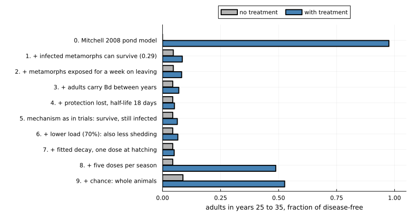

``` julia
first_death(r) = any(>(0), r.death_day) ? minimum(filter(>(0), r.death_day)) : 0
println("| Baths | Alive after 2 years (of 80) | First death (day) |")
println("|---|---|---|")
for (label, r) in (("none", untreated), ("one, day 0", one), ("every 240 days", baths(dose_days = 0:240:729)),
        ("every 150 days", baths(dose_days = 0:150:729)), ("every 90 days", every90),
        ("every 90 days, 10% of frogs", baths(coverage = 0.1, dose_days = 0:90:729)),
        ("every 90 days, 10% of frogs, no exchange", baths(coverage = 0.1, x = 0.0, dose_days = 0:90:729)),
        ("one, day 150 (loads already high)", baths(dose_days = [150])))
    @printf("| %s | %d | %s |\n", label, r.alive[end], first_death(r) == 0 ? "none" : string(first_death(r)))
end
```

| Baths | Alive after 2 years (of 80) | First death (day) |
|----|----|----|
| none | 0 | 156 |
| one, day 0 | 0 | 195 |
| every 240 days | 0 | 195 |
| every 150 days | 80 | none |
| every 90 days | 80 | none |
| every 90 days, 10% of frogs | 80 | none |
| every 90 days, 10% of frogs, no exchange | 8 | 184 |
| one, day 150 (loads already high) | 0 | 157 |

``` julia
step!("Bd frog", "treatment", "+ a bath every 90 days", alive(r1), every90.alive[end] / N,
    "all survive: each bath resets the slow build-up of load")
```

    (step = 6, untreated = 0.0, treated = 1.0)

This is the one system where bacteria that last only weeks could still
work. Load takes months to build; a short burst of extra clearance
knocks it back, and the build-up starts again. Because frogs exchange
bacteria, bathing a small part of the population protects the rest.

Two cautions. The slow build-up is for a population that starts clean.
In the field trial the pond was in the middle of an outbreak, treated
frogs were surrounded by heavily infected ones, and their loads were
back within two months; the last row of the table is the model’s version
of treating too late. And the size of the clearance effect of the
bacteria is assumed, not measured.

### Part C summary

``` julia
ladder_plot("Bd frog", "fraction of 80 frogs alive after 2 years")
```

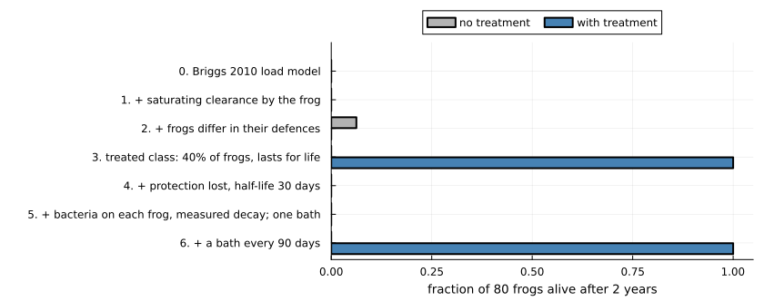

## How much did each step move the answer?

The change in the treated outcome at each step, for each system. Bars to
the right are steps that made treatment look better; bars to the left,
worse.

``` julia
function change_plot(system)
    rows = filter(r -> r.system == system && !isnan(r.treated), ladder)
    d = [rows[i].treated - rows[i - 1].treated for i in 2:length(rows)]
    labels = ["$(rows[i].n). $(rows[i].added)" for i in 2:length(rows)]
    bar(d; orientation = :h, yticks = (1:length(d), labels), yflip = true, legend = false,
        xlims = (-1.05, 1.05), xlabel = "change in treated outcome", title = system,
        color = [x >= 0 ? :seagreen : :indianred for x in d], left_margin = 6Plots.mm,
        size = (840, 70 + 34 * length(d)))
    vline!([0.0]; color = :black)
end
change_plot("Bsal")
```

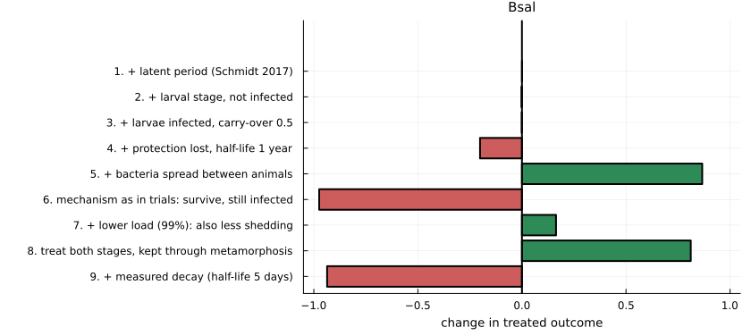

``` julia
change_plot("Bd toad")
```

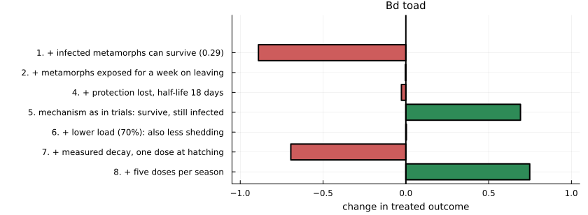

``` julia
change_plot("Bd frog")
```

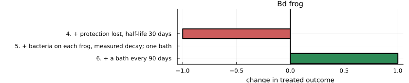

Large bars point both ways in every system. No single addition
dominates, and the sign of a step depends on the system: the observed
mechanism (survive, still infected) is the largest negative step for
Bsal and a large positive step for toads.

## Does the effect of one piece of realism depend on the others?

A ladder adds things in one order. To check that the order is not
driving the conclusions, four pieces of treatment realism are switched
on and off in every combination for Bsal, on the full host model of step
3:

- **mechanism**: blocks infection (0.99), or survive but stay infected
  (0.99);
- **duration**: lasts for life, or measured decay (half-life 5 days);
- **spread**: none, or between animals at 50 per year;
- **stages**: adults once, or both stages every quarter with the
  bacteria kept through metamorphosis.

``` julia
levels = (
    mechanism = ["blocks", "survive"],
    duration = ["lasting", "decays"],
    spread = ["none", "spreads"],
    stages = ["adults", "both"],
)
function factorial_run(mech, dur, spr, stg)
    tr = T(; (mech == "blocks" ? (efficacy = 0.99,) : (tolerance = 0.99,))...,
        (dur == "decays" ? (abundance_half_life = 5 / 365, protective_fold = 100.0) : (;))...,
        direct = spr == "spreads" ? 50.0 : 0.0)
    kw = stg == "both" ? (treat = :both, treat_times = quarterly, retention = 1.0) : (;)
    return lar(stage, tr; coverage = 1.0, kw...).mean_adults
end
design = [(; mech, dur, spr, stg, outcome = factorial_run(mech, dur, spr, stg))
          for mech in levels.mechanism, dur in levels.duration, spr in levels.spread, stg in levels.stages]
design = sort(vec(design); by = r -> -r.outcome)
nothing
```

``` julia
println("| Mechanism | Duration | Spread | Stages treated | Mean adults |")
println("|---|---|---|---|---|")
for r in design
    @printf("| %s | %s | %s | %s | %.2f |\n", r.mech, r.dur, r.spr, r.stg, r.outcome)
end
```

| Mechanism | Duration | Spread  | Stages treated | Mean adults |
|-----------|----------|---------|----------------|-------------|
| blocks    | lasting  | spreads | both           | 1.00        |
| blocks    | lasting  | none    | both           | 1.00        |
| blocks    | lasting  | spreads | adults         | 1.00        |
| blocks    | lasting  | none    | adults         | 0.33        |
| survive   | lasting  | spreads | both           | 0.27        |
| survive   | lasting  | none    | both           | 0.22        |
| survive   | lasting  | spreads | adults         | 0.20        |
| survive   | lasting  | none    | adults         | 0.13        |
| blocks    | decays   | spreads | both           | 0.07        |
| blocks    | decays   | none    | both           | 0.06        |
| blocks    | decays   | spreads | adults         | 0.05        |
| blocks    | decays   | none    | adults         | 0.05        |
| survive   | decays   | spreads | adults         | 0.04        |
| survive   | decays   | none    | adults         | 0.04        |
| survive   | decays   | none    | both           | 0.03        |
| survive   | decays   | spreads | both           | 0.03        |

The average effect of switching each piece on, and how much that effect
varies with the other three:

``` julia
function effect(field, on)
    diffs = Float64[]
    for r in design
        getfield(r, field) == on || continue
        partner = only(filter(q -> all(getfield(q, f) == getfield(r, f) for f in (:mech, :dur, :spr, :stg) if f != field) &&
            getfield(q, field) != on, design))
        push!(diffs, r.outcome - partner.outcome)
    end
    return diffs
end
println("| Switched on | Mean change | Smallest | Largest |")
println("|---|---|---|---|")
for (field, on, label) in ((:mech, "survive", "survive instead of block"), (:dur, "decays", "measured decay"),
        (:spr, "spreads", "spread between animals"), (:stg, "both", "treat both stages"))
    d = effect(field, on)
    @printf("| %s | %+.2f | %+.2f | %+.2f |\n", label, sum(d) / length(d), minimum(d), maximum(d))
end
```

| Switched on              | Mean change | Smallest | Largest |
|--------------------------|-------------|----------|---------|
| survive instead of block | -0.32       | -0.80    | -0.00   |
| measured decay           | -0.47       | -0.95    | -0.09   |
| spread between animals   | +0.10       | -0.00    | +0.67   |
| treat both stages        | +0.10       | -0.01    | +0.67   |

The ranges are wide: the effect of each piece depends strongly on the
others. Spread, for example, matters a great deal for a lasting,
infection-blocking treatment given to adults, and hardly at all once the
bacteria decay in days. (In the model, animals that acquire bacteria
from others share the dosing clock of the treated ones, so spread cannot
outlast the decay.) A piece of realism therefore cannot be judged by
adding it to a simple model alone.

## All steps

``` julia
fmt(x) = isnan(x) ? "" : @sprintf("%.2f", x)
println("| System | Step | Phase | Added | No treatment | With treatment | What changed |")
println("|---|---|---|---|---|---|---|")
for r in ladder
    println("| ", join((r.system, r.n, r.phase, r.added, fmt(r.untreated), fmt(r.treated), r.note), " | "), " |")
end
```

| System | Step | Phase | Added | No treatment | With treatment | What changed |
|----|----|----|----|----|----|----|
| Bsal | 0 | host | susceptible and infectious adults | 0.00 | 0.34 | collapse; treated adults live but are not replaced |
| Bsal | 1 | host | \+ latent period (Schmidt 2017) | 0.00 | 0.34 | almost no change: a one-day delay against a one-week illness |
| Bsal | 2 | host | \+ larval stage, not infected | 0.04 | 0.34 | untreated population no longer vanishes: larvae are a refuge |
| Bsal | 3 | host | \+ larvae infected, carry-over 0.5 | 0.04 | 0.33 | small change at this carry-over |
| Bsal | 4 | treatment | \+ protection lost, half-life 1 year | 0.04 | 0.13 | collapse only delayed |
| Bsal | 5 | treatment | \+ bacteria spread between animals | 0.04 | 1.00 | full protection: the microbiome maintains itself |
| Bsal | 6 | treatment | mechanism as in trials: survive, still infected | 0.04 | 0.02 | fails; survivors shed for longer, so transmission rises |
| Bsal | 7 | treatment | \+ lower load (99%): also less shedding | 0.04 | 0.19 | partial; survivors remain infected |
| Bsal | 8 | treatment | treat both stages, kept through metamorphosis | 0.04 | 1.00 | full protection with no spread at all |
| Bsal | 9 | treatment | \+ measured decay (half-life 5 days) | 0.04 | 0.06 | fails: protection lasts about a month |
| Bd toad | 0 | host | Mitchell 2008 pond model | 0.00 | 0.98 | untreated: toads and Bd both die out; treated: toads saved, Bd gone |
| Bd toad | 1 | host | \+ infected metamorphs can survive (0.29) | 0.05 | 0.09 | toads no longer die out, so nor does Bd; treatment now protects poorly |
| Bd toad | 2 | host | \+ metamorphs exposed for a week on leaving | 0.05 | 0.08 | little further change |
| Bd toad | 3 | host | \+ adults carry Bd between years | 0.04 |  | untreated only; little change in this parameter set |
| Bd toad | 4 | treatment | \+ protection lost, half-life 18 days | 0.05 | 0.06 | slightly worse |
| Bd toad | 5 | treatment | mechanism as in trials: survive, still infected | 0.05 | 0.75 | much better than blocking here; Bd persists |
| Bd toad | 6 | treatment | \+ lower load (70%): also less shedding | 0.05 | 0.75 | little changed: untreated tadpoles and the pond keep Bd going |
| Bd toad | 7 | treatment | \+ measured decay, one dose at hatching | 0.05 | 0.06 | protection gone before the season ends |
| Bd toad | 8 | treatment | \+ five doses per season | 0.05 | 0.80 | most of the benefit restored |
| Bd frog | 0 | host | Briggs 2010 load model | 0.00 |  | all die: 80 frogs is above the threshold of 23 |
| Bd frog | 1 | host | \+ saturating clearance by the frog | 0.00 |  | threshold rises from 23 to 68 frogs; 80 still all die |
| Bd frog | 2 | host | \+ frogs differ in their defences | 0.06 |  | a few of the best-defended survive |
| Bd frog | 3 | treatment | treated class: 40% of frogs, lasts for life | 0.00 | 1.00 | all survive, including the untreated: protection is shared |
| Bd frog | 4 | treatment | \+ protection lost, half-life 30 days | 0.00 | 0.00 | die-off delayed by about three months, not prevented |
| Bd frog | 5 | treatment | \+ bacteria on each frog, measured decay; one bath | 0.00 | 0.00 | die-off delayed by about six weeks |
| Bd frog | 6 | treatment | \+ a bath every 90 days | 0.00 | 1.00 | all survive: each bath resets the slow build-up of load |

## What the exercise shows

1.  **The answer changed at almost every step, and reversed more than
    once.** For Bsal, a model stopped at step 5 says a self-spreading
    microbiome is essential; at step 8, that spread is unnecessary; at
    step 9, that neither is achievable with bacteria that last a few
    weeks.
2.  **Host biology moved the answer as much as treatment biology.** A
    larval stage changed the untreated fate of the salamanders. One
    survival probability for infected toad metamorphs reversed both the
    untreated outcome and the value of the reference treatment.
3.  **How protection works matters more than how strong it is, and its
    effect has no fixed sign.** Letting animals survive infection is the
    worst change for Bsal and one of the best for toads.
4.  **Effects interact.** The factorial shows that the value of spread,
    of treating larvae or of a lasting treatment each depends on the
    other pieces.
5.  **The systems differ for structural reasons.** A toad cohort passes
    through a short infected stage once a year and can be re-treated. A
    salamander must be protected for life against a pathogen that kills
    in a week. In frogs, where disease follows a load that builds
    slowly, short-lived bacteria can still work if they are re-applied.

## What is not in the models

- In Parts A and B bacterial abundance is a clock since the last dose,
  not a state of each animal. Only the frog model of Part C tracks it
  per animal.
- The fold-drop in abundance at which protection is lost has not been
  measured, nor has the effect of the bacteria on clearance, nor whether
  applied bacteria survive metamorphosis.
- The Bsal model has no recovery from infection and no years between
  metamorphosis and maturity. The toad model has thresholds standing in
  for extinction, and infected adult toads are not yet combined with
  treatment. The frog treatment steps use identical frogs.
- The three systems do not share one model structure, so Part B starts
  from a more complex model than Part A.
- Everything is deterministic except the choice of which frogs are
  treated in Part C.

## References

- Briggs CJ et al. (2010) PNAS 107:9695–9700.
  doi:10.1073/pnas.0912886107
- Harris RN et al. (2009) ISME J 3:818–824. doi:10.1038/ismej.2009.27
- Knapp RA et al. (2022) PeerJ 10:e12712. doi:10.7717/peerj.12712
- Madison JD et al. (2025) Infect Immun 93:e00569-24.
  doi:10.1128/iai.00569-24
- Mitchell KM et al. (2008) Proc R Soc B 275:329–334.
  doi:10.1098/rspb.2007.1356
- Schmidt BR et al. (2017) R Soc Open Sci 4:160801.
  doi:10.1098/rsos.160801
- Smith D et al. (2022) J Evol Biol 35:589–598. doi:10.1111/jeb.13987
- Wang Y et al. (2021) Nat Commun 12:5788.
  doi:10.1038/s41467-021-26127-9
