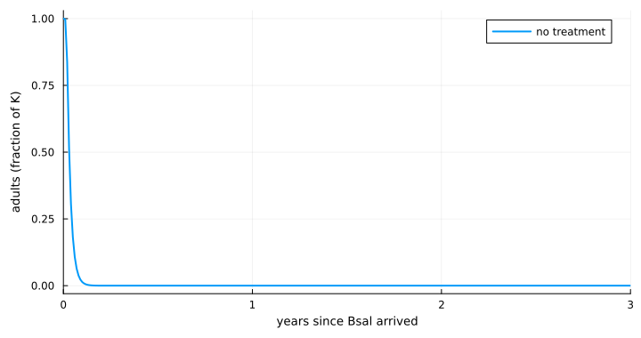
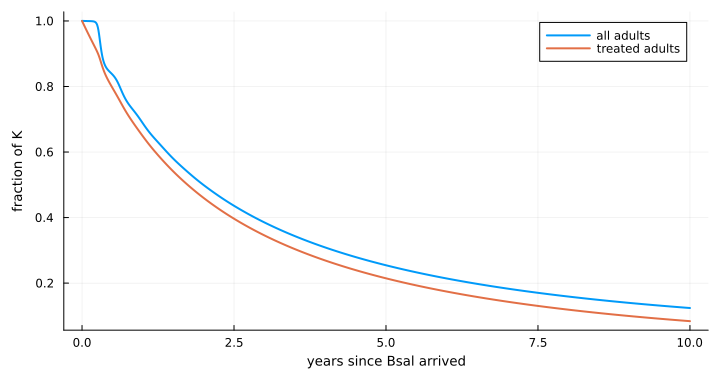
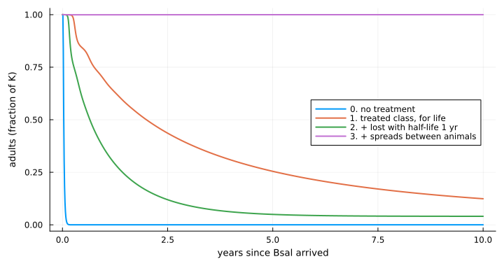
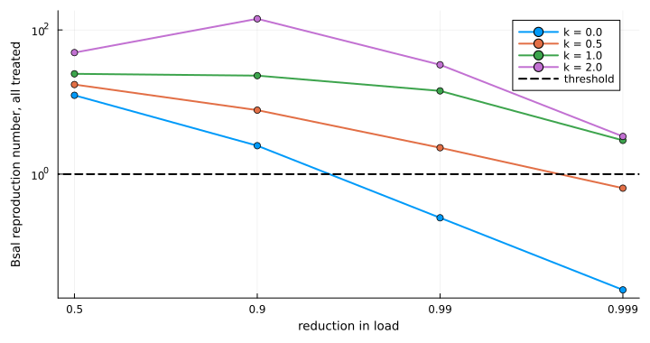
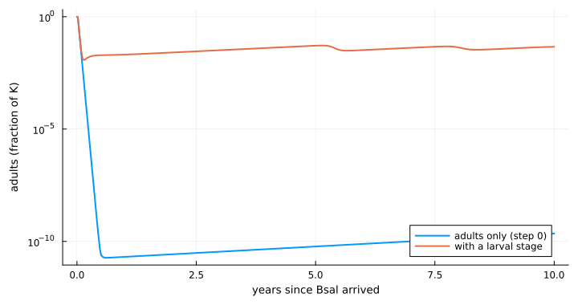
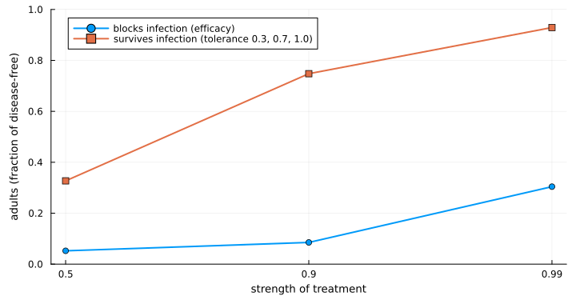

# Does a protective skin microbiome save the population?


- [The question](#the-question)
- [Part A. Bsal in fire salamanders](#part-a-bsal-in-fire-salamanders)
  - [Step 0. The host and the
    pathogen](#step-0-the-host-and-the-pathogen)
  - [Step 1. A treated class](#step-1-a-treated-class)
  - [Step 2. Protection is lost](#step-2-protection-is-lost)
  - [Step 3. The microbiome spreads between
    animals](#step-3-the-microbiome-spreads-between-animals)
  - [Step 4. What trials actually show: survival, not fewer
    infections](#step-4-what-trials-actually-show-survival-not-fewer-infections)
  - [Step 5. Lower pathogen load: less death and less
    shedding](#step-5-lower-pathogen-load-less-death-and-less-shedding)
  - [Step 6. Larvae](#step-6-larvae)
  - [Step 7. Treat the right stage](#step-7-treat-the-right-stage)
  - [Step 8. How long the bacteria really
    last](#step-8-how-long-the-bacteria-really-last)
  - [Part A summary](#part-a-summary)
- [Part B. Bd in common toads](#part-b-bd-in-common-toads)
  - [Step 0. The host and the
    pathogen](#step-0-the-host-and-the-pathogen-1)
  - [Step 1. A treated class](#step-1-a-treated-class-1)
  - [Step 2. Protection is lost](#step-2-protection-is-lost-1)
  - [Step 3. Stop treating and rely on
    spread](#step-3-stop-treating-and-rely-on-spread)
  - [Step 4. Survival, not fewer
    infections](#step-4-survival-not-fewer-infections)
  - [Step 5. Lower load](#step-5-lower-load)
  - [Step 6. Infection after
    metamorphosis](#step-6-infection-after-metamorphosis)
  - [Step 8. How long the bacteria really
    last](#step-8-how-long-the-bacteria-really-last-1)
  - [Part B summary](#part-b-summary)
- [What each piece of realism did](#what-each-piece-of-realism-did)
- [What is not in the model](#what-is-not-in-the-model)
- [References](#references)

## The question

Amphibians can be treated with skin bacteria that inhibit the chytrid
fungi *Batrachochytrium dendrobatidis* (Bd) and *B. salamandrivorans*
(Bsal). Would that protect a population?

This vignette answers the question several times over. It starts from
the simplest possible description of treatment and adds one piece of
biology at each step. After every step it asks the same question again,
so that the effect of each added piece of realism can be seen.

Two systems are followed in parallel:

- **Bsal in fire salamanders**, starting from the model of Schmidt et
  al. (2017);
- **Bd in common toads**, starting from the model of Mitchell et
  al. (2008).

> [!IMPORTANT]
>
> The two starting models are published and are reproduced here from
> their papers. Everything added to them is new work in this package and
> **is not a published result**. Values taken from experiments are read
> from the package’s parameter compendium and are named where they are
> used. All other added values (efficacy, coverage, spread, exposure
> windows) are illustrative: they show what the model does, not what a
> real treatment would achieve.

``` julia
using Chytridiomycosis, Plots, Printf
default(linewidth = 2, size = (720, 380), legendfontsize = 8, guidefontsize = 9,
    titlefontsize = 10, left_margin = 4Plots.mm, bottom_margin = 4Plots.mm)

T(; kw...) = MicrobiomeTreatment(; kw...)

# One row per step, filled in as we go and shown as a table at the end.
ladder = NamedTuple[]
step!(system, n, added, outcome, note) = push!(ladder, (; system, n, added, outcome, note))

function ladder_plot(system, xlabel)
    rows = filter(r -> r.system == system, ladder)
    labels = ["$(r.n). $(r.added)" for r in rows]
    bar([r.outcome for r in rows]; orientation = :h, yticks = (1:length(rows), labels),
        yflip = true, legend = false, xlabel, xlims = (0, 1.05), xticks = 0:0.25:1,
        size = (820, 70 + 34 * length(rows)), left_margin = 6Plots.mm, color = :steelblue)
end
```

    ladder_plot (generic function with 1 method)

## Part A. Bsal in fire salamanders

The outcome throughout Part A is the **mean number of adults over the
ten years after Bsal arrives, as a fraction of carrying capacity**. A
value of 1 means the population was untouched.

### Step 0. The host and the pathogen

Schmidt et al. (2017) describe adult female salamanders as susceptible,
latent or infectious. Infectious animals die within about a week.

``` julia
p = SchmidtParameters(:schmidt2017)
@printf("R0 = %.1f\n", basic_reproduction_number(p))

sli(tr; kw...) = solve(ProbioticSLIProblem(p, tr; kw...))
a0 = sli(T())
step!("Bsal", 0, "no treatment", a0.mean_hosts, "population collapses within a year")
plot(a0.t, a0.hosts ./ p.K; xlabel = "years since Bsal arrived", ylabel = "adults (fraction of K)",
    label = "no treatment", xlims = (0, 3))
```

    R0 = 24.8



With a reproduction number near 25 the population collapses.

### Step 1. A treated class

The simplest description of treatment: an animal is either treated or
not, and a treated animal is infected less often. Every adult is treated
once, on the day Bsal arrives, with a treatment that blocks 99% of
infections and lasts for life.

``` julia
block = T(efficacy = 0.99)
@printf("coverage needed to stop Bsal invading: %.2f\n", critical_coverage(p, block))
a1 = sli(block; coverage = 1.0)
step!("Bsal", 1, "treated class: blocks 99% of infection, for life", a1.mean_hosts,
    "treated adults are safe; their offspring are not")
plot(a1.t, [a1.hosts a1.treated] ./ p.K; label = ["all adults" "treated adults"],
    xlabel = "years since Bsal arrived", ylabel = "fraction of K")
```

    coverage needed to stop Bsal invading: 0.97



The treated adults survive, but the population still declines. Recruits
are born untreated and Bsal is still circulating, so each generation of
treated animals is replaced by unprotected ones.

### Step 2. Protection is lost

Applied bacteria do not stay for life. Here a treated animal reverts to
untreated with a half-life of one year.

``` julia
a2 = sli(T(efficacy = 0.99, half_life = 1.0); coverage = 1.0)
step!("Bsal", 2, "+ protection lost, half-life 1 year", a2.mean_hosts, "collapse is only delayed")
a2.mean_hosts
```

    0.13396963041084453

### Step 3. The microbiome spreads between animals

If treated animals pass the bacteria to others, protection can reach the
recruits. The microbiome then has its own reproduction number: the
number of animals one treated animal passes it to before losing it.

``` julia
spread = T(efficacy = 0.99, half_life = 1.0, direct = 50.0)
@printf("microbiome reproduction number %.0f, long-run coverage %.2f\n",
    microbiome_reproduction_number(spread; turnover = p.b), equilibrium_coverage(spread; turnover = p.b))
a3 = sli(spread; coverage = 1.0)
step!("Bsal", 3, "+ microbiome spreads between animals", a3.mean_hosts,
    "full protection: the microbiome maintains itself")
plot(a0.t, a0.hosts ./ p.K; label = "0. no treatment", xlabel = "years since Bsal arrived",
    ylabel = "adults (fraction of K)", legend = :right)
plot!(a1.t, a1.hosts ./ p.K; label = "1. treated class, for life")
plot!(a2.t, a2.hosts ./ p.K; label = "2. + lost with half-life 1 yr")
plot!(a3.t, a3.hosts ./ p.K; label = "3. + spreads between animals")
```

    microbiome reproduction number 46, long-run coverage 0.98



At this level of realism the conclusion would be: **a self-spreading,
strongly protective microbiome works, and nothing else does.**

### Step 4. What trials actually show: survival, not fewer infections

In challenge trials, treated animals were infected as often as untreated
ones, but fewer died. In one trial of *Rana muscosa*, the compendium
records these counts:

``` julia
h = parameter_set(:harris2009ismej)
mortality_reduction(h.deaths_treated, h.n_treated, h.deaths_control, h.n_control)
```

    (median = 0.9538243805732652, lower = 0.5503655143974926, upper = 0.9999082328698974)

So the treated class is changed: instead of blocking infection,
treatment reduces disease-induced death (`tolerance`). A treated,
infected animal stays infectious.

``` julia
tolerant = T(tolerance = 0.9, half_life = 1.0, direct = 50.0)
@printf("Bsal reproduction number if everyone is treated: %.0f (untreated %.0f)\n",
    effective_reproduction_number(p, tolerant, 1.0), basic_reproduction_number(p))
a4 = sli(tolerant; coverage = 1.0)
step!("Bsal", 4, "+ protection as in trials: survive, still infected", a4.mean_hosts,
    "fails, and raises transmission: survivors shed for longer")
a4.mean_hosts
```

    Bsal reproduction number if everyone is treated: 232 (untreated 25)

    0.020566192434802892

The same spreading microbiome now fails. Animals that survive infection
shed for longer, so Bsal’s reproduction number goes up, not down.

### Step 5. Lower pathogen load: less death and less shedding

A microbiome that suppresses the fungus should lower the load on the
animal. Lower load means less shedding as well as less death. Here both
follow from one reduction in load: shedding in proportion to load, death
in proportion to load raised to a power `k`.

``` julia
reductions = [0.5, 0.9, 0.99, 0.999]
ks = [0.0, 0.5, 1.0, 2.0]
R = [effective_reproduction_number(p, load_reducing_treatment(ρ; death_exponent = k), 1.0)
     for ρ in reductions, k in ks]
plot(string.(reductions), R; yscale = :log10, marker = :circle, xlabel = "reduction in load",
    ylabel = "Bsal reproduction number, all treated",
    label = permutedims(["k = $k" for k in ks]), legend = :topright)
hline!([1.0]; color = :black, linestyle = :dash, label = "threshold")
```



With death proportional to load (`k = 1`) the two effects nearly cancel:
the animal sheds less but for longer. Only a very large reduction brings
the reproduction number below 1.

``` julia
a5 = sli(load_reducing_treatment(0.99; half_life = 1.0, direct = 50.0); coverage = 1.0)
step!("Bsal", 5, "+ lower load (99%): less death and less shedding", a5.mean_hosts,
    "partial; survivors remain infected")
(mean_adults = a5.mean_hosts, final_prevalence = a5.final_prevalence)
```

    (mean_adults = 0.17958281415555719, final_prevalence = 0.1329268012959979)

### Step 6. Larvae

Schmidt’s model has adults only. Fire salamander larvae can be infected
experimentally without showing disease, and half of them carried the
infection through metamorphosis (Wang et al. 2021; the count is read
from the compendium).

``` julia
stage = BsalLarvalStage(:wang2021; adult_to_larva = 5.2)
@printf("carry-over through metamorphosis: %.1f\n", stage.carry_over)
b0 = solve(BsalLarvalProblem(p, stage))
plot(a0.t, max.(a0.hosts ./ p.K, 1e-12); yscale = :log10, label = "adults only (step 0)",
    xlabel = "years since Bsal arrived", ylabel = "adults (fraction of K)", legend = :bottomright)
plot!(b0.t, b0.adults ./ p.K; label = "with a larval stage")
```

    carry-over through metamorphosis: 0.5



Adding the stage changes the untreated outcome. Larvae already in the
water metamorphose after the adult epidemic has burnt out, so the
population no longer falls to vanishingly small numbers. The
near-extinction in the adults-only model was partly a result of having
no other stage.

Treatment is now put on this model, going back to the infection-blocking
treatment of step 1 so that the effect of the stage itself is clear.

``` julia
lar(tr; kw...) = solve(ProbioticLarvalProblem(p, stage, tr; coverage = 1.0, kw...))
a6 = lar(block)
step!("Bsal", 6, "+ larval stage (treatment as in step 1)", a6.mean_adults,
    "as step 1: recruits still unprotected")
a6.mean_adults
```

    0.33434708829646337

### Step 7. Treat the right stage

With larvae in the model, treatment can be given to them too. Two new
unknowns link the stages: whether a treated larva keeps the bacteria
through metamorphosis (`retention`), and whether a treated mother’s
larvae are born with them (`maternal`).

``` julia
quarterly = 0:0.25:9.75
strategies = [
    ("adults, once", (;)),
    ("larvae, quarterly; lost at metamorphosis", (treat = :larvae, treat_times = quarterly)),
    ("larvae, quarterly; kept", (treat = :larvae, treat_times = quarterly, retention = 1.0)),
    ("both stages, quarterly; kept", (treat = :both, treat_times = quarterly, retention = 1.0)),
]
vals = [lar(block; kw...).mean_adults for (_, kw) in strategies]
bar(vals; orientation = :h, yticks = (1:4, first.(strategies)), yflip = true, legend = false,
    xlabel = "mean adults (fraction of K)", xlims = (0, 1.05), xticks = 0:0.25:1,
    left_margin = 6Plots.mm, size = (820, 230), color = :steelblue)
```


``` julia
a7 = lar(block; treat = :both, treat_times = quarterly, retention = 1.0)
step!("Bsal", 7, "+ treat both stages, kept through metamorphosis", a7.mean_adults,
    "full protection with no spread at all")
a7.mean_adults
```

    0.9999385316733599

This overturns the conclusion of step 3. Once recruits can be treated
before they become adults, **the microbiome does not need to spread**.
It does need to survive metamorphosis, and that has not been measured.

### Step 8. How long the bacteria really last

Two open datasets (a field trial in *Rana sierrae* and a laboratory
trial in *Xenopus laevis*) give the abundance of applied bacteria over
time. Fitting an exponential decline to them gives half-lives of 3 to 14
days; in the field, 4 to 5 days. (The fits are this project’s own and
are described in the project wiki.)

Protection now wanes with abundance. `protective_fold` is how far
abundance can fall before half the effect is lost; nobody has measured
it, so three values are shown.

``` julia
days = 0:1:150
plot(xlabel = "days since application", ylabel = "fraction of full protection", legend = :topright)
for F in (10.0, 100.0, 1000.0)
    w = T(efficacy = 0.99, abundance_half_life = 5 / 365, protective_fold = F)
    plot!(days, [protection(w, d / 365) for d in days];
        label = @sprintf("fold %g: half gone after %.0f days", F, 365 * protection_duration(w)))
end
current()
```


``` julia
waning = T(efficacy = 0.99, abundance_half_life = 5 / 365, protective_fold = 100.0)
a8 = lar(waning; treat = :both, treat_times = quarterly, retention = 1.0)
step!("Bsal", 8, "+ measured decay (half-life 5 days), dosed quarterly", a8.mean_adults,
    "fails: protection lasts about a month; monthly dosing reaches 0.28")
monthly = lar(waning; treat = :both, treat_times = 0:(1 / 12):9.95, retention = 1.0)
(quarterly = a8.mean_adults, monthly = monthly.mean_adults)
```

    (quarterly = 0.06364264021907155, monthly = 0.2817745379332257)

### Part A summary

``` julia
ladder_plot("Bsal", "mean adults over 10 years, fraction of K")
```


## Part B. Bd in common toads

The outcome throughout Part B is the **number of adults over the last
ten of 35 years, as a fraction of the number without Bd**, together with
whether Bd persists. The parameter set is the one behind Figure 2d of
Mitchell et al. (2008), in which Bd drives the toads extinct and then
dies out itself.

### Step 0. The host and the pathogen

In Mitchell’s model only tadpoles are infected. Infected tadpoles are
removed at metamorphosis, and zoospores live in the pond.

``` julia
m = MitchellParameters(:mitchell2008; set = "fig2d")
pond(tr; kw...) = solve(ProbioticPondProblem(m, tr; kw...))
rel(r) = r.A_mean / r.A_disease_free
show_pond(r) = (adults = round(rel(r), digits = 2), toads_persist = r.toads_persist, bd_persists = r.bd_persist)

b0 = pond(T())
step!("Bd toad", 0, "no treatment", rel(b0), "toads and Bd both go extinct")
show_pond(b0)
```

    (adults = 0.0, toads_persist = false, bd_persists = false)

### Step 1. A treated class

Each year 80% of tadpoles are treated at hatching with a treatment that
blocks 90% of infections and lasts the season.

``` julia
b1 = pond(T(efficacy = 0.9); coverage = 0.8)
step!("Bd toad", 1, "treated class: 80% of tadpoles, blocks 90%", rel(b1), "toads saved, Bd eliminated")
adults(r) = (r.t[r.t .>= -2], r.A[r.t .>= -2] ./ r.A_disease_free)
plot(adults(b0)...; label = "0. no treatment", xlabel = "years since Bd arrived",
    ylabel = "adults (fraction of disease-free)", legend = :right)
plot!(adults(b1)...; label = "1. tadpoles treated every year")
```


Unlike Bsal, the simplest treatment works here. The infected stage is
short and a new cohort can be treated every year. It does not prevent
the initial crash: adults fall to a few percent of their former number
before Bd dies out and the population recovers over two decades.

### Step 2. Protection is lost

``` julia
b2 = pond(T(efficacy = 0.9, half_life = 0.05); coverage = 0.8)
step!("Bd toad", 2, "+ protection lost, half-life 18 days", rel(b2), "still works: the season is short")
show_pond(b2)
```

    (adults = 0.86, toads_persist = true, bd_persists = false)

### Step 3. Stop treating and rely on spread

Can treatment stop after five years if the bacteria persist in the pond
and reach new tadpoles from there?

``` julia
b3 = pond(T(efficacy = 0.9, environmental = 50.0, reservoir_half_life = 1.0); coverage = 0.8,
    treat_years = 0:4)
step!("Bd toad", 3, "+ treat 5 years only, bacteria persist in pond", rel(b3),
    "fails once treatment stops")
show_pond(b3)
```

    (adults = 0.0, toads_persist = false, bd_persists = false)

The field trial behind step 8 found that the applied bacterium spread to
untreated frogs within days but then declined everywhere, so this step
is not rescued by the evidence either. The remaining steps go back to
treating every year.

### Step 4. Survival, not fewer infections

As in Part A, treatment now lets infected tadpoles live instead of
preventing infection.

``` julia
b4 = pond(T(tolerance = 0.7); coverage = 0.8)
step!("Bd toad", 4, "+ protection as in trials: survive, still infected", rel(b4),
    "toads persist at lower numbers; Bd is no longer eliminated")
show_pond(b4)
```

    (adults = 0.62, toads_persist = true, bd_persists = true)

The toads are saved, but Bd now stays in the pond for good, so treatment
can never stop.

### Step 5. Lower load

``` julia
b5 = pond(load_reducing_treatment(0.7); coverage = 0.8)
step!("Bd toad", 5, "+ lower load (70%): less death and less shedding", rel(b5),
    "little changed: untreated tadpoles and the pond keep Bd going")
show_pond(b5)
```

    (adults = 0.63, toads_persist = true, bd_persists = true)

### Step 6. Infection after metamorphosis

Mitchell’s model removes every infected tadpole at metamorphosis.
Experiments show that toadlets exposed to Bd are infected, that most
die, and that some survive (Smith et al. 2022; counts from the
compendium).

``` julia
s = parameter_set(:smith2022)
survival = 1 - s.deaths_exposed / s.n_exposed
stages = PostMetamorphicInfection(metamorph_survival = survival)
@printf("toadlet survival after exposure: %.2f\n", survival)
c0 = pond(T(); stages)
show_pond(c0)
```

    toadlet survival after exposure: 0.29

    (adults = 0.05, toads_persist = true, bd_persists = true)

This changes the untreated outcome: with some infected metamorphs
surviving, the toads no longer go extinct, and so neither does Bd. The
published “both die out” result depended on every infected animal dying.

``` julia
effs = [0.5, 0.9, 0.99]
tols = [0.3, 0.7, 1.0]
blocking = [rel(pond(T(efficacy = e); coverage = 0.8, stages)) for e in effs]
tolerating = [rel(pond(T(tolerance = τ); coverage = 0.8, stages)) for τ in tols]
plot(["0.5", "0.9", "0.99"], blocking; marker = :circle, label = "blocks infection (efficacy)",
    xlabel = "strength of treatment", ylabel = "adults (fraction of disease-free)", ylims = (0, 1),
    legend = :topleft)
plot!(["0.5", "0.9", "0.99"], tolerating; marker = :square,
    label = "survives infection (tolerance 0.3, 0.7, 1.0)")
```



``` julia
b6 = pond(T(efficacy = 0.9); coverage = 0.8, stages)
step!("Bd toad", 6, "+ infected metamorphs can survive (treatment as in step 1)", rel(b6),
    "blocking infection no longer eliminates Bd or protects well")
b6t = pond(T(tolerance = 0.7); coverage = 0.8, stages)
step!("Bd toad", 7, "same, with survival-type protection", rel(b6t),
    "now the better mechanism: the ranking has reversed")
(blocking = show_pond(b6), tolerating = show_pond(b6t))
```

    (blocking = (adults = 0.09, toads_persist = true, bd_persists = true), tolerating = (adults = 0.75, toads_persist = true, bd_persists = true))

In step 1, blocking infection eliminated Bd. With the more realistic
life cycle it does not, and the treatment that lets animals survive
infection now does better. **Which mechanism is best depends on a detail
of the host’s life cycle, not on the treatment.**

### Step 8. How long the bacteria really last

With the measured decay, one dose at hatching wanes during the 95-day
tadpole season. More doses in the season restore much of it.

``` julia
waning_t = T(tolerance = 0.7, abundance_half_life = 5 / 365, protective_fold = 100.0)
schedules = [("at hatching only", Float64[]), ("+ day 45", [45.0]), ("+ days 30, 60", [30.0, 60.0]),
    ("+ days 20, 40, 60, 80", [20.0, 40.0, 60.0, 80.0])]
doses = [rel(pond(waning_t; coverage = 0.8, stages, redose_days = d)) for (_, d) in schedules]
bar(doses; orientation = :h, yticks = (1:4, first.(schedules)), yflip = true, legend = false,
    xlabel = "adults (fraction of disease-free)", xlims = (0, 1.05), xticks = 0:0.25:1,
    left_margin = 6Plots.mm, size = (820, 230), color = :steelblue)
```


``` julia
step!("Bd toad", 8, "+ measured decay, one dose at hatching", doses[1], "protection gone before the season ends")
step!("Bd toad", 9, "+ three doses per season", doses[3], "about two-thirds of the benefit restored; five doses do better")
doses
```

    4-element Vector{Float64}:
     0.056362921491221865
     0.14450370239523072
     0.5057080690629617
     0.8044351451182551

### Part B summary

``` julia
ladder_plot("Bd toad", "adults in years 25 to 35, fraction of disease-free")
```


## What each piece of realism did

``` julia
println("| System | Step | Added | Outcome | What changed |")
println("|---|---|---|---|---|")
for r in ladder
    @printf("| %s | %d | %s | %.2f | %s |\n", r.system, r.n, r.added, r.outcome, r.note)
end
```

| System | Step | Added | Outcome | What changed |
|----|----|----|----|----|
| Bsal | 0 | no treatment | 0.00 | population collapses within a year |
| Bsal | 1 | treated class: blocks 99% of infection, for life | 0.34 | treated adults are safe; their offspring are not |
| Bsal | 2 | \+ protection lost, half-life 1 year | 0.13 | collapse is only delayed |
| Bsal | 3 | \+ microbiome spreads between animals | 1.00 | full protection: the microbiome maintains itself |
| Bsal | 4 | \+ protection as in trials: survive, still infected | 0.02 | fails, and raises transmission: survivors shed for longer |
| Bsal | 5 | \+ lower load (99%): less death and less shedding | 0.18 | partial; survivors remain infected |
| Bsal | 6 | \+ larval stage (treatment as in step 1) | 0.33 | as step 1: recruits still unprotected |
| Bsal | 7 | \+ treat both stages, kept through metamorphosis | 1.00 | full protection with no spread at all |
| Bsal | 8 | \+ measured decay (half-life 5 days), dosed quarterly | 0.06 | fails: protection lasts about a month; monthly dosing reaches 0.28 |
| Bd toad | 0 | no treatment | 0.00 | toads and Bd both go extinct |
| Bd toad | 1 | treated class: 80% of tadpoles, blocks 90% | 0.98 | toads saved, Bd eliminated |
| Bd toad | 2 | \+ protection lost, half-life 18 days | 0.86 | still works: the season is short |
| Bd toad | 3 | \+ treat 5 years only, bacteria persist in pond | 0.00 | fails once treatment stops |
| Bd toad | 4 | \+ protection as in trials: survive, still infected | 0.62 | toads persist at lower numbers; Bd is no longer eliminated |
| Bd toad | 5 | \+ lower load (70%): less death and less shedding | 0.63 | little changed: untreated tadpoles and the pond keep Bd going |
| Bd toad | 6 | \+ infected metamorphs can survive (treatment as in step 1) | 0.09 | blocking infection no longer eliminates Bd or protects well |
| Bd toad | 7 | same, with survival-type protection | 0.75 | now the better mechanism: the ranking has reversed |
| Bd toad | 8 | \+ measured decay, one dose at hatching | 0.06 | protection gone before the season ends |
| Bd toad | 9 | \+ three doses per season | 0.51 | about two-thirds of the benefit restored; five doses do better |

Reading down the table:

1.  **The answer changed at almost every step**, and it changed
    direction more than once. A model stopped at step 3 says a
    self-spreading microbiome is essential for Bsal. Stopped at step 7
    it says spread is unnecessary. Stopped at step 8 it says neither is
    achievable with bacteria that last a few weeks.
2.  **How protection works matters more than how strong it is.**
    Blocking infection and surviving infection give opposite
    population-level results for Bsal, and swap rank in toads when the
    life cycle is made more realistic.
3.  **Life-cycle detail in the host model changed the conclusions as
    much as anything in the treatment model.** Larvae in the Bsal model,
    and surviving metamorphs in the toad model, each overturned a
    result.
4.  **The two systems differ for a structural reason.** A toad cohort
    passes through a short infected stage once a year and can be
    re-treated. A salamander must be protected for life against a
    pathogen that kills in a week.

## What is not in the model

- Bacterial abundance is a clock since the last dose, not a state of
  each animal. Animals that pick up bacteria from others share the clock
  of the treated ones.
- The fold-drop in abundance at which protection is lost has not been
  measured.
- Whether applied bacteria survive metamorphosis has not been measured.
- The Bsal model has no recovery from infection and no years between
  metamorphosis and maturity. The toad model has thresholds standing in
  for extinction, and adult toads that carry Bd are not yet combined
  with treatment.
- Everything is deterministic.

## References

- Harris RN et al. (2009) ISME J 3:818–824. doi:10.1038/ismej.2009.27
- Mitchell KM et al. (2008) Proc R Soc B 275:329–334.
  doi:10.1098/rspb.2007.1356
- Schmidt BR et al. (2017) R Soc Open Sci 4:160801.
  doi:10.1098/rsos.160801
- Smith D et al. (2022) J Evol Biol 35:589–598. doi:10.1111/jeb.13987
- Wang Y et al. (2021) Nat Commun 12:5788.
  doi:10.1038/s41467-021-26127-9
- Knapp RA et al. (2022) PeerJ 10:e12712. doi:10.7717/peerj.12712 (field
  persistence data)
- Madison JD et al. (2025) Infect Immun 93:e00569-24.
  doi:10.1128/iai.00569-24 (laboratory persistence data)
