# Does a protective skin microbiome save the population?


- [The question and the method](#the-question-and-the-method)
- [Part A. Bsal in fire salamanders](#part-a-bsal-in-fire-salamanders)
  - [Host and pathogen](#host-and-pathogen)
  - [Treatment](#treatment)
  - [Part A summary](#part-a-summary)
- [Part B. Bd in common toads](#part-b-bd-in-common-toads)
  - [Host and pathogen](#host-and-pathogen-1)
  - [Treatment](#treatment-1)
  - [Part B summary](#part-b-summary)
- [Part C. Bd in frogs](#part-c-bd-in-frogs)
  - [Host and pathogen](#host-and-pathogen-2)
  - [Treatment](#treatment-2)
  - [Part C summary](#part-c-summary)
- [How much did each step move the
  answer?](#how-much-did-each-step-move-the-answer)
- [Does the effect of one piece of realism depend on the
  others?](#does-the-effect-of-one-piece-of-realism-depend-on-the-others)
- [All steps](#all-steps)
- [What the exercise shows](#what-the-exercise-shows)
- [What is not in the models](#what-is-not-in-the-models)
- [References](#references)

## The question and the method

Amphibians can be treated with skin bacteria that inhibit the chytrid
fungi *Batrachochytrium dendrobatidis* (Bd) and *B. salamandrivorans*
(Bsal). Would that protect a population?

The answer a model gives depends on how much biology is in it. This
vignette makes that dependence visible. For each of three host–pathogen
systems it:

1.  starts from the **simplest model** of the host and the pathogen;
2.  adds the **biology of the host and pathogen** one piece at a time,
    with no treatment;
3.  adds the **biology of the treatment** one piece at a time;
4.  after every step, records the same two outcomes: the population
    **without treatment**, and the population under one fixed
    **reference treatment**;
5.  ends with **chance**: the last model of each part is run again with
    whole animals and random events, many times over.

Most steps add one thing, and the step before is recovered by switching
it off. Where a step instead swaps a mechanism or sets an earlier
addition aside, it says so; the equations at the start of each part list
the settings every step uses. The final sections measure how much each
addition moved the answer, and check with a factorial design whether the
effect of one piece of realism depends on the others. A [second
vignette](../02_nested_model/02_nested_model.md) repeats the exercise in
a single nested model, where every combination of pieces can be compared
like for like.

| Part | System                   | Simplest model                    |
|------|--------------------------|-----------------------------------|
| A    | Bsal in fire salamanders | susceptible and infectious adults |
| B    | Bd in common toads       | Mitchell et al. (2008) pond model |
| C    | Bd in frogs              | Briggs et al. (2010) load model   |

> [!IMPORTANT]
>
> The published models (Schmidt et al. 2017, Mitchell et al. 2008,
> Briggs et al. 2010) are reproduced from their papers. Everything added
> to them is new work in this package and **is not a published result**.
> Values taken from experiments are read from the package’s parameter
> compendium and are named where they are used. All other added values
> (efficacy, coverage, spread, exposure windows, clearance) are
> illustrative: they show what the model does, not what a real treatment
> would achieve.

``` julia
using Chytridiomycosis, Plots, Printf
using Distributions: LogNormal, quantile
using Random: Xoshiro
default(linewidth = 2, size = (720, 380), legendfontsize = 8, guidefontsize = 9,
    titlefontsize = 10, left_margin = 4Plots.mm, bottom_margin = 4Plots.mm)

include("../diagram.jl")
T(; kw...) = MicrobiomeTreatment(; kw...)

# One row per step, filled in as we go. `untreated` and `treated` are the two outcomes;
# NaN where one does not apply.
ladder = NamedTuple[]
function step!(system, phase, added, untreated, treated, note)
    n = count(r -> r.system == system, ladder)
    push!(ladder, (; system, n, phase, added, untreated, treated, note))
    return (step = n, untreated = round(untreated, digits = 3), treated = round(treated, digits = 3))
end

function ladder_plot(system, xlabel)
    rows = filter(r -> r.system == system, ladder)
    k = length(rows)
    labels = ["$(r.n). $(r.added)" for r in rows]
    z(x) = isnan(x) ? 0.0 : x
    bar((1:k) .- 0.2, [z(r.untreated) for r in rows]; orientation = :h, bar_width = 0.38,
        label = "no treatment", color = :gray70, yticks = (1:k, labels), yflip = true, xlabel,
        xlims = (0, 1.05), xticks = 0:0.25:1, size = (840, 80 + 36k), left_margin = 6Plots.mm,
        legend = :outertop, legend_column = 2)
    bar!((1:k) .+ 0.2, [z(r.treated) for r in rows]; orientation = :h, bar_width = 0.38,
        label = "with treatment", color = :steelblue)
end
```

    ladder_plot (generic function with 1 method)

## Part A. Bsal in fire salamanders

The outcome in Part A is the **mean number of adults over the ten years
after Bsal arrives, as a fraction of carrying capacity**. The reference
treatment is: every adult treated once, on the day Bsal arrives, with
bacteria that block 99% of infections for life.

### Host and pathogen

#### Step 0. Susceptible and infectious adults

The simplest model: an adult is susceptible or infectious, infection
passes by contact, and infectious animals die of the disease. This is
the model of Schmidt et al. (2017) with its latent period made
negligibly short.

``` julia
p = SchmidtParameters(:schmidt2017)
p_si = Chytridiomycosis.with(p; e = 5000.0)          # latent period under two hours
block = T(efficacy = 0.99)

sli(q, tr; kw...) = solve(ProbioticSLIProblem(q, tr; kw...))
u0, t0 = sli(p_si, T()), sli(p_si, block; coverage = 1.0)
@printf("R0 = %.1f\n", basic_reproduction_number(p_si))
step!("Bsal", "host", "susceptible and infectious adults", u0.mean_hosts, t0.mean_hosts,
    "collapse; treated adults live but are not replaced")
```

    R0 = 24.8

    (step = 0, untreated = 0.003, treated = 0.338)

#### Step 1. A latent period

Infected animals are not infectious at once (Schmidt et al. 2017, as
published).

``` julia
u1, t1 = sli(p, T()), sli(p, block; coverage = 1.0)
@printf("R0 = %.1f\n", basic_reproduction_number(p))
step!("Bsal", "host", "+ latent period (Schmidt 2017)", u1.mean_hosts, t1.mean_hosts,
    "almost no change: a one-day delay against a one-week illness")
```

    R0 = 24.8

    (step = 1, untreated = 0.004, treated = 0.338)

``` julia
plot(u1.t, u1.hosts ./ p.K; label = "no treatment", xlabel = "years since Bsal arrived",
    ylabel = "adults (fraction of K)")
plot!(t1.t, t1.hosts ./ p.K; label = "all adults treated once")
plot!(t1.t, t1.treated ./ p.K; label = "of which still treated", linestyle = :dash)
```


Treated adults survive, but the population still declines: recruits are
born untreated and Bsal is still circulating.

#### Step 2. A larval stage

Salamanders have aquatic larvae. Here they are added as a stage that
Bsal does not infect.

``` julia
clean_larvae = BsalLarvalStage(carry_over = 0.0)
lar(st, tr; kw...) = solve(ProbioticLarvalProblem(p, st, tr; kw...))
u2, t2 = lar(clean_larvae, T()), lar(clean_larvae, block; coverage = 1.0)
step!("Bsal", "host", "+ larval stage, not infected", u2.mean_adults, t2.mean_adults,
    "untreated population no longer vanishes: larvae are a refuge")
```

    (step = 2, untreated = 0.044, treated = 0.336)

``` julia
plot(u1.t, max.(u1.hosts ./ p.K, 1e-12); yscale = :log10, label = "adults only (step 1)",
    xlabel = "years since Bsal arrived", ylabel = "adults (fraction of K), no treatment",
    legend = :bottomright)
plot!(u2.t, u2.adults ./ p.K; label = "with a larval stage (step 2)")
```


Larvae already in the water metamorphose after the adult epidemic has
burnt out. The near-extinction in the adults-only model was partly a
result of having no other stage.

#### Step 3. Larvae can be infected

Fire salamander larvae can be infected experimentally without showing
disease, and half carried the infection through metamorphosis (Wang et
al. 2021; the count is read from the compendium). The transmission rate
from adults to larvae is illustrative.

``` julia
stage = BsalLarvalStage(:wang2021; adult_to_larva = 5.2)
@printf("carry-over through metamorphosis: %.1f; R0 = %.1f\n", stage.carry_over,
    basic_reproduction_number(p, stage))
u3, t3 = lar(stage, T()), lar(stage, block; coverage = 1.0)
step!("Bsal", "host", "+ larvae infected, carry-over 0.5", u3.mean_adults, t3.mean_adults,
    "small change at this carry-over")
```

    carry-over through metamorphosis: 0.5; R0 = 24.9

    (step = 3, untreated = 0.039, treated = 0.334)

This is the host model used for the rest of Part A.

#### The host model in equations

Densities are adult females and larvae per hectare; time is in years.
Steps 0 and 1 use `ProbioticSLIProblem`, which has adults only. Step 1
is the model of Schmidt et al. (2017):

$$\begin{aligned}
\frac{dS}{dt} &= b S - (d + \gamma N) S - \beta S I \\
\frac{dL}{dt} &= \beta S I - (d + e + \gamma N) L \\
\frac{dI}{dt} &= e L - (d + d_I + \gamma N) I
\end{aligned}$$

with $N = S + L + I$ and $\gamma = (b - d)/K$, so that without Bsal $S$
settles at $K$. Only susceptible adults breed. Bsal enters as $I = 0.01$
per hectare (one per square kilometre) at $t = 0$.

- **Step 0** is the same system with $e = 5000$ per year, so that $L$
  empties within hours and the model is in effect $S \to I$. The printed
  $R_0 = \beta e K / ((b + e)(b + d_I))$, which tends to
  $\beta K / (b + d_I)$ as $e$ grows.
- **Step 1** sets $e$ to its published value: a latent period of about
  one day.

Steps 2 and 3 use `ProbioticLarvalProblem`, which adds uninfected and
infected larvae, $W_S$ and $W_I$:

$$\begin{aligned}
\frac{dW_S}{dt} &= b' S - (m + \mu_W) W_S - \beta_{WA} I W_S \\
\frac{dW_I}{dt} &= \beta_{WA} I W_S - (m + \mu_W) W_I \\
\frac{dS}{dt} &= m W_S + (1 - c)\, m W_I - (d + \gamma N) S - \beta S I \\
\frac{dL}{dt} &= c\, m W_I + \beta S I - (d + e + \gamma N) L \\
\frac{dI}{dt} &= e L - (d + d_I + \gamma N) I
\end{aligned}$$

- **Step 2** replaces the recruitment term $b S$ in $dS/dt$ with births
  into the larval stage, $b' S$ with $b' = b (m + \mu_W)/m$. Larvae
  leave by metamorphosis at rate $m$ or die at rate $\mu_W$. The choice
  of $b'$ keeps the Bsal-free state of step 1 ($S = K$, plus
  $W_S = bK/m$ larvae). Here $\beta_{WA} = 0$ and $c = 0$, so $W_I$
  stays at zero.
- **Step 3** adds infection of larvae by infectious adults
  ($\beta_{WA} I W_S$) and carry-over: an infected larva becomes a
  latent adult with probability $c$, and a susceptible adult otherwise.
  Infected larvae do not die of Bsal and, in Part A, infect no one. (The
  code also has larva-to-larva and larva-to-adult transmission,
  `larva_to_larva` and `larva_to_adult`; both are zero throughout Part
  A.) The printed $R_0$ is the largest eigenvalue of the next-generation
  matrix for $(W_I, L, I)$ at the Bsal-free state.


| Symbol | Meaning | Value or source |
|----|----|----|
| $S, L, I$ | susceptible, latent and infectious adults (per ha) | start at $S = K$ |
| $W_S, W_I$ | uninfected and infected larvae (per ha) | start at $W_S = bK/m$ |
| $b$ | recruitment rate | 0.39 per yr, compendium (schmidt2017) |
| $d$ | natural death rate | 0.125 per yr, compendium (schmidt2017) |
| $d_I$ | death rate from Bsal | 52 per yr, compendium (schmidt2017) |
| $e$ | latent to infectious | 364 per yr, compendium (schmidt2017); 5000 in step 0 |
| $\beta$ | transmission between adults | 52 ha per yr, compendium (schmidt2017) |
| $K$ | carrying capacity | 25 per ha, compendium (schmidt2017) |
| $\gamma$ | density dependence | $(b - d)/K$ |
| $m$ | metamorphosis rate, 1/larval period | 1/0.33 per yr, illustrative |
| $\mu_W$ | larval death rate | 1 per yr, illustrative |
| $b'$ | larvae born per susceptible adult | $b (m + \mu_W)/m$ |
| $\beta_{WA}$ | transmission from adults to larvae | 0 in step 2; 5.2 ha per yr in step 3, illustrative |
| $c$ | carry-over through metamorphosis | 0 in step 2; 0.5 in step 3, compendium (wang2021: 5 of 10 larvae) |

The outcome is the mean of $(S + L + I)/K$ over the ten years after Bsal
arrives.

### Treatment

The reference treatment of step 3 is now made more realistic. Each step
states what changed.

#### The treatment in equations

Every class is split into untreated ($U$) and treated ($T$). With all
treatment terms present, the model of `ProbioticLarvalProblem` is, for
adults,

$$\begin{aligned}
\frac{dS_U}{dt} &= m\,[W_{SU} + (1 - r) W_{ST}] + (1 - c)\, m\,[W_{IU} + (1 - r) W_{IT}] \\
&\quad - (d + \gamma N) S_U - \lambda_A S_U + \omega S_T - a_A S_U \\
\frac{dS_T}{dt} &= r\, m W_{ST} + (1 - c)\, r\, m W_{IT} - (d + \gamma N) S_T - (1 - \varepsilon) \lambda_A S_T - \omega S_T + a_A S_U \\
\frac{dL_U}{dt} &= c\, m\,[W_{IU} + (1 - r) W_{IT}] + \lambda_A S_U - (d + e + \gamma N) L_U + \omega L_T - a_A L_U \\
\frac{dL_T}{dt} &= c\, r\, m W_{IT} + (1 - \varepsilon) \lambda_A S_T - (d + e + \gamma N) L_T - \omega L_T + a_A L_U \\
\frac{dI_U}{dt} &= e L_U - (d + d_I + \gamma N) I_U + \omega I_T - a_A I_U \\
\frac{dI_T}{dt} &= e L_T - (d + (1 - \tau) d_I + \gamma N) I_T - \omega I_T + a_A I_U
\end{aligned}$$

and for larvae

$$\begin{aligned}
\frac{dW_{SU}}{dt} &= b'\,[S_U + S_T + \tau (L_T + I_T)] - (m + \mu_W) W_{SU} - \lambda_W W_{SU} + \omega W_{ST} - a_W W_{SU} \\
\frac{dW_{ST}}{dt} &= -(m + \mu_W) W_{ST} - (1 - \varepsilon) \lambda_W W_{ST} - \omega W_{ST} + a_W W_{SU} \\
\frac{dW_{IU}}{dt} &= \lambda_W W_{SU} - (m + \mu_W) W_{IU} + \omega W_{IT} - a_W W_{IU} \\
\frac{dW_{IT}}{dt} &= (1 - \varepsilon) \lambda_W W_{ST} - (m + \mu_W) W_{IT} - \omega W_{IT} + a_W W_{IU}
\end{aligned}$$

with $N$ all adults and

$$\begin{aligned}
\lambda_A &= \beta\,[I_U + (1 - \sigma) I_T], \qquad \lambda_W = \beta_{WA}\,[I_U + (1 - \sigma) I_T], \\
a_A &= \eta\, \frac{S_T + L_T + I_T}{N}, \qquad a_W = \eta\, \frac{W_{ST} + W_{IT}}{W_{SU} + W_{ST} + W_{IU} + W_{IT}}, \\
\omega &= \frac{\ln 2}{h}, \qquad (\varepsilon, \tau, \sigma) = g(t - t_k)\,(\varepsilon_0, \tau_0, \sigma_0), \qquad g(a) = \frac{1 + 1/F}{1 + 2^{a/h_B}/F}.
\end{aligned}$$

Treatment itself is a pulse. At each treatment time $t_k$, a fraction
$\phi$ (`coverage`) of every untreated class of the treated stage moves
to the matching treated class, and the clock of $g$ restarts ($t_k$ is
the most recent application). Bsal arrives just after any treatment at
the same time. Recruits are born untreated. In steps 0 and 1
(`ProbioticSLIProblem`, no larvae) the adult equations are the same
without the metamorphosis terms, and recruits
$b\,[S_U + S_T + \tau (L_T + I_T)]$ enter $S_U$ directly. Treated,
infected adults breed in proportion to $\tau$: this is an assumption of
the code, and with $\tau = 0$ it is Schmidt’s rule. (The code also has
an environmental route of spread, `environmental`, and inheritance from
treated mothers, `maternal`; both are zero throughout Part A and are
left out above.)

What each step switches on:

- **Steps 0–3, reference treatment**: `efficacy = 0.99`, adults treated
  once at $t = 0$ with $\phi = 1$. So $\varepsilon_0 = 0.99$ and
  $\omega = \eta = \tau_0 = \sigma_0 = 0$, $g = 1$: treated adults are
  infected at 1% of the untreated rate, for life.
- **Step 4**, `half_life = 1.0`: $\omega = \ln 2$ per year; treated
  animals revert to untreated.
- **Step 5**, `direct = 50.0`: $\eta = 50$ per year. An untreated animal
  acquires the bacteria in proportion to the treated fraction of its own
  stage. The vignette prints the microbiome’s reproduction number
  $R_m = \eta/(\omega + b)$, with adult turnover $b$, and the long-run
  coverage $1 - 1/R_m$. Larvae are never treated in this step, so
  recruits acquire the bacteria only from adults.
- **Step 6**, `tolerance = 0.9` and no `efficacy`: $\varepsilon_0 = 0$,
  $\tau_0 = 0.9$. A treated, infected adult dies of Bsal at
  $(1 - \tau) d_I$, stays infectious, and breeds at $\tau$. The printed
  reproduction number, with all adults treated, is
  $R_0\,[1 - \phi + \phi M]$ with
  $M = (1 - \varepsilon)(1 - \sigma)(b + d_I)/(b + (1 - \tau) d_I)$.
  This uses the adults-only model and ignores gain or loss of the
  bacteria during an infection.
- **Step 7**, `load_reducing_treatment` with reduction in load $\rho$
  and `death_exponent` $k$: $\sigma_0 = \rho$ and
  $\tau_0 = 1 - (1 - \rho)^k$, with $\varepsilon_0 = 0$. The run uses
  $\rho = 0.99$, $k = 1$, so $\sigma_0 = \tau_0 = 0.99$; loss and spread
  as in step 5.
- **Step 8**: back to $\varepsilon_0 = 0.99$ with $\omega = \eta = 0$.
  `treat = :larvae` or `:both` applies the pulse to $W_{SU} \to W_{ST}$
  and $W_{IU} \to W_{IT}$ as well, every quarter; `retention` is $r$.
  Efficacy protects treated larvae too, through
  $(1 - \varepsilon) \lambda_W$.
- **Step 9**, `abundance_half_life = 5/365`, `protective_fold = 100`:
  $g$ is no longer 1. It multiplies $\varepsilon_0$, $\tau_0$ and
  $\sigma_0$ (here only $\varepsilon_0$ is non-zero), falls to one half
  about $\log_2 F$ abundance half-lives after each application, and is
  reset to 1 by the next. All treated animals share one clock.
  `half_life` is left at its default, so $\omega = 0$.


| Symbol | Meaning | Value or source |
|----|----|----|
| $U, T$ | untreated, treated |  |
| $\varepsilon_0$ | `efficacy`: reduction in the infection rate | 0.99 in steps 0–5, 8, 9; 0 in steps 6–7; illustrative |
| $\tau_0$ | `tolerance`: reduction in death from Bsal | 0.9 in step 6; 0.99 in step 7; illustrative |
| $\sigma_0$ | `shedding_reduction`: reduction in shedding | 0.99 in step 7; illustrative |
| $h$, $\omega$ | `half_life` of treatment and loss rate $\ln 2 / h$ | $h$ = 1 yr in steps 4–7, otherwise none ($\omega = 0$); illustrative |
| $\eta$ | `direct`: spread of the bacteria | 50 per yr in steps 5–7, otherwise 0; illustrative |
| $\phi$ | `coverage` at each treatment | 1 |
| $t_k$ | `treat_times` | 0 in steps 0–7; every quarter from 0 to 9.75 yr in steps 8–9 (monthly in one run) |
| $r$ | `retention` at metamorphosis | 0 or 1 in step 8, 1 in step 9; illustrative, not measured |
| $h_B$ | `abundance_half_life` of the applied bacteria | 5 days in step 9, from this project’s fits to Knapp et al. (2022) and Madison et al. (2025) |
| $F$ | `protective_fold` | 100 in step 9 (10 and 1000 in the plot); illustrative, not measured |
| $g$ | `protection`: share of the full effect left after time $a$ | 1 except in step 9 |

#### Step 4. Protection is lost

A treated animal reverts to untreated, with a half-life of one year.

``` julia
a = lar(stage, T(efficacy = 0.99, half_life = 1.0); coverage = 1.0)
step!("Bsal", "treatment", "+ protection lost, half-life 1 year", u3.mean_adults, a.mean_adults,
    "collapse only delayed")
```

    (step = 4, untreated = 0.039, treated = 0.133)

#### Step 5. The bacteria spread between animals

Treated animals pass the bacteria to others, so protection can reach the
recruits.

``` julia
spread = T(efficacy = 0.99, half_life = 1.0, direct = 50.0)
@printf("microbiome reproduction number %.0f, long-run coverage %.2f\n",
    microbiome_reproduction_number(spread; turnover = p.b), equilibrium_coverage(spread; turnover = p.b))
a = lar(stage, spread; coverage = 1.0)
step!("Bsal", "treatment", "+ bacteria spread between animals", u3.mean_adults, a.mean_adults,
    "full protection: the microbiome maintains itself")
```

    microbiome reproduction number 46, long-run coverage 0.98

    (step = 5, untreated = 0.039, treated = 0.999)

A model stopped here says: **a self-spreading, strongly protective
microbiome works, and nothing else does.**

#### Step 6. What trials show: survival, not fewer infections

In challenge trials, treated animals were infected as often as untreated
ones, but fewer died. The compendium holds the counts from one trial in
*Rana muscosa* (Harris et al. 2009):

``` julia
h = parameter_set(:harris2009ismej)
mortality_reduction(h.deaths_treated, h.n_treated, h.deaths_control, h.n_control; rng = Xoshiro(1))
```

    (median = 0.9528399509303813, lower = 0.5571631729768851, upper = 0.9998974605554769)

So the mechanism is changed: treatment reduces disease-induced death
(`tolerance`) and does not block infection. A treated, infected animal
stays infectious. Loss and spread are as in step 5.

``` julia
tolerant = T(tolerance = 0.9, half_life = 1.0, direct = 50.0)
@printf("Bsal reproduction number if everyone is treated: %.0f (untreated %.0f)\n",
    effective_reproduction_number(p, tolerant, 1.0), basic_reproduction_number(p))
a = lar(stage, tolerant; coverage = 1.0)
step!("Bsal", "treatment", "mechanism as in trials: survive, still infected", u3.mean_adults,
    a.mean_adults, "fails; survivors shed for longer, so transmission rises")
```

    Bsal reproduction number if everyone is treated: 232 (untreated 25)

    (step = 6, untreated = 0.039, treated = 0.025)

#### Step 7. Lower load: less death and less shedding

Bacteria that suppress the fungus should lower the load on the animal,
and so reduce shedding as well as death. Both now follow from one
reduction in load: shedding in proportion to load, death in proportion
to load raised to a power `k`.

``` julia
reductions = [0.5, 0.9, 0.99, 0.999]
ks = [0.0, 0.5, 1.0, 2.0]
R = [effective_reproduction_number(p, load_reducing_treatment(ρ; death_exponent = k), 1.0)
     for ρ in reductions, k in ks]
plot(string.(reductions), R; yscale = :log10, marker = :circle, xlabel = "reduction in load",
    ylabel = "Bsal reproduction number, all treated",
    label = permutedims(["k = $k" for k in ks]), legend = :topright)
hline!([1.0]; color = :black, linestyle = :dash, label = "threshold")
```

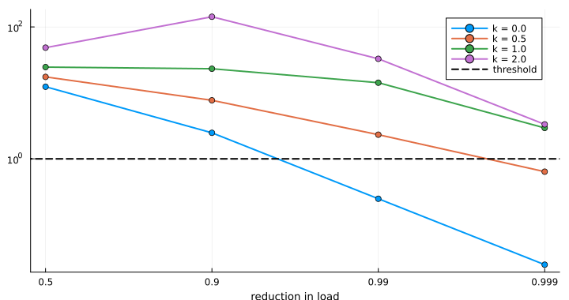

With death proportional to load (`k = 1`) the two effects nearly cancel:
the animal sheds less but for longer.

``` julia
a = lar(stage, load_reducing_treatment(0.99; half_life = 1.0, direct = 50.0); coverage = 1.0)
step!("Bsal", "treatment", "+ lower load (99%): also less shedding", u3.mean_adults, a.mean_adults,
    "partial; survivors remain infected")
```

    (step = 7, untreated = 0.039, treated = 0.189)

#### Step 8. Treat larvae as well

With larvae in the host model they can be treated too. Whether a treated
larva keeps the bacteria through metamorphosis (`retention`) has not
been measured. This step goes back to bacteria that block infection and
last, with no spread, to isolate the effect of the stage.

``` julia
quarterly = 0:0.25:9.75
options = [("adults, once", (;)),
    ("larvae, quarterly; lost at metamorphosis", (treat = :larvae, treat_times = quarterly)),
    ("larvae, quarterly; kept", (treat = :larvae, treat_times = quarterly, retention = 1.0)),
    ("both stages, quarterly; kept", (treat = :both, treat_times = quarterly, retention = 1.0))]
vals = [lar(stage, block; coverage = 1.0, kw...).mean_adults for (_, kw) in options]
bar(vals; orientation = :h, yticks = (1:4, first.(options)), yflip = true, legend = false,
    xlabel = "mean adults (fraction of K)", xlims = (0, 1.05), xticks = 0:0.25:1,
    left_margin = 6Plots.mm, size = (820, 230), color = :steelblue)
```

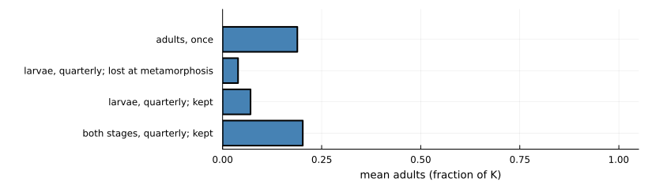

``` julia
step!("Bsal", "treatment", "treat both stages, kept through metamorphosis", u3.mean_adults, vals[4],
    "full protection with no spread at all")
```

    (step = 8, untreated = 0.039, treated = 1.0)

This overturns step 5. Once recruits can be treated before they become
adults, the bacteria do not need to spread.

#### Step 9. How long the bacteria really last

Two open datasets (a field trial in *Rana sierrae*, Knapp et al. 2022,
and a laboratory trial in *Xenopus laevis*, Madison et al. 2025) give
the abundance of applied bacteria over time. Fitting an exponential
decline gives half-lives of 3 to 14 days, and 4 to 5 days in the field.
(The fits are this project’s own.) Protection now wanes with abundance.
`protective_fold` is how far abundance can fall before half the effect
is lost; it has not been measured.

``` julia
days = 0:1:150
plot(xlabel = "days since application", ylabel = "fraction of full protection", legend = :topright)
for F in (10.0, 100.0, 1000.0)
    w = T(efficacy = 0.99, abundance_half_life = 5 / 365, protective_fold = F)
    plot!(days, [protection(w, d / 365) for d in days];
        label = @sprintf("fold %g: half gone after %.0f days", F, 365 * protection_duration(w)))
end
current()
```

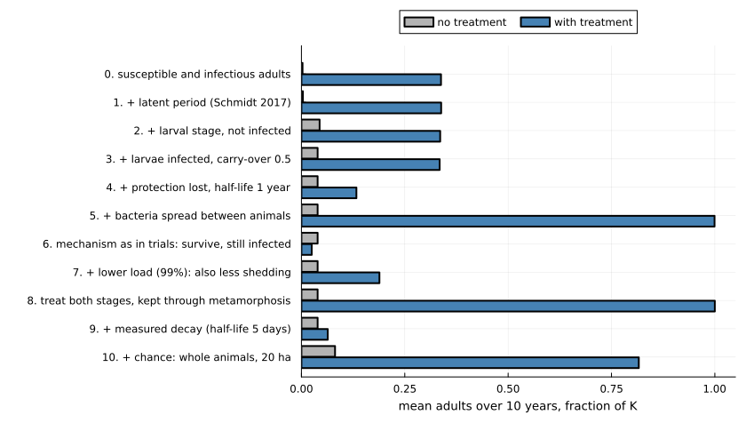

``` julia
waning = T(efficacy = 0.99, abundance_half_life = 5 / 365, protective_fold = 100.0)
a = lar(stage, waning; coverage = 1.0, treat = :both, treat_times = quarterly, retention = 1.0)
monthly = lar(stage, waning; coverage = 1.0, treat = :both, treat_times = 0:(1 / 12):9.95, retention = 1.0)
@printf("dosed monthly instead of quarterly: %.2f\n", monthly.mean_adults)
step!("Bsal", "treatment", "+ fitted decay (half-life 5 days)", u3.mean_adults, a.mean_adults,
    "fails: protection lasts about a month")
```

    dosed monthly instead of quarterly: 0.28

    (step = 9, untreated = 0.039, treated = 0.064)

#### Step 10. Chance

Every model so far treats animals as continuous densities, so a
population, or Bsal, can be reduced to a fraction of an animal and grow
back. The last step runs the same model with whole animals and random
events (`StochasticNestedProblem`, which reproduces the equations when
the population is large). Bsal arrives as one infected adult in 20
hectares, 500 adults, and each case is run 100 times.

In the stochastic version each class holds a whole number of animals in
an area of 20 ha: 500 adults ($K \times 20$) and 64 larvae
($bK/m \times 20$) at the start. Every term of the equations above
becomes a per-animal rate, evaluated at densities (count divided by
area). In each step of six hours ($\Delta t = 1/1460$ yr) an animal
leaves its class with probability $1 - e^{-R \Delta t}$, where $R$ is
the sum of its rates out, and goes to each destination with probability
in proportion to that rate. Births are Poisson, with mean the birth term
of the equations times the area times $\Delta t$. A treatment treats
each untreated animal with probability $\phi$. The transitions come from
the package’s nested model (`NestedChytridProblem`); with the latent
class, larvae and larval infection switched on, as here, they are the
equations above, so the two versions agree when the area is large. One
difference from the equations: one infected adult in 20 ha is 0.05 per
ha, against 0.01 per ha in steps 0–9.

``` julia
using Random: Xoshiro
host_a = ChytridBiology(:wang2021; latent = true, larvae = true, larval_infection = true)
chanceA(tr; kw...) = [solve(StochasticNestedProblem(p, host_a, tr; area = 20.0, kw...); rng = Xoshiro(s))
    for s in 1:100]
meanA(rs) = sum(r.mean_adults for r in rs) / length(rs)
cu = chanceA(T())
ct = chanceA(waning; coverage = 1.0, treat = :both, treat_times = quarterly, retention = 1.0)
cb = chanceA(block; coverage = 1.0)
@printf("Bsal lost within 10 years, untreated: %d of 100 runs\n", count(r -> !isnan(r.pathogen_extinction), cu))
@printf("reference treatment of step 3 (block 99%%, adults once): %.2f with chance, %.2f in the equations\n",
    meanA(cb), t3.mean_adults)
step!("Bsal", "chance", "+ chance: whole animals, 20 ha", meanA(cu), meanA(ct),
    "the failed treatment of step 9 now keeps most of the population")
```

    Bsal lost within 10 years, untreated: 100 of 100 runs
    reference treatment of step 3 (block 99%, adults once): 0.95 with chance, 0.33 in the equations

    (step = 10, untreated = 0.081, treated = 0.816)

Chance overturns step 9. In the equations, bacteria that last days fail
because Bsal never quite disappears: whenever protection lapses it
returns from a trace. With whole animals, Bsal arriving in a population
that has just been treated usually fails to establish and is lost, and
does not come back. The same happens to the step-3 reference treatment,
which keeps nearly the whole population instead of a third. The [second
vignette](../02_nested_model/02_nested_model.md) explores this in
detail.

### Part A summary

``` julia
ladder_plot("Bsal", "mean adults over 10 years, fraction of K")
```

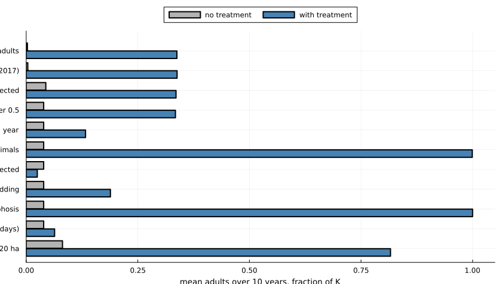

## Part B. Bd in common toads

The outcome in Part B is the **number of adults in years 25 to 35 after
Bd arrives, as a fraction of the number without Bd**. The reference
treatment is: 80% of tadpoles treated at hatching every year with
bacteria that block 90% of infections for the season. The parameter set
is the one behind Figure 2d of Mitchell et al. (2008).

### Host and pathogen

#### Step 0. The pond model

Mitchell’s model is the simplest available for this system, though it is
not as simple as step 0 of Part A: tadpoles are infected by zoospores in
the pond, infected tadpoles are removed at metamorphosis, and juveniles
and adults are never infected.

The equations below are the host model as it stands after step 3. Time
$t$ is in years and $T$ is the time of year. Between the yearly events,

$$\begin{aligned}
\frac{dP_X}{dt} &= -(\mu_P + \nu Z)\,P_X \\
\frac{dP_Y}{dt} &= \nu Z\,P_X - (\mu_P + \alpha_P)\,P_Y \\
\frac{dM}{dt} &= -(\mu_J + \varepsilon)\,M \\
\frac{dA_X}{dt} &= \varepsilon M \left(1 - \frac{A_X + A_Y}{K}\right) - \mu_A A_X
  - \chi(t)\,\nu_A Z A_X + \sigma_A A_Y \\
\frac{dA_Y}{dt} &= \chi(t)\,\nu_A Z A_X - (\mu_A + \alpha_A + \sigma_A)\,A_Y \\
\frac{dZ}{dt} &= \rho P_Y + \chi(t)\,\rho_A A_Y + \gamma Z e^{-\varphi Z} - \mu_Z Z
\end{aligned}$$

where $\chi(t) = 1$ while adults are at the pond
($t_1 \le T < t_1 + d_A/365$) and 0 otherwise. Three events happen each
year:

$$\begin{aligned}
T = t_1 &: \quad P_X \leftarrow P_X + \iota\psi\,(A_X + A_Y) \\
T = t_2 &: \quad J_0 = P_X\,(1 - q + q\,s_J) + P_Y\,s_J, \qquad
  q = 1 - e^{-\nu Z d_J / 365}, \qquad P_X,\ P_Y \leftarrow 0 \\
\omega \text{ after } t_2 &: \quad M \leftarrow M + J_0\,e^{-\mu_J \omega}
\end{aligned}$$

At breeding, tadpoles are born to every adult. At metamorphosis the
tadpoles leave the pond as a juvenile cohort $J_0$; $Z$ in $q$ is its
value at that moment. A cohort only dies (at rate $\mu_J$) until it is
$\omega$ old, and then joins the pool $M$ of juveniles that can mature
into adults. $M$ is Mitchell’s $\int_\omega^\infty J\,da$: following
each cohort in closed form solves the paper’s age-structured juvenile
equation exactly.

| Step | What it adds | Terms |
|----|----|----|
| 0 | Mitchell et al. (2008), equations (2.1) to (2.5) | $s_J = 0$, $d_J = 0$, no $A_Y$ ($\chi = 0$) |
| 1 | infected metamorphs can survive | $s_J > 0$ |
| 2 | metamorphs are exposed as they leave | $d_J > 0$, so $q > 0$ |
| 3 | adults are infected at the pond, shed there and clear the infection | $A_Y$, $\chi(t)$, $\nu_A$, $\rho_A$, $\sigma_A$ |

With steps 1 to 3 switched off, the equations are those of Mitchell et
al. (2008), and the package reproduces the outcomes of their Fig. 2b to
2d. Bd arrives as $Z_0$ zoospores at the start of year 0, after 100
years without Bd. Following the paper, the toads are declared extinct
(every stage set to zero) below 50 adults, and Bd below 100 zoospores.
The package tests the toads at each yearly event, and Bd only at
breeding, when there are no tadpoles. In step 3 Bd is not removed at
breeding while an infected adult is present.

| Symbol | Meaning | Value or source |
|----|----|----|
| $P_X$, $P_Y$ | uninfected and infected tadpoles |  |
| $J_0$, $M$ | a juvenile cohort at metamorphosis; juveniles older than $\omega$ |  |
| $A_X$, $A_Y$ | uninfected and infected adults |  |
| $Z$ | free-living zoospores in the pond |  |
| $t_1$, $t_2$ | day of breeding and of metamorphosis | days 60 and 155, compendium (mitchell2008) |
| $\omega$ | age at which juveniles can start to mature | 500 days, compendium (mitchell2008) |
| $\iota$, $\psi$ | mating couples per adult; eggs per couple | 0.14, 2000, compendium (mitchell2008) |
| $\varepsilon$ | maturation rate of juveniles older than $\omega$ | 0.16 per year, compendium (mitchell2008) |
| $\mu_P$, $\mu_J$, $\mu_A$ | natural death rates of tadpoles, juveniles, adults | 7.55, 0.73, 0.73 per year, compendium (mitchell2008) |
| $K$ | limit on the number of adults | 14,000, compendium (mitchell2008) |
| $\alpha_P$ | extra death rate of infected tadpoles | 1.62 per year, compendium (mitchell2008) |
| $\nu$ | infection rate per zoospore | $2.3 \times 10^{-8}$ per zoospore per year, compendium (mitchell2008, Fig. 2d) |
| $\rho$ | zoospores released per infected tadpole | $6 \times 10^{6}$ per tadpole per year, compendium (mitchell2008, Fig. 2d) |
| $\mu_Z$ | zoospore death rate | 13 per year, compendium (mitchell2008) |
| $\gamma$, $\varphi$ | saprobic growth of zoospores and its density dependence | 0 (so the term is off), $10^{-6}$, compendium (mitchell2008) |
| $Z_0$ | zoospores introduced | $10^4$, package default |
| $s_J$ | chance that an infected metamorph survives and clears Bd | 0 (step 0); $1 - 72/101 = 0.29$ from step 1, compendium (smith2022) |
| $d_J$ | days metamorphs are exposed as they leave | 0 (steps 0, 1); 7 from step 2, illustrative |
| $d_A$ | days adults spend at the pond from $t_1$ | 30 in step 3, illustrative |
| $\nu_A$, $\rho_A$ | adult infection rate and shedding while at the pond | equal to $\nu$ and $\rho$ in step 3, illustrative |
| $\sigma_A$ | adult clearance rate | 1 per year in step 3, illustrative |
| $\alpha_A$ | extra death rate of infected adults | 0, illustrative |


``` julia
m = MitchellParameters(:mitchell2008; set = "fig2d")
none = PostMetamorphicInfection()
pond(tr; stages = none, kw...) = solve(ProbioticPondProblem(m, tr; stages, kw...))
rel(r) = r.A_mean / r.A_disease_free
ref = T(efficacy = 0.9)

u, t = pond(T()), pond(ref; coverage = 0.8)
@printf("Bd persists: untreated %s, treated %s\n", u.bd_persist, t.bd_persist)
step!("Bd toad", "host", "Mitchell 2008 pond model", rel(u), rel(t),
    "untreated: toads and Bd both die out; treated: toads saved, Bd gone")
```

    Bd persists: untreated false, treated false

    (step = 0, untreated = 0.0, treated = 0.975)

``` julia
series(r) = (r.t[r.t .>= -2], r.A[r.t .>= -2] ./ r.A_disease_free)
plot(series(u)...; label = "no treatment", xlabel = "years since Bd arrived",
    ylabel = "adults (fraction of disease-free)", legend = :right)
plot!(series(t)...; label = "tadpoles treated every year")
```

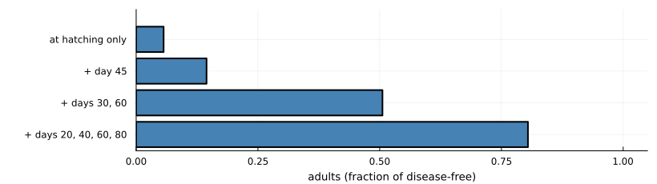

Unlike Bsal, the simplest treatment works here: the infected stage is
short and a new cohort can be treated each year. It does not prevent the
initial crash.

#### Step 1. Infected metamorphs can survive

Experiments show that toadlets exposed to Bd are infected, that most
die, and that some survive (Smith et al. 2022; counts from the
compendium).

``` julia
s = parameter_set(:smith2022)
survival = 1 - s.deaths_exposed / s.n_exposed
@printf("toadlet survival after exposure: %.2f\n", survival)
st1 = PostMetamorphicInfection(metamorph_survival = survival)
u, t = pond(T(); stages = st1), pond(ref; coverage = 0.8, stages = st1)
@printf("Bd persists: untreated %s, treated %s\n", u.bd_persist, t.bd_persist)
step!("Bd toad", "host", "+ infected metamorphs can survive (0.29)", rel(u), rel(t),
    "toads no longer die out, so nor does Bd; treatment now protects poorly")
```

    toadlet survival after exposure: 0.29
    Bd persists: untreated true, treated true

    (step = 1, untreated = 0.046, treated = 0.085)

One added survival probability reverses both outcomes. The published
“both die out” result depended on every infected animal dying; once some
survive, the host persists, Bd persists with it, and blocking 90% of
infections is no longer enough.

#### Step 2. Metamorphs are exposed as they leave the pond

``` julia
st2 = PostMetamorphicInfection(metamorph_survival = survival, metamorph_exposure_days = 7.0)
u, t = pond(T(); stages = st2), pond(ref; coverage = 0.8, stages = st2)
step!("Bd toad", "host", "+ metamorphs exposed for a week on leaving", rel(u), rel(t),
    "little further change")
```

    (step = 2, untreated = 0.046, treated = 0.082)

#### Step 3. Adults carry Bd between years

Breeding adults carry Bd at low prevalence in field surveys. Here adults
are infected while at the pond, shed there, and clear the infection over
about a year. (Treatment is not yet combined with infected adults in the
package, so only the untreated outcome is shown.)

``` julia
st3 = PostMetamorphicInfection(metamorph_survival = survival, metamorph_exposure_days = 7.0,
    adult_exposure_days = 30.0, adult_relative_shedding = 1.0, adult_clearance = 1.0)
r = solve(ToadStageProblem(m, st3))
@printf("Bd persists: %s; adult prevalence after breeding: %.2f\n", r.bd_persist, r.adult_prevalence)
step!("Bd toad", "host", "+ adults carry Bd between years", r.A_mean / r.A_disease_free, NaN,
    "untreated only; little change in this parameter set")
```

    Bd persists: true; adult prevalence after breeding: 0.99

    (step = 3, untreated = 0.044, treated = NaN)

The host model of step 2 is used for the rest of Part B.

Every “with treatment” outcome in Part B, including the reference
treatment of steps 0 to 2, comes from the model below. From step 4 it
sits on the step-2 host, so there are no infected adults ($A_Y = 0$).
Tadpoles are split into untreated ($U$) and treated ($T$), uninfected
and infected:

$$\begin{aligned}
\frac{dP_{XU}}{dt} &= -(\mu_P + \nu Z)\,P_{XU} + \lambda P_{XT} \\
\frac{dP_{XT}}{dt} &= -\big(\mu_P + (1 - g\eta)\,\nu Z + \lambda\big)\,P_{XT} \\
\frac{dP_{YU}}{dt} &= \nu Z\,P_{XU} - (\mu_P + \alpha_P)\,P_{YU} + \lambda P_{YT} \\
\frac{dP_{YT}}{dt} &= (1 - g\eta)\,\nu Z\,P_{XT} - \big(\mu_P + (1 - g\tau)\,\alpha_P + \lambda\big)\,P_{YT} \\
\frac{dZ}{dt} &= \rho\,\big(P_{YU} + (1 - g\kappa)\,P_{YT}\big) + \gamma Z e^{-\varphi Z} - \mu_Z Z
\end{aligned}$$

with $M$ and $A_X$ as before. A treated tadpole is infected less often
(efficacy $\eta$), dies of infection less often (tolerance $\tau$) and
sheds less (shedding reduction $\kappa$). It loses the bacteria at rate
$\lambda = \ln 2 / h$. All three effects are scaled by the protection
left since the last dose, $g = g(t - t_{\mathrm{dose}})$, where

$$g(a) = \frac{1 + 1/F}{1 + 2^{a/h_B}/F}.$$

$g = 1$ when the bacteria do not decline ($h_B = \infty$). Treatment
enters through three events in each year from the arrival of Bd:

$$\begin{aligned}
T = t_1 &: \quad P_{XU} \leftarrow P_{XU} + \iota\psi A_X, \quad \text{then}\quad
  P_{XT} \leftarrow P_{XT} + c\,P_{XU},\ \ P_{XU} \leftarrow (1 - c)\,P_{XU},\ \ t_{\mathrm{dose}} \leftarrow t \\
T = t_1 + d_k/365 &: \quad P_{iT} \leftarrow P_{iT} + c\,P_{iU},\ \ P_{iU} \leftarrow (1 - c)\,P_{iU}
  \ \ (i = X, Y),\ \ t_{\mathrm{dose}} \leftarrow t \\
T = t_2 &: \quad J_0 = P_{XU}(1 - q_U + q_U s_U) + P_{XT}(1 - q_T + q_T s_T) + P_{YU} s_U + P_{YT} s_T
\end{aligned}$$

with $q_U = 1 - e^{-\nu Z d_J/365}$,
$q_T = 1 - e^{-(1 - g\eta)\nu Z d_J/365}$, $s_U = s_J$ and
$s_T = s_J + g\tau(1 - s_J)$. Tolerance therefore also raises the
survival of infected metamorphs. Metamorphs lose the bacteria, so every
juvenile and adult is untreated. With one dose at hatching and $h_B = 5$
days, $F = 100$, the protection left at metamorphosis 95 days later is
$g = 1.01/(1 + 2^{19}/100) \approx 0.0002$. Each extra dose also treats
a share $c$ of the tadpoles still untreated, so after the dose at
hatching and four more, all but $0.2^5$ (about 0.03%) of tadpoles have
been treated.

The steps do not all add to the one before: steps 5 to 7 change which
effect the bacteria have.

| Step | Treatment in the “with treatment” outcome |
|----|----|
| 0 to 2 (reference) | $\eta = 0.9$, $c = 0.8$, no loss of protection |
| 3 | none (treatment is not yet combined with infected adults) |
| 4 | $\eta = 0.9$, $h = 0.05$ years (18 days) |
| 5 | $\tau = 0.7$ in place of $\eta$; no loss of protection |
| 6 | $\tau = \kappa = 0.7$ (`load_reducing_treatment(0.7)`) |
| 7 | $\tau = 0.7$, declining with $h_B = 5$ days and $F = 100$; one dose |
| 8 | as step 7, with doses also on days $d_k$ = 20, 40, 60 and 80 |
| 9 | as step 8, with chance |

| Symbol | Meaning | Value or source |
|----|----|----|
| $c$ | share of untreated tadpoles treated at each dose | 0.8, illustrative |
| $\eta$ | efficacy: reduction in the infection rate | 0.9 (reference, step 4); 0.5, 0.9, 0.99 compared in step 5; illustrative |
| $\tau$ | tolerance: reduction in the extra death rate of infected tadpoles | 0.7 (steps 5 to 9); 0.3, 0.7, 1.0 compared in step 5; illustrative |
| $\kappa$ | shedding reduction | 0.7 in step 6 (load 70% lower, death proportional to load), illustrative |
| $h$, $\lambda$ | half-life of the treated state; $\lambda = \ln 2/h$ | 18 days in step 4, otherwise $\infty$; illustrative |
| $h_B$ | half-life of the applied bacteria | 5 days, this project’s fit to Knapp et al. (2022) and Madison et al. (2025) (Part A, step 9) |
| $F$ | starting abundance over the abundance giving half the effect | 100, illustrative |
| $d_k$ | days after hatching of extra doses | 20, 40, 60, 80 in step 8, illustrative |
| $g$ | share of the full effect left since the last dose | from $h_B$ and $F$ |

The package can also spread the bacteria between tadpoles, through a
pond reservoir, or from treated mothers, and can treat adults instead.
All of these are off in Part B.


### Treatment

#### Step 4. Protection is lost

``` julia
u = pond(T(); stages = st2)
a = pond(T(efficacy = 0.9, half_life = 0.05); coverage = 0.8, stages = st2)
step!("Bd toad", "treatment", "+ protection lost, half-life 18 days", rel(u), rel(a), "slightly worse")
```

    (step = 4, untreated = 0.046, treated = 0.056)

#### Step 5. Mechanism as in trials: survival, not fewer infections

This step swaps the mechanism: treated tadpoles are infected as often as
untreated ones but survive better. It also sets aside the loss of
protection of step 4, so that the two mechanisms are compared on equal
terms; steps 5 to 8 keep bacteria for life unless their decay is stated.

``` julia
effs, tols = [0.5, 0.9, 0.99], [0.3, 0.7, 1.0]
blocking = [rel(pond(T(efficacy = e); coverage = 0.8, stages = st2)) for e in effs]
tolerating = [rel(pond(T(tolerance = τ); coverage = 0.8, stages = st2)) for τ in tols]
plot(["weak", "medium", "strong"], blocking; marker = :circle,
    label = "blocks infection (0.5, 0.9, 0.99)", xlabel = "strength of treatment",
    ylabel = "adults (fraction of disease-free)", ylims = (0, 1), legend = :topleft)
plot!(["weak", "medium", "strong"], tolerating; marker = :square,
    label = "survives infection (0.3, 0.7, 1.0)")
```

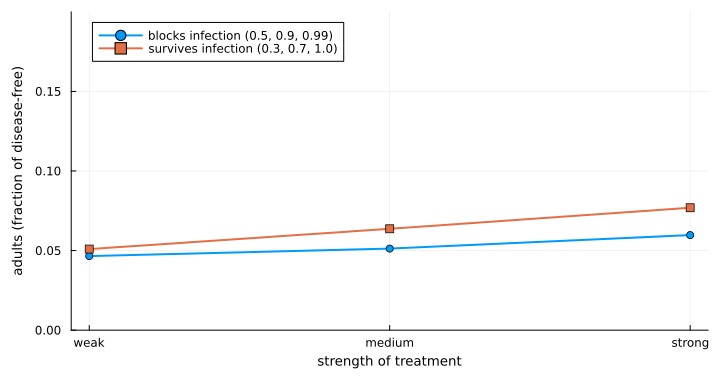

``` julia
a = pond(T(tolerance = 0.7); coverage = 0.8, stages = st2)
step!("Bd toad", "treatment", "mechanism as in trials: survive, still infected", rel(u), rel(a),
    "much better than blocking here; Bd persists")
```

    (step = 5, untreated = 0.046, treated = 0.748)

For Bsal the observed mechanism made treatment fail. Here it makes
treatment work better, because Bd is going to persist anyway and what
matters is how many infected animals live.

#### Step 6. Lower load

``` julia
a = pond(load_reducing_treatment(0.7); coverage = 0.8, stages = st2)
step!("Bd toad", "treatment", "+ lower load (70%): also less shedding", rel(u), rel(a),
    "little changed: untreated tadpoles and the pond keep Bd going")
```

    (step = 6, untreated = 0.046, treated = 0.751)

#### Step 7. How long the bacteria really last

With the fitted decay (half-life 5 days), one dose at hatching wanes
during the 95-day tadpole season. This step keeps the survival mechanism
of step 5 but not the lower shedding of step 6.

``` julia
waning_t = T(tolerance = 0.7, abundance_half_life = 5 / 365, protective_fold = 100.0)
schedules = [("at hatching only", Float64[]), ("+ day 45", [45.0]), ("+ days 30, 60", [30.0, 60.0]),
    ("+ days 20, 40, 60, 80", [20.0, 40.0, 60.0, 80.0])]
doses = [rel(pond(waning_t; coverage = 0.8, stages = st2, redose_days = d)) for (_, d) in schedules]
bar(doses; orientation = :h, yticks = (1:4, first.(schedules)), yflip = true, legend = false,
    xlabel = "adults (fraction of disease-free)", xlims = (0, 1.05), xticks = 0:0.25:1,
    left_margin = 6Plots.mm, size = (820, 230), color = :steelblue)
```

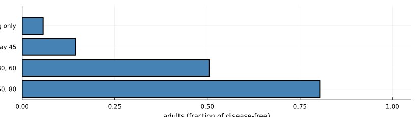

``` julia
step!("Bd toad", "treatment", "+ fitted decay, one dose at hatching", rel(u), doses[1],
    "protection gone before the season ends")
```

    (step = 7, untreated = 0.046, treated = 0.056)

#### Step 8. Several doses in a season

``` julia
step!("Bd toad", "treatment", "+ five doses per season", rel(u), doses[4], "most of the benefit restored")
```

    (step = 8, untreated = 0.046, treated = 0.804)

Each dose renews the protection of treated tadpoles and also treats 80%
of those still untreated, infected ones included, so after five doses
almost every tadpole has been treated. Part of the benefit comes from
that higher coverage, not only from renewed protection.

#### Step 9. Chance

The same pond model with every tadpole, toad and zoospore a whole
number, and every event random (`solve(problem; rng)`); 50 runs of each
case. Mitchell et al.’s rule that toads are extinct below 50 adults, and
Bd below 100 zoospores, is no longer needed: each goes extinct when its
numbers reach zero.

In terms of the equations, every flow above becomes a random event,
drawn in steps of one day (tau-leaping). In each step every animal or
zoospore leaves its class with probability $1 - e^{-Rh}$, where $R$ is
the sum of its per-capita rates out of that class and $h$ is one day,
and goes to each destination in proportion to that rate. New zoospores
are a Poisson draw with mean $\rho\,(P_{YU} + (1 - g\kappa)P_{YT})\,h$.
The yearly events become draws as well: hatchlings are Poisson with mean
$\iota\psi A_X$, each dose treats a binomial share $c$ of untreated
tadpoles, and an uninfected, untreated metamorph reaches age $\omega$
with probability $(1 - q_U + q_U s_U)\,e^{-\mu_J\omega}$ (likewise for
the other classes). The limits of 50 adults and 100 zoospores are not
applied.

``` julia
chanceB(tr; stages = st2, kw...) = [solve(ProbioticPondProblem(m, tr; stages, kw...); rng = Xoshiro(s)) for s in 1:50]
meanB(rs) = sum(rel(r) for r in rs) / length(rs)
five = (coverage = 0.8, redose_days = [20.0, 40.0, 60.0, 80.0])
bu, bt = chanceB(T()), chanceB(waning_t; five...)
base = chanceB(T(); stages = none)
blk = chanceB(ref; coverage = 0.8)
@printf("Mitchell's model (step 0), untreated: toads persist in %d of 50 runs, adults %.2f (equations: extinct)\n",
    count(r -> r.toads_persist, base), meanB(base))
@printf("reference treatment (block 90%%) on the step-2 host: %.2f, Bd persists in %d of 50 (equations: %.2f)\n",
    meanB(blk), count(r -> r.bd_persist, blk), rel(pond(ref; coverage = 0.8, stages = st2)))
step!("Bd toad", "chance", "+ chance: whole animals", meanB(bu), meanB(bt),
    "little change for this model; large changes elsewhere (see text)")
```

    Mitchell's model (step 0), untreated: toads persist in 50 of 50 runs, adults 0.78 (equations: extinct)
    reference treatment (block 90%) on the step-2 host: 0.36, Bd persists in 35 of 50 (equations: 0.08)

    (step = 9, untreated = 0.072, treated = 0.819)

For the final model chance changes little. Elsewhere on the ladder it
changes a great deal:

- **Mitchell’s published outcome does not survive it.** In the equations
  Bd drives the toads to extinction and then dies out itself. With whole
  animals the toads fall to a few dozen adults, too few tadpoles remain
  to carry Bd through the winter, Bd is lost, and the toads recover. The
  published result depends on declaring toads extinct below 50 adults.
- **Blocking infection does better.** On the step-2 host model, Bd is
  lost by chance in some runs, and treatment then protects the
  population fully.

### Part B summary

``` julia
ladder_plot("Bd toad", "adults in years 25 to 35, fraction of disease-free")
```


## Part C. Bd in frogs

The outcome in Part C is the **fraction of 80 frogs sharing one pool
that are alive after two years**. Disease here depends on the fungal
load on each frog. The reference treatment is introduced at step 2.

### Host and pathogen

#### Step 0. Load on each frog

In the model of Briggs et al. (2010) each frog carries a load of
sporangia. Sporangia release zoospores into a shared pool, zoospores
infect frogs, and a frog dies when its load reaches a lethal level.
Loads run away when there are enough frogs to keep the pool topped up.

The equations below are the model as it stands after step 2. Each live
frog $i$ carries $S_i$ sporangia, and the pool holds $Z$ zoospores:

$$\begin{aligned}
\frac{dS_i}{dt} &= \frac{\nu\gamma}{V}\,Z + (\eta\nu f - \sigma)\,S_i - \frac{c_i\,S_i}{h + S_i}, \\
\frac{dZ}{dt} &= \varepsilon + \eta(1 - f)\sum_{j\ \mathrm{alive}} S_j - \mu Z - \frac{\gamma}{V}\,N_{\mathrm{alive}}\,Z.
\end{aligned}$$

Zoospores meet each frog at rate $\gamma/V$, and a fraction $\nu$ of
meetings start a sporangium. Each sporangium releases $\eta$ zoospores a
day: a fraction $f$ reinfect the same frog and the rest go to the pool.
A frog dies when $S_i$ reaches $S_{\max}$; from then on it sheds nothing
and takes up no zoospores. All frogs start with no sporangia, and the
pool starts at $\varepsilon/(\mu + \gamma N/V)$. On its own a frog’s
load would decline, because $\eta\nu f$ (about 0.04 per day) is below
$\sigma$; loads run away only when enough frogs feed the pool.

What each step adds:

- **Step 0** is the model of Briggs et al. (2010) with no clearance
  ($c_i = 0$). The $S_i$ and $Z$ equations without $\varepsilon$ are
  those of the paper. The outside input $\varepsilon$ is the paper’s
  external source of zoospores (its Fig. 3D), here as a constant rate.
- **Step 1** adds clearance by the frog, $c\,S_i/(h + S_i)$, the same
  for every frog ($c_i = c$). This term is new in this package.
- **Step 2** lets $c_i$ differ: the 80 values are evenly spaced
  quantiles of a lognormal distribution with median $c$.

| Symbol | Meaning | Value or source |
|----|----|----|
| $S_i$ | sporangia on frog $i$ | state (sporangia per frog) |
| $Z$ | zoospores in the pool | state (zoospores per pool) |
| $N_{\mathrm{alive}}$ | frogs alive | starts at $N = 80$ |
| $V$ | pool volume | 1 volume unit; compendium (briggs2010) |
| $\gamma$ | rate at which zoospores meet a frog | 0.01 volume units per day; compendium (briggs2010) |
| $\nu$ | fraction of meetings that start a sporangium | 0.05; compendium (briggs2010) |
| $f$ | fraction of released zoospores that reinfect the same frog | 0.05; compendium (briggs2010) |
| $\eta$ | zoospores released per sporangium | 17.5 per day; compendium (briggs2010) |
| $\sigma$ | loss of sporangia | 0.2 per day; compendium (briggs2010) |
| $\mu$ | death of zoospores in the pool | 1 per day; compendium (briggs2010) |
| $S_{\max}$ | lethal load | 10,000 sporangia; compendium (briggs2010) |
| $\varepsilon$ | zoospores entering from outside | 1,000 per day; set in this vignette (the value Briggs et al. used for an external source) |
| $c$ | maximum clearance (step 1) | 100 sporangia per day; illustrative |
| $h$ | load at which clearance is half its maximum (step 1) | 500 sporangia; illustrative |
| $c_i$ | clearance of frog $i$ (step 2) | lognormal, median $c$, log-scale sd 0.5; illustrative |


``` julia
pb = BriggsParameters(:briggs2010)
N, hsat = 80, 500.0
ε = parameter_set(:briggs2010; set = "fig3d").εZ    # zoospores from outside, per day
tipping(c; n = N) = solve(LoadTippingProblem(pb; c, h = hsat, N = n, ε, tspan = (0.0, 730.0)))
alive(r) = count(r.alive) / length(r.alive)

@printf("frogs needed for loads to run away: %.0f\n", host_density_threshold(pb))
r0 = tipping(0.0)
step!("Bd frog", "host", "Briggs 2010 load model", alive(r0), NaN, "all die: 80 frogs is above the threshold of 23")
```

    frogs needed for loads to run away: 23

    (step = 0, untreated = 0.0, treated = NaN)

#### Step 1. Frogs clear some of their load

Frogs have defences. Here each frog removes sporangia at a rate that
saturates as load rises: defences cope with a light infection and are
overwhelmed by a heavy one (this package’s load tipping model; the
clearance values are illustrative).

``` julia
c = 100.0
@printf("frogs needed for loads to run away: %d\n", critical_host_number(pb; c, h = hsat, ε))
r1 = tipping(c)
r1small = tipping(c; n = 50)
@printf("alive after two years: %.2f of 80 frogs, %.2f of 50 frogs\n", alive(r1), alive(r1small))
step!("Bd frog", "host", "+ saturating clearance by the frog", alive(r1), NaN,
    "threshold rises from 23 to 68 frogs; 80 still all die")
```

    frogs needed for loads to run away: 68
    alive after two years: 0.00 of 80 frogs, 1.00 of 50 frogs

    (step = 1, untreated = 0.0, treated = NaN)

#### Step 2. Frogs differ

Frogs now differ in how strong their defences are (lognormal, same
median). The reference treatment for Part C starts here: each frog, with
probability 0.4, carries bacteria that triple its clearance, for life.

``` julia
cs = quantile.(LogNormal(log(c), 0.5), ((1:N) .- 0.5) ./ N)
r2 = tipping(cs)
frogs(tr; kw...) = solve(ProbioticLoadProblem(pb, tr; c, c_treated = 3c, h = hsat, N, ε, days = 730, kw...);
    rng = Xoshiro(1))
ref_c = frogs(T(); coverage = 0.4)
step!("Bd frog", "host", "+ frogs differ in their defences", alive(r2), NaN,
    "a few of the best-defended survive")
```

    (step = 2, untreated = 0.062, treated = NaN)

With identical frogs a die-off is all or nothing; with differences it is
partial, and it stops when too few frogs are left to sustain the pool.
The treatment steps use identical frogs (step 1), because treatment and
host differences are not yet combined in the package.

### Treatment

#### Step 3. A treated class

Treated frogs clear sporangia faster. In the load equations above, with
identical frogs,

$$c_i = \begin{cases} c_T, & \text{frog } i \text{ treated}, \\ c, & \text{otherwise}. \end{cases}$$

On day 0 each frog is treated with probability equal to the coverage, so
the treated frogs differ from run to run. Loads follow the equations
through each day. At the end of each day a treated frog stops being
treated with probability $1 - e^{-\omega}$, where
$\omega = \ln 2 / t_{1/2}$. In step 3, $t_{1/2}$ is infinite (treated
for life); step 4 sets $t_{1/2} = 30$ days and treats every frog. The
package can also let untreated frogs pick up the bacteria from treated
ones; that is switched off here.

| Symbol | Meaning | Value or source |
|----|----|----|
| $c_T$ | clearance of a treated frog | $3c$ = 300 sporangia per day; illustrative |
| coverage | probability that a frog is treated on day 0 | 0.4 (step 3), 1 (step 4); illustrative |
| $t_{1/2}$ | half-life of the treated state | infinite (step 3), 30 days (step 4); illustrative |

``` julia
step!("Bd frog", "treatment", "treated class: 40% of frogs, lasts for life", alive(r1),
    ref_c.alive[end] / N, "all survive, including the untreated: protection is shared")
```

    (step = 3, untreated = 0.0, treated = 1.0)

Because disease depends on the shared pool, treating 40% protects
everyone.

#### Step 4. Protection is lost

``` julia
a = frogs(T(half_life = 30.0); coverage = 1.0)
@printf("first death: day %d (untreated: day %d)\n", minimum(filter(>(0), a.death_day)),
    ceil(Int, minimum(r1.death_time)))
step!("Bd frog", "treatment", "+ protection lost, half-life 30 days", alive(r1), a.alive[end] / N,
    "die-off delayed by about three months, not prevented")
```

    first death: day 241 (untreated: day 156)

    (step = 4, untreated = 0.0, treated = 0.0)

#### Step 5. Bacteria as a state of each frog

Until now every treated animal has been simply “treated”. Each frog now
carries its own abundance of the applied bacteria. It declines with the
half-life fitted to field data (5 days; this project’s own fit), and
frogs exchange bacteria through the pond. Exchange moves bacteria
between frogs without creating any, so they spread but do not sustain
themselves. That is what the field trial showed: eleven days after most
frogs in a pond were bathed, frogs that were never bathed carried about
0.63 times as much of the bacterium as bathed ones, and it then declined
in both.

``` julia
baths(; x = 0.1, F = 100.0, coverage = 0.75, dose_days = [0], days = 730) =
    solve(ProbioticAbundanceProblem(pb, T(abundance_half_life = 5.0, protective_fold = F, direct = x);
        c, c_treated = 3c, h = hsat, N, ε, coverage, dose_days, days))
for x in (0.0, 0.1, 1.0)
    r = baths(; x, days = 30)
    @printf("exchange %.1f per day: unbathed/bathed abundance on day 11 = %.2f\n", x,
        r.abundance_unbathed[12] / r.abundance_bathed[12])
end
```

    exchange 0.0 per day: unbathed/bathed abundance on day 11 = 0.00
    exchange 0.1 per day: unbathed/bathed abundance on day 11 = 0.60
    exchange 1.0 per day: unbathed/bathed abundance on day 11 = 1.00

An exchange rate of about 0.1 per day reproduces the field ratio and is
used below.

In equations, each frog $i$ now carries an abundance $B_i$ of the
applied bacteria, in dose units. A bath sets $B_i = 1$ on every live
frog in the bathed group (the first 75% of frogs, 60 of 80). Between
baths

$$\begin{aligned}
\frac{dB_i}{dt} &= -\delta B_i + x\,(\bar{B} - B_i),
  \qquad \delta = \frac{\ln 2}{t_B},
  \qquad \bar{B} = \frac{1}{N_{\mathrm{alive}}}\sum_{j\ \mathrm{alive}} B_j, \\
c_i &= c + (c_T - c)\,\frac{B_i}{B_i + 1/F},
\end{aligned}$$

and $S_i$ and $Z$ follow the equations of step 1 with this $c_i$. Summed
over live frogs the exchange terms cancel, so the mean abundance falls
at rate $\delta$ whatever $x$ is. With $F = 100$ a freshly bathed frog
has 99% of the extra clearance, and keeps at least half of it until
$B_i$ falls to $1/F$: about $\log_2 F \approx 6.6$ half-lives (33 days)
without exchange. The treated class of steps 3 and 4 is not part of this
model; protection now wanes through $B_i$. Step 6 repeats the bath on
days 0, 90, 180, and so on.

| Symbol | Meaning | Value or source |
|----|----|----|
| $B_i$ | abundance of applied bacteria on frog $i$ | state (dose units; 1 just after a bath) |
| $t_B$ | half-life of the abundance | 5 days; this package’s fit to field data, not a published estimate |
| $x$ | rate at which frogs exchange bacteria | 0.1 per day; chosen to match the field ratio above |
| $F$ | protective fold: abundance after a bath divided by the abundance giving half the effect | 100; illustrative |
| $c_T$ | clearance at full effect | $3c$ = 300 sporangia per day; illustrative |
| coverage | share of frogs bathed | 0.75; illustrative |


``` julia
one = baths()
step!("Bd frog", "treatment", "+ bacteria on each frog, fitted decay; one bath", alive(r1),
    one.alive[end] / N, "die-off delayed by about six weeks")
```

    (step = 5, untreated = 0.0, treated = 0.0)

#### Step 6. Repeated baths

``` julia
untreated, every90 = baths(coverage = 0.0), baths(dose_days = 0:90:729)
plot(untreated.t, max.(untreated.mean_load, 1.0); yscale = :log10, label = "no treatment",
    xlabel = "days", ylabel = "mean Bd load per live frog", legend = :bottomright, xlims = (0, 730))
plot!(one.t, max.(one.mean_load, 1.0); label = "one bath on day 0")
plot!(every90.t, max.(every90.mean_load, 1.0); label = "a bath every 90 days")
hline!([pb.Smax]; color = :black, linestyle = :dash, label = "lethal load")
```

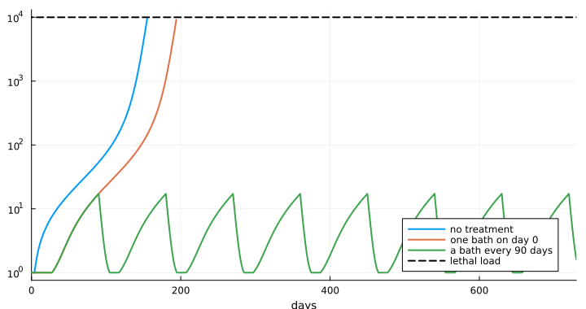

``` julia
first_death(r) = any(>(0), r.death_day) ? minimum(filter(>(0), r.death_day)) : 0
println("| Baths | Alive after 2 years (of 80) | First death (day) |")
println("|---|---|---|")
for (label, r) in (("none", untreated), ("one, day 0", one), ("every 240 days", baths(dose_days = 0:240:729)),
        ("every 150 days", baths(dose_days = 0:150:729)), ("every 90 days", every90),
        ("every 90 days, 10% of frogs", baths(coverage = 0.1, dose_days = 0:90:729)),
        ("every 90 days, 10% of frogs, no exchange", baths(coverage = 0.1, x = 0.0, dose_days = 0:90:729)),
        ("one, day 150 (loads already high)", baths(dose_days = [150])))
    @printf("| %s | %d | %s |\n", label, r.alive[end], first_death(r) == 0 ? "none" : string(first_death(r)))
end
```

| Baths | Alive after 2 years (of 80) | First death (day) |
|----|----|----|
| none | 0 | 156 |
| one, day 0 | 0 | 195 |
| every 240 days | 0 | 195 |
| every 150 days | 80 | none |
| every 90 days | 80 | none |
| every 90 days, 10% of frogs | 80 | none |
| every 90 days, 10% of frogs, no exchange | 8 | 184 |
| one, day 150 (loads already high) | 0 | 157 |

``` julia
step!("Bd frog", "treatment", "+ a bath every 90 days", alive(r1), every90.alive[end] / N,
    "all survive: each bath resets the slow build-up of load")
```

    (step = 6, untreated = 0.0, treated = 1.0)

This is the one system where bacteria that last only weeks could still
work. Load takes months to build; a short burst of extra clearance
knocks it back, and the build-up starts again. Because frogs exchange
bacteria, bathing a small part of the population protects the rest.

#### Step 7. Chance

The same model with every sporangium on every frog, and every zoospore
in the pool, a whole number, and every event random
(`StochasticFrogProblem`); 20 runs of each case.

Time moves in steps of $dt = 0.05$ days. In each step the random events
have the rates of the equations, so on average they follow them:

| Event in a step | Number drawn | Term in the equations |
|----|----|----|
| new sporangia on frog $i$ | Poisson with mean $\left(\frac{\nu\gamma}{V} Z + \eta\nu f S_i\right) dt$ | first two terms of $dS_i/dt$ |
| sporangia lost from frog $i$ | Binomial($S_i$, $1 - e^{-(\sigma + c_i/(h + S_i))\,dt}$) | $\sigma S_i + c_i S_i/(h + S_i)$ |
| zoospores released by frog $i$ | Poisson with mean $\eta(1 - f) S_i\,dt$ | $\eta(1 - f)\sum_j S_j$ |
| zoospores lost from the pool | Binomial($Z$, $1 - e^{-(\mu + \gamma N_{\mathrm{alive}}/V)\,dt}$) | $\mu Z + (\gamma/V) N_{\mathrm{alive}} Z$ |
| zoospores from outside | Poisson with mean $\varepsilon\,dt$ | $\varepsilon$ |

A frog dies as soon as $S_i$ reaches $S_{\max}$. The bacteria $B_i$ stay
continuous and follow the step-5 equation, solved exactly over each
step.

``` julia
bath_tr = T(abundance_half_life = 5.0, protective_fold = 100.0, direct = 0.1)
chanceC(; tr = bath_tr, kw...) = [solve(StochasticFrogProblem(pb, tr; c, c_treated = 3c, h = hsat, N, ε,
    days = 730, coverage = 0.75, kw...); rng = Xoshiro(s)) for s in 1:20]
aliveC(rs) = sum(r.alive[end] for r in rs) / (N * length(rs))
firstC(rs) = (v = sort([first_death(r) for r in rs if first_death(r) > 0]); isempty(v) ? "none" : string(v[cld(length(v), 2)]))
cases = [("no treatment", chanceC(coverage = 0.0), untreated),
    ("bath every 90 days", chanceC(dose_days = 0:90:729), every90),
    ("bath every 150 days", chanceC(dose_days = 0:150:729), baths(dose_days = 0:150:729)),
    ("bath every 90 days, 10% of frogs", chanceC(coverage = 0.1, dose_days = 0:90:729),
        baths(coverage = 0.1, dose_days = 0:90:729))]
nothing
```

``` julia
println("| Baths | Equations: alive after 2 years | Chance: alive (mean of 20 runs) | Chance: runs with no deaths | Chance: median first death |")
println("|---|---|---|---|---|")
for (label, rs, det) in cases
    @printf("| %s | %d | %.0f | %d of 20 | %s |\n", label, det.alive[end], aliveC(rs) * N,
        count(r -> r.alive[end] == N, rs), firstC(rs))
end
```

| Baths | Equations: alive after 2 years | Chance: alive (mean of 20 runs) | Chance: runs with no deaths | Chance: median first death |
|----|----|----|----|----|
| no treatment | 0 | 0 | 0 of 20 | 114 |
| bath every 90 days | 80 | 80 | 20 of 20 | none |
| bath every 150 days | 80 | 0 | 0 of 20 | 154 |
| bath every 90 days, 10% of frogs | 80 | 24 | 6 of 20 | 482 |

``` julia
step!("Bd frog", "chance", "+ chance: whole sporangia and zoospores", aliveC(cases[1][2]), aliveC(cases[2][2]),
    "baths every 90 days still protect; less frequent or narrower bathing now fails")
```

    (step = 7, untreated = 0.0, treated = 1.0)

Chance makes the frog system harder to protect. Untreated, frogs die
about six weeks earlier than in the equations: a few frogs whose loads
happen to run high feed the shared pool and tip the rest. Baths every 90
days still protect every frog, but baths every 150 days, which were
enough in the equations, now fail, and bathing 10% of frogs works in
only some runs.

Two cautions. The slow build-up is for a population that starts clean.
In the field trial the pond was in the middle of an outbreak, treated
frogs were surrounded by heavily infected ones, and their loads were
back within two months; the last row of the table is the model’s version
of treating too late. And the size of the clearance effect of the
bacteria is assumed, not measured.

### Part C summary

``` julia
ladder_plot("Bd frog", "fraction of 80 frogs alive after 2 years")
```

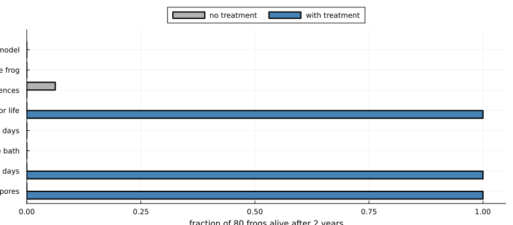

## How much did each step move the answer?

The change in the treated outcome at each step, for each system. Bars to
the right are steps that made treatment look better; bars to the left,
worse.

``` julia
function change_plot(system)
    rows = filter(r -> r.system == system && !isnan(r.treated), ladder)
    d = [rows[i].treated - rows[i - 1].treated for i in 2:length(rows)]
    labels = ["$(rows[i].n). $(rows[i].added)" for i in 2:length(rows)]
    bar(d; orientation = :h, yticks = (1:length(d), labels), yflip = true, legend = false,
        xlims = (-1.05, 1.05), xlabel = "change in treated outcome", title = system,
        color = [x >= 0 ? :seagreen : :indianred for x in d], left_margin = 6Plots.mm,
        size = (840, 70 + 34 * length(d)))
    vline!([0.0]; color = :black)
end
change_plot("Bsal")
```

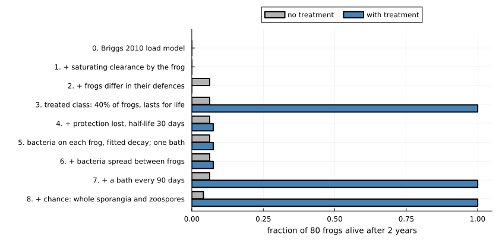

``` julia
change_plot("Bd toad")
```

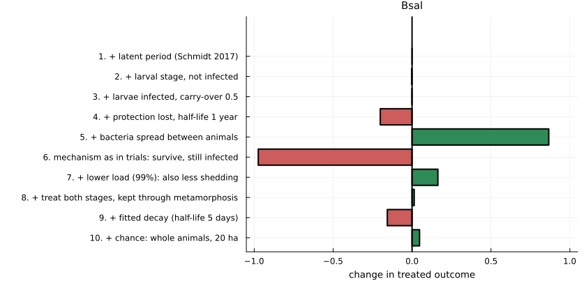

``` julia
change_plot("Bd frog")
```

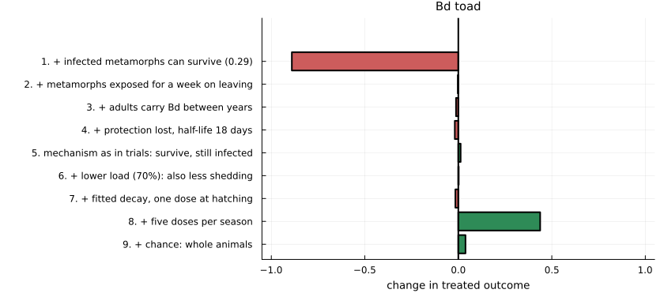

Large bars point both ways in every system. No single addition
dominates, and the sign of a step depends on the system: the observed
mechanism (survive, still infected) is the largest negative step for
Bsal and a large positive step for toads.

## Does the effect of one piece of realism depend on the others?

A ladder adds things in one order. To check that the order is not
driving the conclusions, four pieces of treatment realism are switched
on and off in every combination for Bsal, on the full host model of step
3:

- **mechanism**: blocks infection (0.99), or survive but stay infected
  (0.99);
- **duration**: lasts for life, or fitted decay (half-life 5 days);
- **spread**: none, or between animals at 50 per year;
- **stages**: adults once, or both stages every quarter with the
  bacteria kept through metamorphosis.

``` julia
levels = (
    mechanism = ["blocks", "survive"],
    duration = ["lasting", "decays"],
    spread = ["none", "spreads"],
    stages = ["adults", "both"],
)
function factorial_run(mech, dur, spr, stg)
    tr = T(; (mech == "blocks" ? (efficacy = 0.99,) : (tolerance = 0.99,))...,
        (dur == "decays" ? (abundance_half_life = 5 / 365, protective_fold = 100.0) : (;))...,
        direct = spr == "spreads" ? 50.0 : 0.0)
    kw = stg == "both" ? (treat = :both, treat_times = quarterly, retention = 1.0) : (;)
    return lar(stage, tr; coverage = 1.0, kw...).mean_adults
end
design = [(; mech, dur, spr, stg, outcome = factorial_run(mech, dur, spr, stg))
          for mech in levels.mechanism, dur in levels.duration, spr in levels.spread, stg in levels.stages]
design = sort(vec(design); by = r -> -r.outcome)
nothing
```

``` julia
println("| Mechanism | Duration | Spread | Stages treated | Mean adults |")
println("|---|---|---|---|---|")
for r in design
    @printf("| %s | %s | %s | %s | %.2f |\n", r.mech, r.dur, r.spr, r.stg, r.outcome)
end
```

| Mechanism | Duration | Spread  | Stages treated | Mean adults |
|-----------|----------|---------|----------------|-------------|
| blocks    | lasting  | spreads | both           | 1.00        |
| blocks    | lasting  | none    | both           | 1.00        |
| blocks    | lasting  | spreads | adults         | 1.00        |
| blocks    | lasting  | none    | adults         | 0.33        |
| survive   | lasting  | spreads | both           | 0.27        |
| survive   | lasting  | none    | both           | 0.22        |
| survive   | lasting  | spreads | adults         | 0.20        |
| survive   | lasting  | none    | adults         | 0.13        |
| blocks    | decays   | spreads | both           | 0.07        |
| blocks    | decays   | none    | both           | 0.06        |
| blocks    | decays   | spreads | adults         | 0.05        |
| blocks    | decays   | none    | adults         | 0.05        |
| survive   | decays   | spreads | adults         | 0.04        |
| survive   | decays   | none    | adults         | 0.04        |
| survive   | decays   | none    | both           | 0.03        |
| survive   | decays   | spreads | both           | 0.03        |

The average effect of switching each piece on, and how much that effect
varies with the other three:

``` julia
function effect(field, on)
    diffs = Float64[]
    for r in design
        getfield(r, field) == on || continue
        partner = only(filter(q -> all(getfield(q, f) == getfield(r, f) for f in (:mech, :dur, :spr, :stg) if f != field) &&
            getfield(q, field) != on, design))
        push!(diffs, r.outcome - partner.outcome)
    end
    return diffs
end
println("| Switched on | Mean change | Smallest | Largest |")
println("|---|---|---|---|")
for (field, on, label) in ((:mech, "survive", "survive instead of block"), (:dur, "decays", "fitted decay"),
        (:spr, "spreads", "spread between animals"), (:stg, "both", "treat both stages"))
    d = effect(field, on)
    @printf("| %s | %+.2f | %+.2f | %+.2f |\n", label, sum(d) / length(d), minimum(d), maximum(d))
end
```

| Switched on              | Mean change | Smallest | Largest |
|--------------------------|-------------|----------|---------|
| survive instead of block | -0.32       | -0.80    | -0.00   |
| fitted decay             | -0.47       | -0.95    | -0.09   |
| spread between animals   | +0.10       | -0.00    | +0.67   |
| treat both stages        | +0.10       | -0.01    | +0.67   |

The ranges are wide: the effect of each piece depends strongly on the
others. Spread, for example, matters a great deal for a lasting,
infection-blocking treatment given to adults, and hardly at all once the
bacteria decay in days. (In the model, animals that acquire bacteria
from others share the dosing clock of the treated ones, so spread cannot
outlast the decay.) A piece of realism therefore cannot be judged by
adding it to a simple model alone.

## All steps

``` julia
fmt(x) = isnan(x) ? "" : @sprintf("%.2f", x)
println("| System | Step | Phase | Added | No treatment | With treatment | What changed |")
println("|---|---|---|---|---|---|---|")
for r in ladder
    println("| ", join((r.system, r.n, r.phase, r.added, fmt(r.untreated), fmt(r.treated), r.note), " | "), " |")
end
```

| System | Step | Phase | Added | No treatment | With treatment | What changed |
|----|----|----|----|----|----|----|
| Bsal | 0 | host | susceptible and infectious adults | 0.00 | 0.34 | collapse; treated adults live but are not replaced |
| Bsal | 1 | host | \+ latent period (Schmidt 2017) | 0.00 | 0.34 | almost no change: a one-day delay against a one-week illness |
| Bsal | 2 | host | \+ larval stage, not infected | 0.04 | 0.34 | untreated population no longer vanishes: larvae are a refuge |
| Bsal | 3 | host | \+ larvae infected, carry-over 0.5 | 0.04 | 0.33 | small change at this carry-over |
| Bsal | 4 | treatment | \+ protection lost, half-life 1 year | 0.04 | 0.13 | collapse only delayed |
| Bsal | 5 | treatment | \+ bacteria spread between animals | 0.04 | 1.00 | full protection: the microbiome maintains itself |
| Bsal | 6 | treatment | mechanism as in trials: survive, still infected | 0.04 | 0.02 | fails; survivors shed for longer, so transmission rises |
| Bsal | 7 | treatment | \+ lower load (99%): also less shedding | 0.04 | 0.19 | partial; survivors remain infected |
| Bsal | 8 | treatment | treat both stages, kept through metamorphosis | 0.04 | 1.00 | full protection with no spread at all |
| Bsal | 9 | treatment | \+ fitted decay (half-life 5 days) | 0.04 | 0.06 | fails: protection lasts about a month |
| Bsal | 10 | chance | \+ chance: whole animals, 20 ha | 0.08 | 0.82 | the failed treatment of step 9 now keeps most of the population |
| Bd toad | 0 | host | Mitchell 2008 pond model | 0.00 | 0.98 | untreated: toads and Bd both die out; treated: toads saved, Bd gone |
| Bd toad | 1 | host | \+ infected metamorphs can survive (0.29) | 0.05 | 0.09 | toads no longer die out, so nor does Bd; treatment now protects poorly |
| Bd toad | 2 | host | \+ metamorphs exposed for a week on leaving | 0.05 | 0.08 | little further change |
| Bd toad | 3 | host | \+ adults carry Bd between years | 0.04 |  | untreated only; little change in this parameter set |
| Bd toad | 4 | treatment | \+ protection lost, half-life 18 days | 0.05 | 0.06 | slightly worse |
| Bd toad | 5 | treatment | mechanism as in trials: survive, still infected | 0.05 | 0.75 | much better than blocking here; Bd persists |
| Bd toad | 6 | treatment | \+ lower load (70%): also less shedding | 0.05 | 0.75 | little changed: untreated tadpoles and the pond keep Bd going |
| Bd toad | 7 | treatment | \+ fitted decay, one dose at hatching | 0.05 | 0.06 | protection gone before the season ends |
| Bd toad | 8 | treatment | \+ five doses per season | 0.05 | 0.80 | most of the benefit restored |
| Bd toad | 9 | chance | \+ chance: whole animals | 0.07 | 0.82 | little change for this model; large changes elsewhere (see text) |
| Bd frog | 0 | host | Briggs 2010 load model | 0.00 |  | all die: 80 frogs is above the threshold of 23 |
| Bd frog | 1 | host | \+ saturating clearance by the frog | 0.00 |  | threshold rises from 23 to 68 frogs; 80 still all die |
| Bd frog | 2 | host | \+ frogs differ in their defences | 0.06 |  | a few of the best-defended survive |
| Bd frog | 3 | treatment | treated class: 40% of frogs, lasts for life | 0.00 | 1.00 | all survive, including the untreated: protection is shared |
| Bd frog | 4 | treatment | \+ protection lost, half-life 30 days | 0.00 | 0.00 | die-off delayed by about three months, not prevented |
| Bd frog | 5 | treatment | \+ bacteria on each frog, fitted decay; one bath | 0.00 | 0.00 | die-off delayed by about six weeks |
| Bd frog | 6 | treatment | \+ a bath every 90 days | 0.00 | 1.00 | all survive: each bath resets the slow build-up of load |
| Bd frog | 7 | chance | \+ chance: whole sporangia and zoospores | 0.00 | 1.00 | baths every 90 days still protect; less frequent or narrower bathing now fails |

## What the exercise shows

1.  **The answer changed at almost every step, and reversed more than
    once.** For Bsal, a model stopped at step 5 says a self-spreading
    microbiome is essential; at step 8, that spread is unnecessary; at
    step 9, that neither is achievable with bacteria that last a few
    weeks.
2.  **Host biology can move the answer as much as treatment biology, but
    not everywhere.** A larval stage changed the untreated fate of the
    salamanders. One survival probability for infected toad metamorphs
    reversed both the untreated outcome and the value of the reference
    treatment. The [second
    vignette](../02_nested_model/02_nested_model.md) tests this like for
    like in a single model and finds that it depends on the regime: for
    Bsal at the published host density, six pieces of host biology
    barely change the outcome, and near the invasion threshold they
    change it a great deal. Its stochastic version also shows that
    chance can matter more than any of them: with whole animals,
    blocking infection in every adult on arrival nearly always
    eliminates Bsal, where the equations of step 1 here leave about a
    third of the population.
3.  **How protection works matters more than how strong it is, and its
    effect has no fixed sign.** Letting animals survive infection is the
    worst change for Bsal and one of the best for toads.
4.  **Effects interact.** The factorial shows that the value of spread,
    of treating larvae or of a lasting treatment each depends on the
    other pieces.
5.  **The systems differ for structural reasons.** A toad cohort passes
    through a short infected stage once a year and can be re-treated. A
    salamander must be protected for life against a pathogen that kills
    in a week. In frogs, where disease follows a load that builds
    slowly, short-lived bacteria can still work if they are re-applied.
6.  **Chance is a piece of realism, and it changed the answer in every
    system, in different directions.** For Bsal it turned a failed
    treatment into a successful one, because Bsal arriving among treated
    animals is lost before it can establish. For toads it overturned the
    published extinction of both host and pathogen. For frogs it made
    treatment harder, because random high loads tip the population
    sooner.

## What is not in the models

- In Parts A and B bacterial abundance is a clock since the last dose,
  not a state of each animal. Only the frog model of Part C tracks it
  per animal.
- The fold-drop in abundance at which protection is lost has not been
  measured, nor has the effect of the bacteria on clearance, nor whether
  applied bacteria survive metamorphosis.
- The Bsal model has no recovery from infection and no years between
  metamorphosis and maturity. The toad model has thresholds standing in
  for extinction, and infected adult toads are not yet combined with
  treatment. The frog treatment steps use identical frogs.
- The three systems do not share one model structure, so Part B starts
  from a more complex model than Part A. The [second
  vignette](../02_nested_model/02_nested_model.md) uses one nested
  model, for the salamander system, in which every piece of biology is a
  switch.
- No fade-out rule is applied in Part A, so densities can fall to
  meaningless values and recover. The second vignette shows what such a
  rule changes.
- The stochastic steps use one introduced infected animal (Part A) or
  the published introduction (Parts B and C), one population size, and
  time steps of hours to a day. In Part A the area is 20 hectares;
  whether the host is lost depends on it (see the second vignette).

## References

- Briggs CJ, Knapp RA, Vredenburg VT (2010) Enzootic and epizootic
  dynamics of the chytrid fungal pathogen of amphibians. *Proceedings of
  the National Academy of Sciences* 107:9695–9700.
  [doi:10.1073/pnas.0912886107](https://doi.org/10.1073/pnas.0912886107)
- Harris RN, Brucker RM, Walke JB, Becker MH, et al. (2009) Skin
  microbes on frogs prevent morbidity and mortality caused by a lethal
  skin fungus. *The ISME Journal* 3:818–824.
  [doi:10.1038/ismej.2009.27](https://doi.org/10.1038/ismej.2009.27)
- Knapp RA, Joseph MB, Smith TC, Hegeman EE, et al. (2022) Effectiveness
  of antifungal treatments during chytridiomycosis epizootics in
  populations of an endangered frog. *PeerJ* 10:e12712.
  [doi:10.7717/peerj.12712](https://doi.org/10.7717/peerj.12712)
- Madison JD, Osborne OG, Ellison A, Garvey Griffith CN, et al. (2025)
  Probiotic colonization of *Xenopus laevis* skin causes short-term
  changes in skin microbiomes and gene expression. *Infection and
  Immunity* 93:e00569-24.
  [doi:10.1128/iai.00569-24](https://doi.org/10.1128/iai.00569-24)
- Mitchell KM, Churcher TS, Garner TWJ, Fisher MC (2008) Persistence of
  the emerging pathogen *Batrachochytrium dendrobatidis* outside the
  amphibian host greatly increases the probability of host extinction.
  *Proceedings of the Royal Society B* 275:329–334.
  [doi:10.1098/rspb.2007.1356](https://doi.org/10.1098/rspb.2007.1356)
- Schmidt BR, Bozzuto C, Lötters S, Steinfartz S (2017) Dynamics of host
  populations affected by the emerging fungal pathogen *Batrachochytrium
  salamandrivorans*. *Royal Society Open Science* 4:160801.
  [doi:10.1098/rsos.160801](https://doi.org/10.1098/rsos.160801)
- Smith D, O’Brien D, Hall J, Sergeant C, et al. (2022) Challenging a
  host–pathogen paradigm: susceptibility to chytridiomycosis is
  decoupled from genetic erosion. *Journal of Evolutionary Biology*
  35:589–598. [doi:10.1111/jeb.13987](https://doi.org/10.1111/jeb.13987)
- Wang Y, Verbrugghe E, Meuris L, Chiers K, et al. (2021) Epidermal
  galactose spurs chytrid virulence and predicts amphibian colonization.
  *Nature Communications* 12:5788.
  [doi:10.1038/s41467-021-26127-9](https://doi.org/10.1038/s41467-021-26127-9)
