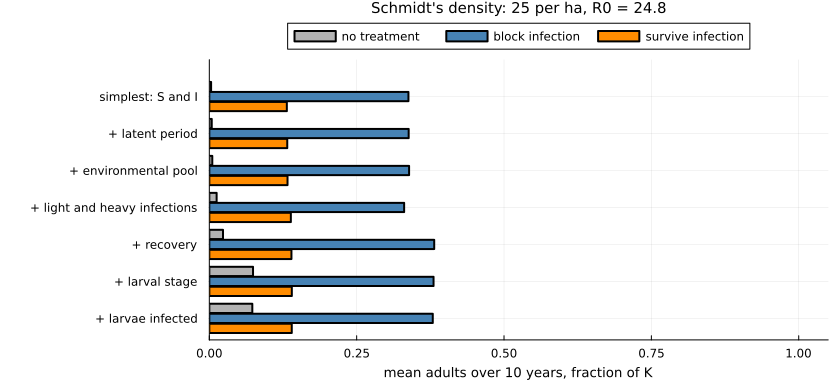
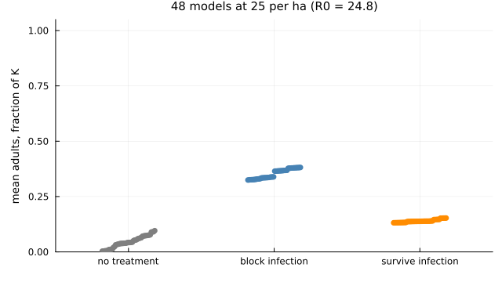
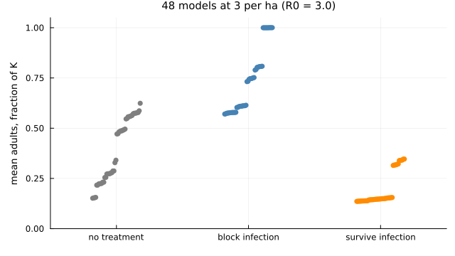
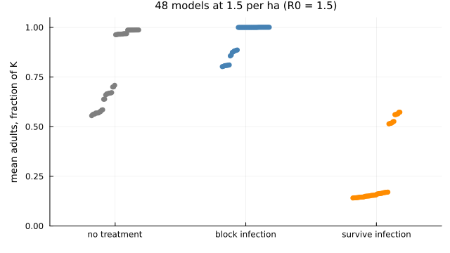
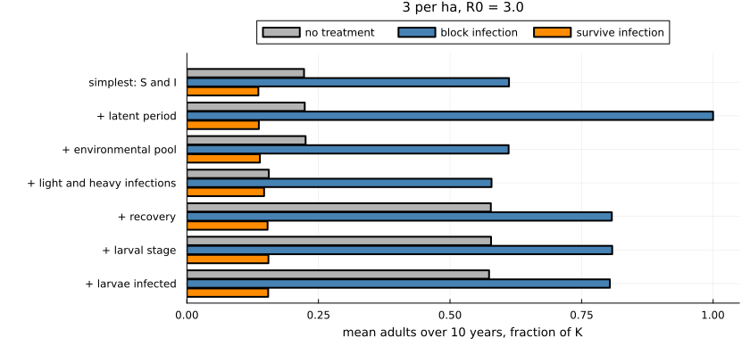
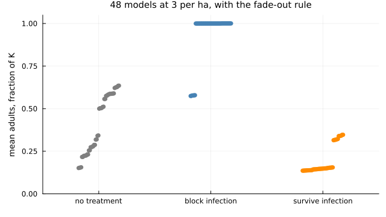

# One model, many switches


- [Why a second vignette](#why-a-second-vignette)
- [The outcomes](#the-outcomes)
- [A ladder in one model](#a-ladder-in-one-model)
- [Every combination](#every-combination)
- [The same comparison nearer the
  threshold](#the-same-comparison-nearer-the-threshold)
- [A fade-out rule](#a-fade-out-rule)
- [Does the order of adding matter?](#does-the-order-of-adding-matter)
- [What this shows](#what-this-shows)
- [Limits](#limits)
- [References](#references)

## Why a second vignette

The [first vignette](../01_building_realism/01_building_realism.md)
built up realism along a ladder in three host–pathogen systems. Those
systems start from three different published models, so their steps
cannot be compared directly, and a ladder adds things in one order only.

This vignette uses a single **nested model** in which each piece of
biology is a switch. With every switch off it is the simplest possible
model: susceptible and infectious adults. Any combination of switches
can be turned on, so that:

- every model is compared with every other like for like;
- the effect of one piece of realism can be measured against every
  setting of the others;
- the same comparison can be repeated in different conditions.

| Switch | What it adds |
|----|----|
| `latent` | infected animals are not infectious at once |
| `environment` | half of transmission goes through a pool of zoospores that outlasts the animals that shed them (total transmission unchanged) |
| `load` | infections start light (little shedding, no disease death) and progress to heavy |
| `recovery` | infected animals can clear the infection |
| `larvae` | an aquatic larval stage between birth and adulthood |
| `larval_infection` | larvae are infected by adults, without disease, and half carry the infection through metamorphosis |

> [!IMPORTANT]
>
> The model is anchored on the Bsal model of Schmidt et al. (2017) for
> fire salamanders: with only `latent` on it is their published model,
> with their parameter values. The carry-over through metamorphosis is
> from Wang et al. (2021), read from the package’s compendium.
> **Everything else is new work in this package and is not a published
> result**, and the values attached to the other switches (pool
> half-life 30 days, light infections shedding 10% as much and lasting
> about two weeks, recovery at the same rate as progression, a
> four-month larval stage) are illustrative.

``` julia
using Chytridiomycosis, Plots, Printf
default(linewidth = 2, size = (720, 380), legendfontsize = 8, guidefontsize = 9,
    titlefontsize = 10, left_margin = 4Plots.mm, bottom_margin = 4Plots.mm)

T(; kw...) = MicrobiomeTreatment(; kw...)
bio(; kw...) = ChytridBiology(:wang2021; kw...)
schmidt = SchmidtParameters(:schmidt2017)
```

    SchmidtParameters{Float64}(0.39, 0.125, 52.0, 364.0, 52.0, 25.0, 0.0625, 1.0)

## The outcomes

Bsal arrives in a population at carrying capacity. Four things are
recorded for each model:

- the pathogen’s initial **growth rate**;
- **untreated**: mean adults over the next ten years, as a fraction of
  carrying capacity;
- **block**: the same, with every adult treated once with bacteria that
  block 99% of infections for life;
- **survive**: the same, with bacteria that prevent 99% of disease
  deaths and do not block infection. This is the kind of protection seen
  in trials.

``` julia
function outcomes(p, b)
    run(tr; kw...) = solve(NestedChytridProblem(p, b, tr; kw...))
    u = run(T())
    bl, sv = run(T(efficacy = 0.99); coverage = 1.0), run(T(tolerance = 0.99); coverage = 1.0)
    fate(r) = !isnan(r.host_extinction) ? :host_lost : !isnan(r.pathogen_fadeout) ? :pathogen_gone : :both_persist
    return (growth = invasion_growth_rate(p, b), untreated = u.mean_adults, lowest = u.min_adults,
        block = bl.mean_adults, survive = sv.mean_adults, fates = (fate(u), fate(bl), fate(sv)))
end
```

    outcomes (generic function with 1 method)

A check first: with only the latent class switched on, the growth rate
equals the one that follows from the equations of Schmidt et al. (2017).

``` julia
p = schmidt
λ = (sqrt((p.e - p.d_I)^2 + 4 * p.e * p.β * p.K) - 2p.b - p.d_I - p.e) / 2
(nested = invasion_growth_rate(p, bio(latent = true)), schmidt = λ)
```

    (nested = 496.972318234428, schmidt = 496.97231824502785)

## A ladder in one model

The switches are turned on one after another, starting from the simplest
model.

``` julia
order = [:latent, :environment, :load, :recovery, :larvae, :larval_infection]
names_ = ["simplest: S and I", "+ latent period", "+ environmental pool", "+ light and heavy infections",
    "+ recovery", "+ larval stage", "+ larvae infected"]
ladder_models(p) = [outcomes(p, bio(; (k => true for k in order[1:i])...)) for i in 0:length(order)]

function ladder_figure(rows, title)
    k = length(rows)
    bar((1:k) .- 0.27, [r.untreated for r in rows]; orientation = :h, bar_width = 0.25, label = "no treatment",
        color = :gray70, yticks = (1:k, names_), yflip = true, xlims = (0, 1.05), xticks = 0:0.25:1,
        xlabel = "mean adults over 10 years, fraction of K", size = (840, 80 + 44k),
        left_margin = 6Plots.mm, legend = :outertop, legend_column = 3, title)
    bar!(1:k, [r.block for r in rows]; orientation = :h, bar_width = 0.25, label = "block infection", color = :steelblue)
    bar!((1:k) .+ 0.27, [r.survive for r in rows]; orientation = :h, bar_width = 0.25, label = "survive infection",
        color = :darkorange)
end

function ladder_table(rows)
    println("| Model | Growth rate (per yr) | Untreated | Lowest untreated | Block | Survive |")
    println("|---|---|---|---|---|---|")
    for (n, r) in zip(names_, rows)
        @printf("| %s | %.0f | %.3f | %.0e | %.3f | %.3f |\n", n, r.growth, r.untreated, r.lowest, r.block, r.survive)
    end
end

high = ladder_models(schmidt)
ladder_figure(high, "Schmidt's density: 25 per ha, R0 = 24.8")
```



``` julia
ladder_table(high)
```

| Model | Growth rate (per yr) | Untreated | Lowest untreated | Block | Survive |
|----|----|----|----|----|----|
| simplest: S and I | 1248 | 0.003 | 2e-11 | 0.338 | 0.132 |
| \+ latent period | 497 | 0.004 | 2e-11 | 0.338 | 0.132 |
| \+ environmental pool | 309 | 0.005 | 2e-11 | 0.339 | 0.133 |
| \+ light and heavy infections | 111 | 0.012 | 6e-06 | 0.331 | 0.138 |
| \+ recovery | 98 | 0.023 | 2e-03 | 0.382 | 0.139 |
| \+ larval stage | 98 | 0.074 | 2e-02 | 0.380 | 0.140 |
| \+ larvae infected | 98 | 0.073 | 2e-02 | 0.379 | 0.140 |

At the density Schmidt et al. used, where Bsal’s reproduction number is
about 25, **the added biology changes the conclusions very little**. The
epidemic slows more than ten-fold as switches are turned on, but the
population collapses in every model, and each treatment gives almost the
same result throughout. One thing does change: the lowest density the
untreated population reaches rises by many orders of magnitude, which
matters for whether it could go extinct.

## Every combination

A ladder is one path. The four switches for the adult stage are now set
in every combination, with three settings for the larvae (none, present
but not infected, infected): 48 models.

``` julia
configs = vec([(; latent, environment, load, recovery, larvae = lv > 0, larval_infection = lv > 1)
    for latent in (false, true), environment in (false, true), load in (false, true),
        recovery in (false, true), lv in 0:2])
all_models(p; fade = 0.0) = [(c, outcomes(p, bio(; fadeout_density = fade, c...))) for c in configs]

same(c, c2, skip) = all(getfield(c, k) == getfield(c2, k) for k in keys(c) if !(k in skip))
pieces = [
    ("latent period", c -> c.latent, (c, c2) -> !c2.latent && same(c, c2, (:latent,))),
    ("environmental pool", c -> c.environment, (c, c2) -> !c2.environment && same(c, c2, (:environment,))),
    ("light and heavy infections", c -> c.load, (c, c2) -> !c2.load && same(c, c2, (:load,))),
    ("recovery", c -> c.recovery, (c, c2) -> !c2.recovery && same(c, c2, (:recovery,))),
    ("larval stage", c -> c.larvae && !c.larval_infection,
        (c, c2) -> !c2.larvae && same(c, c2, (:larvae, :larval_infection))),
    ("larvae infected", c -> c.larval_infection,
        (c, c2) -> c2.larvae && !c2.larval_infection && same(c, c2, (:larvae, :larval_infection))),
]
# change in an outcome when a piece is switched on, for every setting of the other pieces
effects(res, on, off, f) = [f(o) - f(o2) for (c, o) in res if on(c) for (c2, o2) in res if off(c, c2)]

function effects_table(res)
    println("| Piece switched on | Untreated: mean (range) | Block: mean (range) | Survive: mean (range) |")
    println("|---|---|---|---|")
    for (label, on, off) in pieces
        cells = map((o -> o.untreated, o -> o.block, o -> o.survive)) do f
            d = effects(res, on, off, f)
            @sprintf("%+.2f (%+.2f to %+.2f)", sum(d) / length(d), minimum(d), maximum(d))
        end
        println("| ", label, " | ", join(cells, " | "), " |")
    end
end

function spread_figure(res, title)
    f = (o -> o.untreated, o -> o.block, o -> o.survive)
    labels = ["no treatment", "block infection", "survive infection"]
    plot(; xticks = (1:3, labels), xlims = (0.5, 3.5), ylims = (0, 1.05), ylabel = "mean adults, fraction of K", legend = false,
        title, size = (640, 360))
    for (i, g) in enumerate(f)
        v = [g(o) for (_, o) in res]
        scatter!(i .+ range(-0.18, 0.18; length = length(v)), sort(v); markersize = 4,
            color = (:gray50, :steelblue, :darkorange)[i], markerstrokewidth = 0)
    end
    current()
end

res_high = all_models(schmidt)
spread_figure(res_high, "48 models at 25 per ha (R0 = 24.8)")
```



``` julia
effects_table(res_high)
```

| Piece switched on | Untreated: mean (range) | Block: mean (range) | Survive: mean (range) |
|----|----|----|----|
| latent period | +0.00 (+0.00 to +0.00) | +0.00 (+0.00 to +0.00) | +0.00 (+0.00 to +0.01) |
| environmental pool | -0.02 (-0.08 to +0.00) | +0.00 (+0.00 to +0.00) | +0.00 (-0.00 to +0.00) |
| light and heavy infections | +0.01 (-0.00 to +0.02) | +0.00 (-0.01 to +0.01) | -0.00 (-0.01 to +0.01) |
| recovery | +0.03 (+0.00 to +0.09) | +0.04 (+0.03 to +0.05) | +0.01 (+0.00 to +0.02) |
| larval stage | +0.02 (-0.03 to +0.05) | -0.00 (-0.00 to -0.00) | +0.00 (+0.00 to +0.00) |
| larvae infected | -0.00 (-0.01 to -0.00) | -0.00 (-0.00 to -0.00) | -0.00 (-0.00 to -0.00) |

Each dot is one of the 48 models. At this density they sit almost on top
of each other: no piece of host biology moves any outcome by more than
about 0.1. When the pathogen spreads this fast and kills this quickly,
the simple model gives the same answer as the complex one.

## The same comparison nearer the threshold

Schmidt et al. show that Bsal cannot invade below about one adult female
per hectare. The comparison is repeated at 3 per hectare (reproduction
number 3) and 1.5 per hectare (1.5).

``` julia
mid, low = Chytridiomycosis.with(schmidt; K = 3.0), Chytridiomycosis.with(schmidt; K = 1.5)
res_mid, res_low = all_models(mid), all_models(low)
spread_figure(res_mid, "48 models at 3 per ha (R0 = 3.0)")
```



``` julia
effects_table(res_mid)
```

| Piece switched on | Untreated: mean (range) | Block: mean (range) | Survive: mean (range) |
|----|----|----|----|
| latent period | +0.01 (-0.00 to +0.09) | +0.03 (-0.00 to +0.39) | +0.00 (+0.00 to +0.00) |
| environmental pool | -0.02 (-0.09 to +0.03) | -0.10 (-0.39 to +0.01) | -0.00 (-0.03 to +0.00) |
| light and heavy infections | +0.01 (-0.07 to +0.09) | -0.03 (-0.42 to +0.06) | -0.09 (-0.20 to +0.01) |
| recovery | +0.30 (+0.17 to +0.47) | +0.22 (+0.00 to +0.42) | +0.10 (+0.01 to +0.21) |
| larval stage | +0.04 (-0.06 to +0.13) | +0.00 (-0.00 to +0.00) | -0.00 (-0.01 to +0.00) |
| larvae infected | -0.03 (-0.11 to -0.00) | -0.09 (-0.40 to -0.00) | -0.00 (-0.00 to -0.00) |

``` julia
spread_figure(res_low, "48 models at 1.5 per ha (R0 = 1.5)")
```



``` julia
effects_table(res_low)
```

| Piece switched on | Untreated: mean (range) | Block: mean (range) | Survive: mean (range) |
|----|----|----|----|
| latent period | +0.00 (+0.00 to +0.05) | +0.00 (-0.00 to +0.00) | +0.00 (-0.00 to +0.00) |
| environmental pool | -0.00 (-0.04 to +0.03) | -0.05 (-0.19 to +0.02) | -0.01 (-0.05 to +0.01) |
| light and heavy infections | -0.04 (-0.12 to +0.02) | -0.02 (-0.08 to -0.00) | -0.18 (-0.41 to +0.01) |
| recovery | +0.36 (+0.26 to +0.43) | +0.11 (+0.00 to +0.20) | +0.21 (+0.01 to +0.43) |
| larval stage | -0.00 (-0.04 to +0.01) | +0.00 (-0.00 to +0.00) | -0.00 (-0.01 to +0.00) |
| larvae infected | -0.01 (-0.07 to -0.00) | -0.04 (-0.19 to -0.00) | -0.00 (-0.00 to -0.00) |

Now the models disagree. At 3 per hectare the untreated outcome ranges
from 0.15 to 0.62 depending on which biology is included, and the
infection-blocking treatment from 0.57 to full protection. **Realism
matters most near the threshold.**

The ladder at 3 per hectare:

``` julia
ladder_figure(ladder_models(mid), "3 per ha, R0 = 3.0")
```



Three things stand out.

1.  **Recovery is the piece that matters most**, for the untreated
    population and for the blocking treatment. This project has no
    estimate of it for Bsal.
2.  **Pieces do not have a fixed effect.** The ranges in the tables are
    wide: an environmental pool, or infected larvae, changes the
    blocking treatment by anything from nothing to −0.4 depending on
    what else is in the model.
3.  **Bacteria that let animals survive infection do worse than no
    treatment** at these densities, in every one of the 48 models
    (orange below grey; counts in the table below). Untreated, an
    epidemic at low density burns out and the population recovers.
    Treated animals that survive stay infectious in this model, and keep
    infecting the untreated animals born after them.

``` julia
println("| Density | Models in which the survive treatment does worse than none | Blocking does worse than none |")
println("|---|---|---|")
for (label, res) in (("25 per ha", res_high), ("3 per ha", res_mid), ("1.5 per ha", res_low))
    @printf("| %s | %d of 48 | %d of 48 |\n", label, count(x -> x[2].survive < x[2].untreated, res),
        count(x -> x[2].block < x[2].untreated - 1e-6, res))
end
```

| Density | Models in which the survive treatment does worse than none | Blocking does worse than none |
|----|----|----|
| 25 per ha | 0 of 48 | 0 of 48 |
| 3 per ha | 48 of 48 | 0 of 48 |
| 1.5 per ha | 48 of 48 | 0 of 48 |

## A fade-out rule

The equations are deterministic, so a density can fall to a value that
means far less than one animal and then grow back. Near the threshold
that can decide the result. The model is therefore given a fade-out
rule, itself a piece of realism: once infected animals fall below one
per 100 km² (0.0001 per hectare) the pathogen is removed, and if all
animals fall below that density the host population is removed. The
threshold is illustrative.

``` julia
fade = 1e-4
fres_high, fres_mid, fres_low = all_models(schmidt; fade), all_models(mid; fade), all_models(low; fade)
nothing
```

With the rule, each run has a fate within the ten years: the host is
lost, the pathogen is lost and the host remains, or both persist.

``` julia
println("| Density | Treatment | Host lost | Pathogen lost, host remains | Both persist | Mean adults: range |")
println("|---|---|---|---|---|---|")
for (label, res) in (("25 per ha", fres_high), ("3 per ha", fres_mid), ("1.5 per ha", fres_low))
    for (i, (name, f)) in enumerate((("none", o -> o.untreated), ("block", o -> o.block), ("survive", o -> o.survive)))
        fates = [o.fates[i] for (_, o) in res]
        v = [f(o) for (_, o) in res]
        @printf("| %s | %s | %d | %d | %d | %.2f to %.2f |\n", label, name, count(==(:host_lost), fates),
            count(==(:pathogen_gone), fates), count(==(:both_persist), fates), minimum(v), maximum(v))
    end
end
```

| Density | Treatment | Host lost | Pathogen lost, host remains | Both persist | Mean adults: range |
|----|----|----|----|----|----|
| 25 per ha | none | 4 | 34 | 10 | 0.00 to 0.10 |
| 25 per ha | block | 0 | 0 | 48 | 0.32 to 0.38 |
| 25 per ha | survive | 0 | 0 | 48 | 0.13 to 0.15 |
| 3 per ha | none | 0 | 48 | 0 | 0.15 to 0.64 |
| 3 per ha | block | 0 | 42 | 6 | 0.57 to 1.00 |
| 3 per ha | survive | 0 | 12 | 36 | 0.14 to 0.35 |
| 1.5 per ha | none | 0 | 48 | 0 | 0.56 to 0.99 |
| 1.5 per ha | block | 0 | 48 | 0 | 1.00 to 1.00 |
| 1.5 per ha | survive | 0 | 12 | 36 | 0.14 to 0.57 |

``` julia
spread_figure(fres_mid, "48 models at 3 per ha, with the fade-out rule")
```



``` julia
effects_table(fres_mid)
```

| Piece switched on | Untreated: mean (range) | Block: mean (range) | Survive: mean (range) |
|----|----|----|----|
| latent period | +0.00 (-0.00 to +0.00) | +0.00 (-0.00 to +0.00) | +0.00 (+0.00 to +0.00) |
| environmental pool | -0.04 (-0.08 to +0.00) | -0.11 (-0.43 to -0.00) | -0.00 (-0.03 to +0.00) |
| light and heavy infections | +0.00 (-0.07 to +0.09) | -0.11 (-0.43 to -0.00) | -0.09 (-0.20 to +0.01) |
| recovery | +0.33 (+0.22 to +0.47) | +0.11 (+0.00 to +0.43) | +0.10 (+0.01 to +0.21) |
| larval stage | +0.05 (-0.00 to +0.13) | -0.00 (-0.00 to +0.00) | -0.00 (-0.01 to +0.00) |
| larvae infected | -0.01 (-0.02 to -0.01) | -0.00 (-0.00 to -0.00) | -0.00 (-0.00 to -0.00) |

What the rule changes, and what it does not:

1.  **One apparent effect was an artefact.** Without the rule, adding a
    latent period at 3 per hectare seemed to turn the blocking treatment
    from partial to full protection (+0.39). With the rule the latent
    period has no effect at all. In both models the pathogen is in fact
    lost; the model without the latent period was regrowing it from a
    meaningless density.
2.  **The blocking treatment now eliminates the pathogen in most models
    near the threshold**: in 42 of 48 at 3 per hectare and in all 48 at
    1.5. The exceptions at 3 per hectare are models with an
    environmental pool and light infections but no recovery.
3.  **Recovery remains the piece that matters most** for the untreated
    population.
4.  **Treatment changes the fate as well as the numbers.** At 25 per
    hectare an untreated epidemic burns itself out in most models, and
    in a few the host is lost. With either treatment, host and pathogen
    both persist in every model: the treated animals keep the population
    going, and with it the pathogen.
5.  **The survive-type treatment still does worse than none** at the
    lower densities. In most models it is the reason the pathogen
    persists.

## Does the order of adding matter?

The effect of each piece when it is the first thing added to the
simplest model, and when it is the last thing added to the otherwise
complete model, at 3 per hectare with the fade-out rule:

``` julia
full = (latent = true, environment = true, load = true, recovery = true, larvae = true, larval_infection = true)
empty_ = (latent = false, environment = false, load = false, recovery = false, larvae = false, larval_infection = false)
get_(res, c) = only(o for (c2, o) in res if c2 == c)
println("| Piece | Untreated: added first | added last | Block: added first | added last |")
println("|---|---|---|---|---|")
for (label, on, off) in (("latent period", (latent = true,), (latent = false,)),
        ("environmental pool", (environment = true,), (environment = false,)),
        ("light and heavy infections", (load = true,), (load = false,)),
        ("recovery", (recovery = true,), (recovery = false,)),
        ("larval stage, infected", (larvae = true, larval_infection = true), (larvae = false, larval_infection = false)))
    first_ = (get_(fres_mid, merge(empty_, on)), get_(fres_mid, empty_))
    last_ = (get_(fres_mid, full), get_(fres_mid, merge(full, off)))
    @printf("| %s | %+.2f | %+.2f | %+.2f | %+.2f |\n", label, first_[1].untreated - first_[2].untreated,
        last_[1].untreated - last_[2].untreated, first_[1].block - first_[2].block, last_[1].block - last_[2].block)
end
```

| Piece | Untreated: added first | added last | Block: added first | added last |
|----|----|----|----|----|
| latent period | +0.00 | +0.00 | -0.00 | -0.00 |
| environmental pool | +0.00 | -0.04 | -0.00 | -0.00 |
| light and heavy infections | -0.07 | +0.08 | -0.00 | -0.00 |
| recovery | +0.33 | +0.37 | +0.00 | +0.42 |
| larval stage, infected | +0.10 | -0.01 | -0.00 | -0.00 |

Where the two columns differ, the piece interacts with the others, and a
ladder would give a different impression depending on where the piece
was placed.

## What this shows

1.  **Whether realism matters depends on the regime.** For a pathogen
    far above its invasion threshold, six pieces of host biology barely
    change the outcome or the value of treatment. Near the threshold the
    same pieces change both a great deal.
2.  **So the first question is where the system sits.** If Bsal in dense
    salamander populations really has a reproduction number near 25, a
    simple model is enough to say that an infection-blocking treatment
    given once to adults leaves about a third of the population. In
    sparser populations the answer depends on biology that has not been
    measured, recovery above all.
3.  **Effects of single pieces are not transferable.** They vary with
    the rest of the model, so the result of adding one piece to a simple
    model should not be read as the effect of that piece.
4.  **Protection that keeps infected animals alive can be worse than
    none**, where the untreated epidemic would have burnt out.
5.  **A simple model can mislead through its mathematics as well as its
    biology.** One of the largest apparent effects in this vignette
    disappeared when densities too small to mean anything were no longer
    allowed to grow back.

## Limits

- The nested model covers the salamander system only. The toad and frog
  systems of the first vignette have features it lacks: a seasonal
  cohort, and a continuous load on each animal.
- The fade-out rule is a threshold on a deterministic model, with an
  illustrative value. It removes the worst artefact but is not a
  substitute for a stochastic model, which would give the chance of each
  fate.
- Fates are judged within ten years. A population left at a few percent
  of its former density is counted as remaining.
- Treated animals that survive infection never clear it unless
  `recovery` is on.
- The values attached to the switches are illustrative. Different values
  would change the sizes of the effects, though the contrast between
  regimes should hold.

## References

- Schmidt BR et al. (2017) R Soc Open Sci 4:160801.
  doi:10.1098/rsos.160801
- Wang Y et al. (2021) Nat Commun 12:5788.
  doi:10.1038/s41467-021-26127-9
