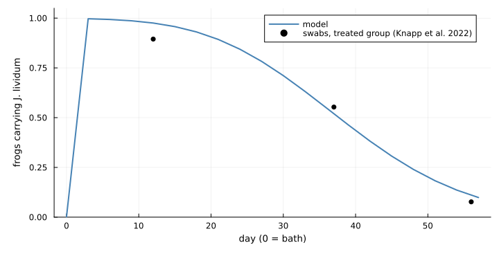
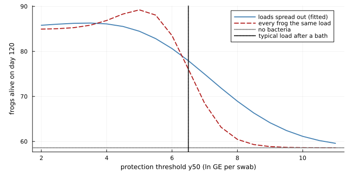

# Does it matter that frogs carry different amounts of a protective bacterium?


- [The question](#the-question)
- [The model](#the-model)
- [What the field trial says](#what-the-field-trial-says)
- [Does the spread of bacterial loads
  matter?](#does-the-spread-of-bacterial-loads-matter)
- [Tolerance and resistance pull $R_0$
  apart](#tolerance-and-resistance-pull-r_0-apart)
- [What the tutorial shows](#what-the-tutorial-shows)
- [Limits](#limits)
- [References](#references)

> [!NOTE]
>
> ### Models in this tutorial
>
> | Model | Source | Category | API page |
> |----|----|----|----|
> | Two-trait IPM of Bd and bacterial load, `BacteriaIPMProblem` | this package, on Wilber et al. 2016 (Bd) and 2017 (zoospore pool) | new | `api/bacteria_ipm.md` |
> | Fit to the joint loads of a field trial, `KnappJointModel` | this package; data of Knapp et al. 2022 | new (new fit) | `api/bacteria_ipm.md` |
>
> Categories: **published** models reimplement a paper’s equations and
> are checked against it; **modified** models add structure to a
> published model; **new** models are new structure. Results from
> modified and new models are not published results.

## The question

Probiotic baths give frogs a skin bacterium that makes an antifungal
compound. In the package’s other microbiome models a treated frog is
either protected or not ([treated/untreated
layer](../07_building_realism/07_building_realism.md)), or carries an
abundance of the bacterium that acts on a single Bd load equation. But
frogs do not take up the same amount of bacteria from a bath, the
bacteria decline at different rates on different frogs, and how well
they protect is thought to depend on how many there are: Becker et al.
(2009) report that “a threshold violacein concentration of about 18 μM
on a salamander’s skin prevents mortality”. If protection has a
threshold, the spread of bacterial loads among frogs may matter as much
as their average.

This tutorial uses a model in which each frog carries two continuous
traits, its Bd load and the load of the bacterium *Janthinobacterium
lividum*, and asks:

1.  what the one field trial with both loads measured says about the
    bacteria;
2.  whether the spread of bacterial loads among frogs changes how many
    survive;
3.  how protection that acts on survival (tolerance) and protection that
    acts on Bd growth (resistance) change the spread of Bd ($R_0$).

``` julia
using Chytridiomycosis, Plots, Printf
include("../diagram.jl")
default(linewidth = 2, size = (720, 380), legendfontsize = 8, guidefontsize = 9,
    titlefontsize = 10, left_margin = 4Plots.mm, bottom_margin = 4Plots.mm)
C = Chytridiomycosis
nothing
```

## The model

Each frog carries a Bd load $x$ (ln zoospore equivalents per swab) and a
load $y$ of *J. lividum* (ln genomic equivalents per swab). Frogs are
uninfected or infected, and carry the bacteria or not, so there are four
classes; the pond holds zoospores $Z$. One step is 3 days, as in Wilber
et al. (2016).


An infected frog at $(x, y)$ survives a step with probability $s$,
clears Bd with probability $l$, and otherwise moves to $(x', y')$:

$$\begin{aligned}
\operatorname{logit} s(x, y) &= b_{00} + b_{10} x + \kappa_s h(y), \\
\operatorname{logit} l(x, y) &= b_{02} + b_{12} x + b_{22} T + \kappa_l h(y), \\
x' &\sim \mathrm{Normal}\!\left(b_{01} + b_{11} x + b_{21} T - \kappa_g h(y),\ v_{01} e^{2 c_{01} x}\right), \\
y' \mid x' &\sim \mathrm{Normal}\!\left(y - \delta \Delta t - \rho x + r \tfrac{\sigma_y}{\sigma_x}(x' - \mathrm{E}\,x'),\ \sigma_y^2 (1 - r^2)\right),
\end{aligned}$$

with the protection given by the bacteria a smooth threshold

$$h(y) = \frac{1}{1 + e^{-(y - y_{50})/w}}.$$

A frog whose $y'$ falls below 0 (1 genomic equivalent) has lost its
bacteria. Uninfected frogs are infected with probability $\phi$ per step
(times $1 - \kappa_i h(y)$ if they carry bacteria), starting at a Bd
load drawn from the initial-load distribution of Wilber et al. (2016).
In the pond, $\phi = 1 - e^{-\Lambda \Delta t}$ with
$\Lambda = \beta_0 \ln(Z + 1) + \beta_1 I$, and
$Z' = \nu(T) Z + \mu_A \sum e^x n(x)$ over infected frogs (Wilber et
al. 2017). A bath gives a fraction of all frogs a fresh load
$y \sim \mathrm{Normal}(\mu_b, \sigma_b)$. With every $\kappa$, $\rho$
and $r$ zero, the Bd side is exactly the Wilber et al. (2016) model.

| Symbol | Meaning | Value |
|----|----|----|
| $b_{00}, b_{10}$; $b_{01}, b_{11}, b_{21}, v_{01}, c_{01}$; $b_{02}, b_{12}, b_{22}$ | Bd survival, growth and clearance | Wilber et al. 2016 (compendium) |
| $\beta_0, \beta_1, \mu_A, \nu(T)$ | transmission, shedding, zoospore survival | Wilber et al. 2017 (compendium) |
| $\delta$ | decline of $y$ per day | fitted below (half-life about 4 days) |
| $\sigma_y$ | SD of the change in $y$ per step | fitted below |
| $\mu_b, \sigma_b$ | $y$ just after a bath | fitted below |
| $y_{50}, w$ | protection threshold and width | illustrative ($\ln 100$, 0.5) |
| $\kappa_s, \kappa_g, \kappa_l, \kappa_i$ | protection of survival, growth, clearance, infection | illustrative (2, 1, 0, 0) |
| $\rho, r$ | effect of Bd on the bacteria; correlation | 0 (no published support) |
| $T$ | water temperature | 15 °C here |

## What the field trial says

In Knapp et al. (2022), subadult *Rana sierrae* in Dusy Basin were
treated with itraconazole, bathed in *J. lividum* on days 0 and 1,
released into the pond and swabbed on days 12, 37 and 56. Frogs were
marked by group, not individually, so a frog’s loads cannot be followed
from one visit to the next. What the swabs give is the joint
distribution of the two loads in the treated group on each day, and that
is what the model is fitted to (`KnappJointModel`): from the day-0 swabs
and a bath, with a constant infection probability per step from the
pond.

``` julia
m = KnappJointModel(; coupled = false)
fit = maximum_likelihood(m; starts = 1, iters = 1500)
e = fit.estimates
@printf("log-likelihood %.2f over %d swabs\n", fit.loglik, fit.n)
@printf("J. lividum half-life %.2f days; just after the bath ln GE %.2f (SD %.2f); σy = %.2f per step\n",
    log(2) / e.decline, e.bath_mean, e.bath_sd, e.σy)
@printf("infection probability %.2f per 3 days; %.0f ITS copies per zoospore equivalent\n",
    e.φ, e.copies_per_ze)
```

    log-likelihood -540.40 over 143 swabs
    J. lividum half-life 4.68 days; just after the bath ln GE 6.48 (SD 2.17); σy = 0.15 per step
    infection probability 0.51 per 3 days; 63 ITS copies per zoospore equivalent

The bacteria halve in four to five days, and their loads spread out as
they decline. The half-life and the noise $\sigma_y$ are not separately
well determined: the best fit found by
`scripts/bacteria_ipm_knapp_fit.jl` (six starts) has a half-life of 4.07
days and $\sigma_y = 0.29$ at log-likelihood −540.38, almost the same as
this single start. With group-marked frogs, a slower decline with less
noise and a faster one with more give nearly the same cross-sections.
The model follows the share of frogs still carrying them:

``` julia
_, sol = C._knapp_joint_solve(m, fit.x)
s = bacteria_ipm_summary(sol)
obs = Dict{Float64,Tuple{Int,Int}}()
for w in m.swabs
    (w.day > 0 && !isnan(w.jl)) || continue
    a, b = get(obs, w.day, (0, 0))
    obs[w.day] = (a + (w.jl >= 1), b + 1)
end
days = sort(collect(keys(obs)))
plot(s.t, s.carrying; label = "model", color = :steelblue, xlabel = "day (0 = bath)",
    ylabel = "frogs carrying J. lividum", ylim = (0, 1.05), legend = :topright)
scatter!(days, [obs[d][1] / obs[d][2] for d in days]; color = :black,
    label = "swabs, treated group (Knapp et al. 2022)")
```



Does a frog’s *J. lividum* load slow its Bd? The coupled model
(`coupled = true`) adds the growth effect $\kappa_g$ and its threshold
$y_{50}$. The fit in `scripts/bacteria_ipm_knapp_fit.jl` profiles
$\kappa_g$: fixed anywhere between −2 and 4, with the other parameters
re-fitted, the log-likelihood stays within 0.6 of the uncoupled fit, so
the joint loads give **no evidence that more bacteria mean less Bd
growth**. (Its unconstrained maximum puts an implausibly large effect in
the opposite direction on a few frogs with very many bacteria; Jani &
Briggs (2014) also found *Janthinobacterium* rising with Bd in an
infection experiment.) The protective effects below are therefore
illustrative.

## Does the spread of bacterial loads matter?

Take 100 frogs at 15 °C with 2 infected, bathed every 15 days, with
illustrative protection ($\kappa_s = 2$, $\kappa_g = 1$). Compare frogs
whose bacterial loads spread out as fitted with frogs that all carry the
same load, for thresholds $y_{50}$ below, at and above the typical load
just after a bath (ln GE 6.5):

``` julia
p = BacteriaIPMParameters()
baths = [(day = d, coverage = 1.0) for d in 0:15:105]
left(q, b = baths) = bacteria_ipm_summary(solve(BacteriaIPMProblem(q; temperature = 15.0,
    uninfected = 98, infected = 2, baths = b))).frogs[end]
none = left(C.with(p; κ_survival = 0.0, κ_growth = 0.0), ())
y50s = 2.0:0.5:11.0
spread = [left(C.with(p; y50)) for y50 in y50s]
same = [left(C.with(p; y50, bath_sd = 0.05, σy = 0.05)) for y50 in y50s]
plot(y50s, spread; label = "loads spread out (fitted)", color = :steelblue,
    xlabel = "protection threshold y50 (ln GE per swab)", ylabel = "frogs alive on day 120")
plot!(y50s, same; label = "every frog the same load", color = :firebrick, linestyle = :dash)
hline!([none]; label = "no bacteria", color = :gray, linestyle = :dot)
vline!([p.bath_mean]; label = "typical load after a bath", color = :black, linestyle = :dot)
```



``` julia
println("| Threshold y50 | Loads spread out | Every frog the same load | No bacteria |")
println("|---|---|---|---|")
for y in (4.0, 5.0, 6.5, 8.0, 9.5)
    i = findfirst(==(y), y50s)
    @printf("| %.1f | %.1f | %.1f | %.1f |\n", y, spread[i], same[i], none)
end
```

| Threshold y50 | Loads spread out | Every frog the same load | No bacteria |
|---------------|------------------|--------------------------|-------------|
| 4.0           | 86.1             | 86.9                     | 58.6        |
| 5.0           | 84.5             | 89.2                     | 58.6        |
| 6.5           | 77.9             | 76.1                     | 58.6        |
| 8.0           | 68.9             | 60.5                     | 58.6        |
| 9.5           | 62.4             | 58.7                     | 58.6        |

The spread helps or hurts depending on where the threshold is. When it
is below the typical load, frogs that all carry the same load are all
protected, while a spread pushes some frogs below the threshold. When it
is above the typical load, frogs that all carry the same load are all
unprotected, and only the spread puts some frogs above it. A model that
gives every treated frog the same protection cannot show either effect,
and where the threshold lies on the load axis is not known: Becker et
al. (2009) measured violacein, not bacterial load, and the two were only
weakly related ($r = 0.33$).

## Tolerance and resistance pull $R_0$ apart

$R_0$ here counts the frogs one infected frog infects through the
zoospore pool and directly (computed as in Wilber et al. 2017). Give
every uninfected frog bacteria at the post-bath distribution, with
protection acting on survival only or on Bd growth only:

``` julia
pc = C._bacteria_pieces(p, IPMMesh2D(IPMMesh(:wilber2016; n = 50), IPMMesh(0.0, 14.0, 28)), 15.0)
function r0(q; carrying)
    nx, ny = 50, 28
    u0 = zeros(1 + ny + nx + nx * ny + 1)
    u0[1] = 100 * (1 - carrying)
    u0[2:1+ny] .= 100 * carrying .* pc.bath ./ sum(pc.bath)
    basic_reproduction_number(BacteriaIPMProblem(q; temperature = 15.0, u0))
end
println("| Protection | No frog carrying | Half carrying | All carrying |")
println("|---|---|---|---|")
for (lab, q) in (("on survival only (κs = 2)", C.with(p; κ_growth = 0.0)),
        ("on Bd growth only (κg = 1)", C.with(p; κ_survival = 0.0)))
    @printf("| %s | %.0f | %.0f | %.0f |\n", lab, r0(q; carrying = 0.0), r0(q; carrying = 0.5),
        r0(q; carrying = 1.0))
end
```

| Protection                 | No frog carrying | Half carrying | All carrying |
|----------------------------|------------------|---------------|--------------|
| on survival only (κs = 2)  | 385              | 390           | 395          |
| on Bd growth only (κg = 1) | 385              | 341           | 297          |

Bacteria that let infected frogs live longer at the same load raise
$R_0$, because those frogs keep shedding; bacteria that slow Bd growth
lower it. A probiotic that works mainly by tolerance could save treated
frogs while making the epidemic around them larger, the amplification
that Barnett et al. (2026) propose for their field result.

## What the tutorial shows

1.  **The one field trial with both loads measured supports the
    bacterial dynamics, not the protection.** *J. lividum* halves in
    four to five days after a bath and its loads spread out; whether
    frogs with more of it carry less Bd cannot be detected in these
    swabs.
2.  **Variation among frogs matters when protection has a threshold.**
    Whether the spread helps or hurts depends on where the threshold
    sits relative to the typical load, which is not known.
3.  **How the bacteria protect changes what they do to the epidemic.**
    Tolerance raises $R_0$; resistance lowers it.

## Limits

- **Illustrative protection.** The threshold, its width and the effects
  are not estimated; the trial did not identify them.
- **Group-marked frogs.** Individual changes in the two loads, and their
  correlation, are not identified; the fit uses cross-sections only.
- **One cohort, constant infection.** The fit has no zoospore data and a
  fixed temperature.
- **A species-level assay.** The *J. lividum* qPCR does not distinguish
  the applied isolate from resident strains.
- **No births.** One season of adults, as in Wilber et al. (2016).

## References

- Barnett et al. (2026) From protection to amplification: imperfect
  chytridiomycosis prophylaxis increases infections in wild amphibians.
  *bioRxiv* (preprint).
  [doi:10.64898/2026.05.15.725113](https://doi.org/10.64898/2026.05.15.725113)
- Becker MH, Brucker RM, Schwantes CR, Harris RN, Minbiole KPC (2009)
  The bacterially produced metabolite violacein is associated with
  survival of amphibians infected with a lethal fungus. *Applied and
  Environmental Microbiology* 75:6635–6638.
  [doi:10.1128/AEM.01294-09](https://doi.org/10.1128/AEM.01294-09)
- Jani AJ, Briggs CJ (2014) The pathogen *Batrachochytrium
  dendrobatidis* disturbs the frog skin microbiome during a natural
  epidemic and experimental infection. *Proceedings of the National
  Academy of Sciences* 111:E5049–E5058.
  [doi:10.1073/pnas.1412752111](https://doi.org/10.1073/pnas.1412752111)
- Knapp RA, Joseph MB, Smith TC, Hegeman EE, et al. (2022) Effectiveness
  of antifungal treatments during chytridiomycosis epizootics in
  populations of an endangered frog. *PeerJ* 10:e12712.
  [doi:10.7717/peerj.12712](https://doi.org/10.7717/peerj.12712)
- Wilber MQ, Langwig KE, Kilpatrick AM, McCallum HI, Briggs CJ (2016)
  Integral projection models for host–parasite systems with an
  application to amphibian chytrid fungus. *Methods in Ecology and
  Evolution* 7:1182–1194.
  [doi:10.1111/2041-210X.12561](https://doi.org/10.1111/2041-210X.12561)
- Wilber MQ, Knapp RA, Toothman M, Briggs CJ (2017) Resistance,
  tolerance and environmental transmission dynamics determine host
  extinction risk in a load-dependent amphibian disease. *Ecology
  Letters* 20:1169–1181.
  [doi:10.1111/ele.12814](https://doi.org/10.1111/ele.12814)
